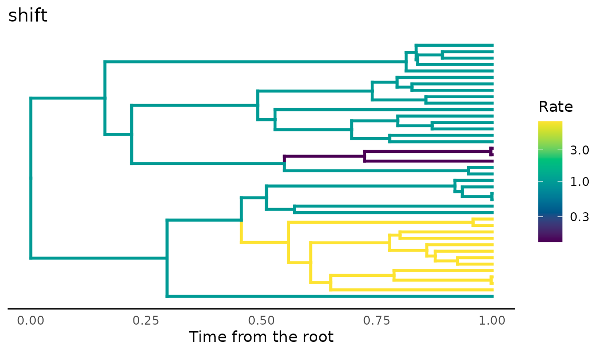
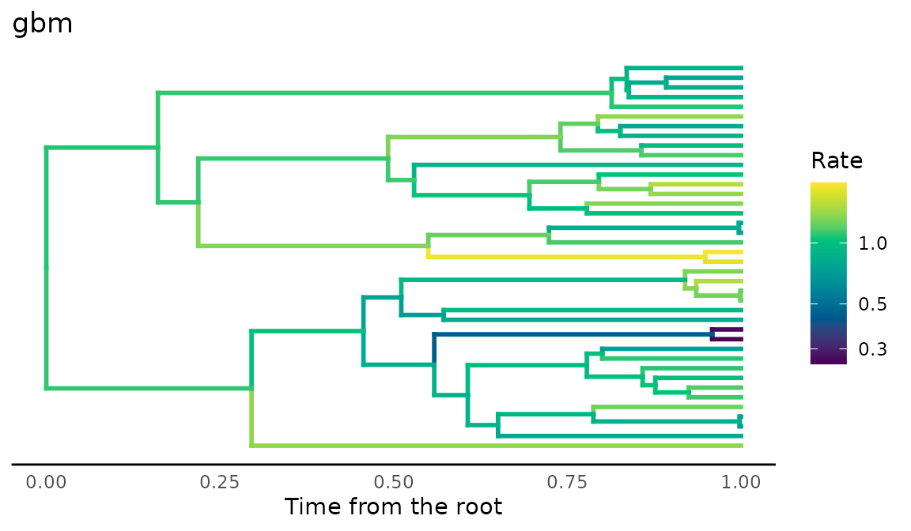
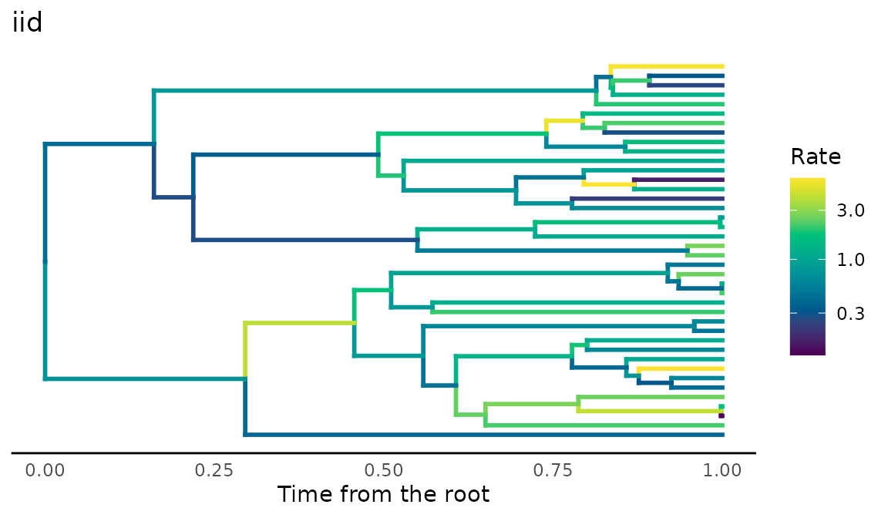
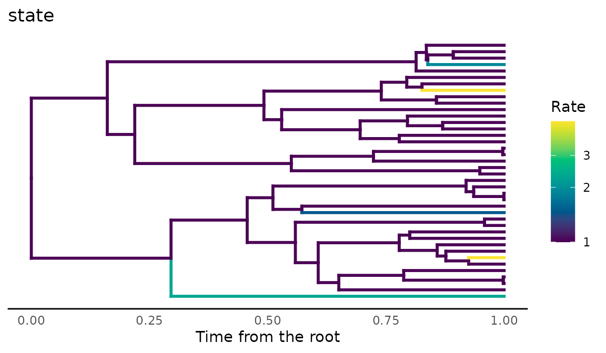
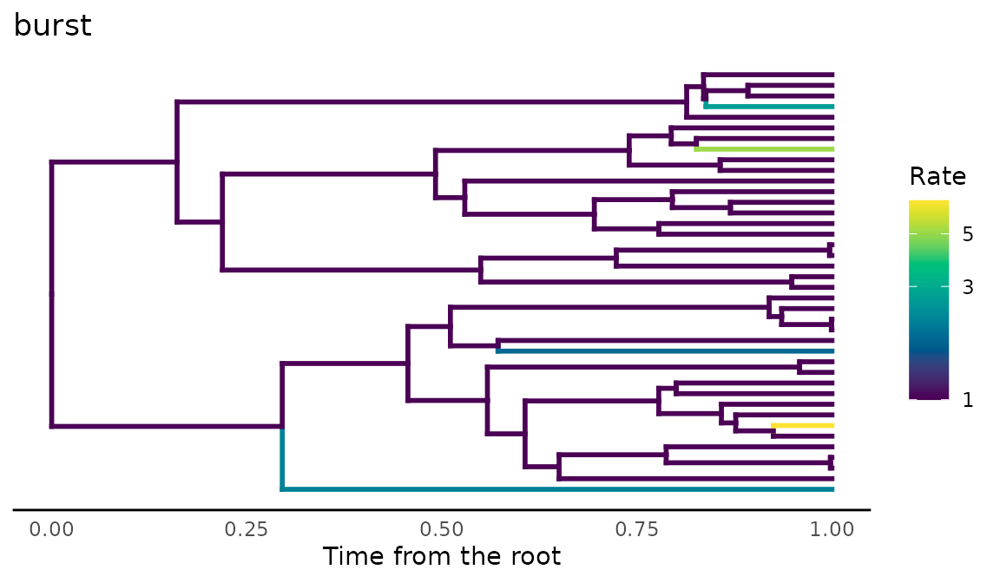
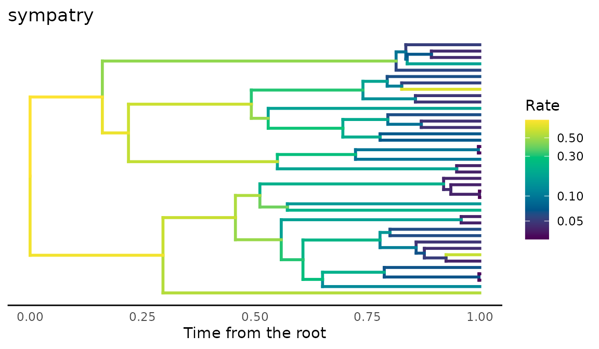
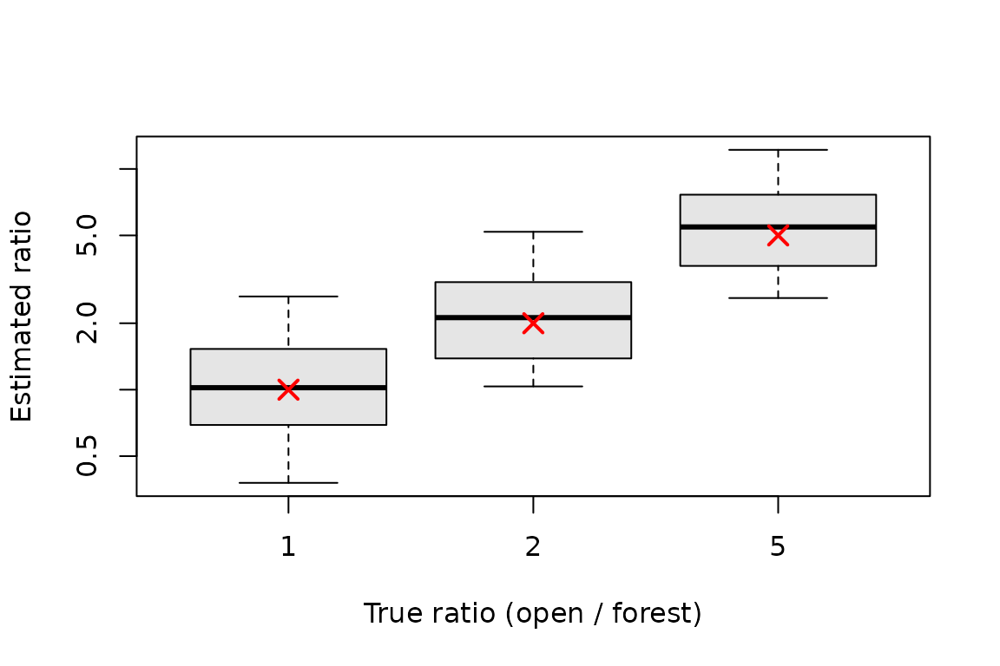

# Rates of trait evolution that vary among branches

Methods that estimate a rate of trait evolution for each branch of a
tree are increasingly used to ask where and why evolution sped up or
slowed down. Whether they can answer such questions depends on how well
they recover rates that are known, and that requires data simulated with
known rates. This vignette shows the three ways comdynamite generates
rates that vary among branches, and how well two estimators recover
them:

1.  rates as a statistical model of their own, with
    [`trait_rates()`](https://provetelab.org/comdynamite/reference/trait_rates.md);
2.  rates that follow the history of a discrete character along the
    tree, such as habitat or region, with
    [`trait_mk()`](https://provetelab.org/comdynamite/reference/trait_mk.md)
    and
    [`history_rates()`](https://provetelab.org/comdynamite/reference/history_rates.md);
3.  rates that follow ecological dynamics, the turnover of partners in a
    simulated metacommunity
    ([`turnover_rates()`](https://provetelab.org/comdynamite/reference/turnover_rates.md))
    or the trophic level in a food web
    ([`food_web_rates()`](https://provetelab.org/comdynamite/reference/food_web_rates.md)).

All of them give one rate per branch, which `trait_rates(edge_rates = )`
turns into trait values at the tips and nodes. The estimates in the last
part were computed in advance with
[`data-raw/vignette_rates.R`](https://github.com/diogoprov/comdynamite/blob/main/data-raw/vignette_rates.R),
which needs RRphylo and mvMORPH; the rest runs here.

``` r

library(comdynamite)
set.seed(7)
tree <- treeshapesim::sim_tree_shape(40)
```

[`plot_rates()`](https://provetelab.org/comdynamite/reference/plot_rates.md)
colours each branch by its rate, on a logarithmic scale, from slow
(dark) to fast (light).

## Rates as a model

[`trait_rates()`](https://provetelab.org/comdynamite/reference/trait_rates.md)
draws the rate of each branch from one of three models: discrete shifts
that multiply the rate and pass to the descendants (`"shift"`), a rate
that drifts as geometric Brownian motion along the tree (`"gbm"`), or
rates drawn independently for each branch (`"iid"`). The trait then
evolves by Brownian motion with that rate on each branch.

``` r

shift <- trait_rates(tree, "shift", shifts = 2, shift_size = c(8, 1 / 8))
gbm <- trait_rates(tree, "gbm", rate_sd = 0.8)
iid <- trait_rates(tree, "iid", rate_sd = 0.8)
plot_rates(shift, title = "shift")
```



``` r

plot_rates(gbm, title = "gbm")
```



``` r

plot_rates(iid, title = "iid")
```



Each result keeps the rates (`edge_rate`), the trait values at the tips
(`tips`) and nodes (`nodes`), and the shifts, so the truth is available
for any comparison.

## Rates from a history along the tree

Ecological hypotheses about rates are often about the history of
lineages: evolution faster in one habitat than another, a burst after
colonising a new region, or a slowdown as lineages accumulate in the
same region.
[`trait_mk()`](https://provetelab.org/comdynamite/reference/trait_mk.md)
simulates the history of a discrete character along the tree, and
[`history_rates()`](https://provetelab.org/comdynamite/reference/history_rates.md)
turns it into the rate of each branch, the mean over the branch of a
rate that depends on the history at each moment.

``` r

habitat <- trait_mk(tree, q = 0.5, states = c("forest", "open"))
state <- history_rates(habitat, "state", state_rates = c(forest = 1, open = 5))
burst <- history_rates(habitat, "burst", burst = 9, decay = 0.1)
sympatry <- history_rates(habitat, "sympatry", r = -0.1)
summary(cbind(state, burst, sympatry))
#>      state           burst          sympatry      
#>  Min.   :1.000   Min.   :1.000   Min.   :0.03020  
#>  1st Qu.:1.000   1st Qu.:1.000   1st Qu.:0.04575  
#>  Median :1.000   Median :1.000   Median :0.09235  
#>  Mean   :1.127   Mean   :1.175   Mean   :0.19150  
#>  3rd Qu.:1.000   3rd Qu.:1.000   3rd Qu.:0.22900  
#>  Max.   :4.621   Max.   :6.911   Max.   :0.81873
```

With `"state"`, each habitat has its own rate, as in Brownian motion
with several regimes (O’Meara et al. 2006). With `"burst"`, each change
of habitat multiplies the rate, and the excess decays with time, along
the descending branches too, following the expectation that selection is
strongest when a lineage first adapts to a new community (McPeek 2017).
With `"sympatry"`, the rate falls as more lineages share the same state,
the diversity-dependent model with biogeography of Drury et al. (2016);
`data-raw/validation_sympatry.R` checks it against RPANDA.

``` r

plot_rates(tree, state, title = "state")
```



``` r

plot_rates(tree, burst, title = "burst")
```



``` r

plot_rates(tree, sympatry, title = "sympatry")
```



``` r

x <- trait_rates(habitat, edge_rates = state)
head(x$tips)
#>         t1         t2         t3         t4         t5         t6 
#> -0.9494369 -0.3051386 -0.5780631 -0.6126907  0.4633037  0.9653968
```

## Rates from ecological dynamics

The metacommunity of
[`simulate_metacommunity()`](https://provetelab.org/comdynamite/reference/simulate_metacommunity.md)
runs in ecological time among the species at the tips, so it cannot
inform internal branches.
[`turnover_rates()`](https://provetelab.org/comdynamite/reference/turnover_rates.md)
uses it for the tip branches:
[`partner_turnover()`](https://provetelab.org/comdynamite/reference/partner_turnover.md)
counts how often other species enter or leave the sites where each
species lives, and over the last `window` units of time of each tip
branch the rate is `sigma2 * (1 + k * turnover)`. How much branch time
the ecological dynamics represent is a choice, set by `window`; by
default it is the whole tip branch.

``` r

sim <- simulate_metacommunity(landscape_implicit(20), species_traits(tree),
                              competition_matrix(tree, "none"), n_steps = 400,
                              record_steps = seq(200, 400, 10), extirpation = 0.02)
rates <- turnover_rates(sim, k = 100)
summary(attr(rates, "turnover"))
#>    Min. 1st Qu.  Median    Mean 3rd Qu.    Max. 
#>  0.0000  0.0000  0.4494  0.3121  0.4746  0.6667
x <- trait_rates(tree, edge_rates = rates)
```

[`food_web_rates()`](https://provetelab.org/comdynamite/reference/food_web_rates.md)
does the same with the food web of
[`food_web_dynamics()`](https://provetelab.org/comdynamite/reference/food_web_dynamics.md):
each tip belongs to a trophic level, and its tip branch evolves faster
the faster the mean trait of its level changed. These speeds are
directional changes under selection, not Brownian variances, so they set
relative rates among levels, scaled by `k`.

``` r

web <- food_web_dynamics(seq(0, 4000, by = 20), init = c(R = 50, N = 0.1, P = 0.1),
                         traits = c(R = 10, N = 4, P = 6), introductions = c(P = 2000),
                         dt = 0.5)
levels <- sample(c("R", "N", "P"), ape::Ntip(tree), replace = TRUE)
rates <- food_web_rates(web, tree, levels, k = 500)
attr(rates, "speed")
#>           R           N           P 
#> 0.001989566 0.002973562 0.000143305
```

## Recovering the rates

``` r

res <- readRDS("branch-rates.rds")
```

**RRphylo under the three models.** RRphylo (Castiglione et al. 2018)
estimates a rate per branch by phylogenetic ridge regression. Over 30
trees of 60 species per model, the mean Spearman correlations were:

``` r

aggregate(cbind(with_change, estimated, ceiling) ~ model, res$models,
          function(v) round(mean(v), 2))
#>   model with_change estimated ceiling
#> 1   gbm        0.36      0.08    0.29
#> 2   iid        0.37      0.06    0.35
#> 3 shift        0.35      0.08    0.24
```

`with_change` is the correlation between the rate RRphylo estimates and
the change that actually happened on each branch, per unit length;
`estimated`, between its absolute value and the true rate; and
`ceiling`, between the true rate and the realised change, scaled by the
square root of the branch length. The ceiling is the most any method can
achieve from one realisation of the process per branch, since a fast
branch can still change little by chance, and it is low. RRphylo follows
the change that happened, but its rates say little about the rate that
generated it.

**Regimes.** When the history is known, the rate of each state can be
estimated by Brownian motion with several regimes (O’Meara et al. 2006),
here with `mvMORPH::mvBM(model = "BMM")` (Clavel et al. 2015) on the
true history, over 30 trees of 60 species per true ratio:

``` r

aggregate(estimated ~ ratio, res$regimes, function(v) round(stats::median(v), 2))
#>   ratio estimated
#> 1     1      1.02
#> 2     2      2.12
#> 3     5      5.46
boxplot(estimated ~ ratio, res$regimes, log = "y", xlab = "True ratio (open / forest)",
        ylab = "Estimated ratio", col = "grey90")
points(1:3, c(1, 2, 5), pch = 4, col = "red", cex = 1.5, lwd = 2)
```



Pooling the branches of each regime gives much better estimates than
rates per branch, and the medians are close to the true ratios (red
crosses), with a wide spread among trees.

**Turnover of partners.** With rates from
[`turnover_rates()`](https://provetelab.org/comdynamite/reference/turnover_rates.md),
the Spearman correlation between the absolute rate RRphylo estimates on
each tip branch and the turnover of partners of the species, over 30
metacommunities on trees of 40 species:

``` r

round(summary(res$turnover$rho), 2)
#>    Min. 1st Qu.  Median    Mean 3rd Qu.    Max. 
#>   -0.27    0.06    0.10    0.13    0.24    0.56
```

The correlation is weak and varies among metacommunities: the turnover
changes the rates of tip branches only, and the same limit of one
realisation per branch applies, so a signature of assembly in the rates
of single branches is hard to detect even when it is there by
construction.

## Limits

- Each branch carries one realisation of the process, which caps how
  well any estimator can recover the rate of a single branch; pooling
  branches, as in models with regimes, helps.
- The ecological dynamics of
  [`turnover_rates()`](https://provetelab.org/comdynamite/reference/turnover_rates.md)
  and
  [`food_web_rates()`](https://provetelab.org/comdynamite/reference/food_web_rates.md)
  inform only the tip branches, and the match between ecological time
  and branch length (`window`) is a choice, not a result of the
  simulation.
- The speeds of
  [`food_web_rates()`](https://provetelab.org/comdynamite/reference/food_web_rates.md)
  are directional changes of the mean trait, so `k` sets relative rates,
  not an equivalence with Brownian variances.

## References

Castiglione, S., Tesone, G., Piccolo, M., Melchionna, M., Mondanaro, A.,
Serio, C., Di Febbraro, M., & Raia, P. (2018). A new method for testing
evolutionary rate variation and shifts in phenotypic evolution. *Methods
in Ecology and Evolution*, 9, 974–983.
<https://doi.org/10.1111/2041-210X.12954>

Clavel, J., Escarguel, G., & Merceron, G. (2015). mvMORPH: An R package
for fitting multivariate evolutionary models to morphometric data.
*Methods in Ecology and Evolution*, 6, 1311–1319.
<https://doi.org/10.1111/2041-210X.12420>

Drury, J., Clavel, J., Manceau, M., & Morlon, H. (2016). Estimating the
effect of competition on trait evolution using maximum likelihood
inference. *Systematic Biology*, 65, 700–710.
<https://doi.org/10.1093/sysbio/syw020>

McPeek, M. A. (2017). *Evolutionary Community Ecology*. Princeton
University Press.
<https://doi.org/10.23943/princeton/9780691088778.001.0001>

O’Meara, B. C., Ané, C., Sanderson, M. J., & Wainwright, P. C. (2006).
Testing for different rates of continuous trait evolution using
likelihood. *Evolution*, 60, 922–933.
<https://doi.org/10.1111/j.0014-3820.2006.tb01171.x>
