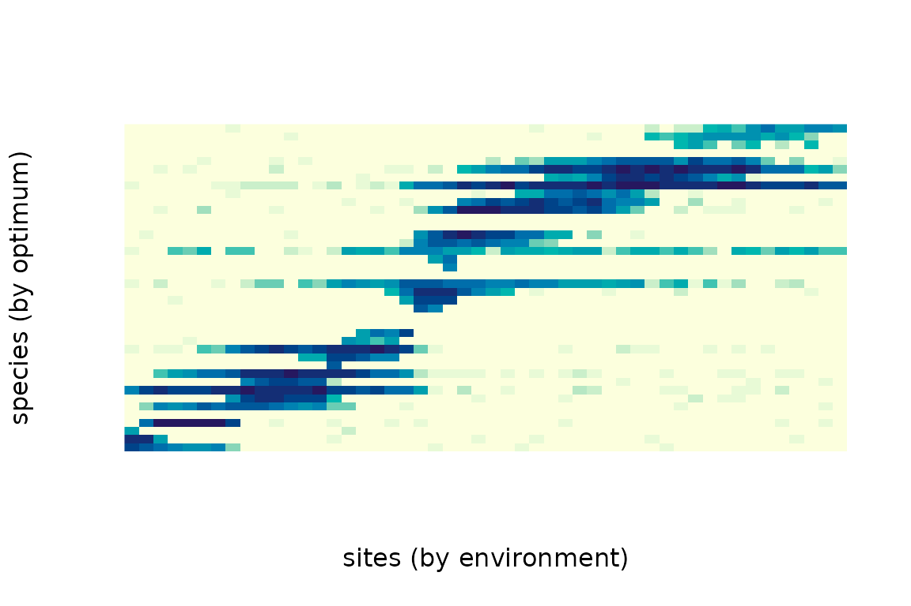
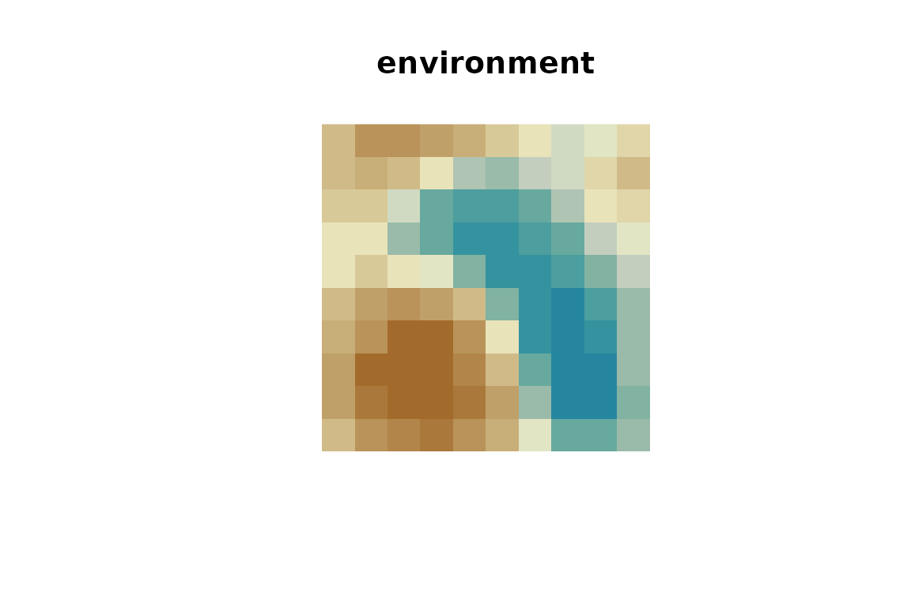

# Getting started with comdynamite

comdynamite simulates metacommunities with the process-based model of
Thompson et al. (2020). Each simulation has four ingredients:

1.  a **landscape**: sites, their environment and how individuals
    disperse among them;
2.  **species traits**: environmental optimum, niche breadth and maximum
    growth rate, with or without phylogenetic signal;
3.  a **competition matrix**;
4.  the **dispersal** rate.

``` r

library(comdynamite)
set.seed(42)
```

## A first metacommunity

We draw a tree of 40 species, give their optima a strong phylogenetic
signal (Brownian motion, `lambda = 1`), and let close relatives compete
more strongly.

``` r

tr <- treeshapesim::sim_tree_shape(40)
traits <- species_traits(tr, lambda = 1)
alpha <- competition_matrix(tr, type = "phylo", inter_max = 0.1)
land <- landscape_implicit(n_sites = 50)

sim <- simulate_metacommunity(land, traits, alpha, dispersal = 0.01, n_steps = 500)
sim
#> <mc_sim> 50 sites x 40 species
#> species persisting: 33 of 40 
#> mean local richness: 10.5
```

`sim$abundance` holds the abundance of each species at each site at the
last step. Ordering sites by their environment and species by their
optimum shows the sorting of species along the gradient:

``` r

a <- sim$abundance[order(land$env), order(traits$optimum)]
image(log1p(a), xlab = "sites (by environment)", ylab = "species (by optimum)",
      axes = FALSE, col = hcl.colors(20, "YlGnBu", rev = TRUE))
```



## Species sorting and mass effects

Dispersal changes the regime. With low dispersal, species occur where
the environment suits them (species sorting); with high dispersal, they
also occur in unsuitable sites that are kept supplied by immigrants
(mass effects), so local richness increases and composition tracks the
environment less closely.

``` r

regimes <- c(sorting = 0.01, mass_effects = 0.5)
res <- lapply(regimes, function(d)
  simulate_metacommunity(land, traits, alpha, dispersal = d, n_steps = 500))
sapply(res, function(s) c(
  mean_richness = mean(rowSums(s$abundance > 0)),
  persisting = sum(colSums(s$abundance) > 0)
))
#>               sorting mass_effects
#> mean_richness   10.16        22.34
#> persisting      32.00        24.00
```

## Spatially explicit landscapes

[`landscape_grid()`](https://provetelab.org/comdynamite/reference/landscape_grid.md)
places sites on a grid, by default wrapped as a torus, with a spatially
autocorrelated environment and an exponential dispersal kernel.

``` r

grid <- landscape_grid(side = 10, env_bandwidth = 2, disp_scale = 2)
image(matrix(grid$env, 10, 10), asp = 1, axes = FALSE,
      col = hcl.colors(20, "Earth"), main = "environment")
```



``` r

sim_sp <- simulate_metacommunity(grid, traits, alpha, dispersal = 0.1, n_steps = 500)
sim_sp
#> <mc_sim> 100 sites x 40 species
#> species persisting: 34 of 40 
#> mean local richness: 21.3
```

With spatial structure, sites are no longer exchangeable, so permuting
sites at random is not a valid null model.
[`torus_permutations()`](https://provetelab.org/comdynamite/reference/torus_permutations.md)
gives the rearrangements of a torus (translations and the eight
symmetries of the square) that keep all distances among sites, and
therefore the spatial autocorrelation of the environment:

``` r

perms <- torus_permutations(10)
dim(perms)
#> [1] 799 100
# the environment under the first rearrangement
env_perm <- grid$env[perms[1, ]]
```

## An environment that changes over time

[`env_over_time()`](https://provetelab.org/comdynamite/reference/env_over_time.md)
adds autocorrelated temporal fluctuations to the environment of each
site, and `record_steps` keeps abundances at chosen steps.

``` r

et <- env_over_time(land$env, n_steps = 500, rho = 0.95, sd = 5)
sim_t <- simulate_metacommunity(land, traits, alpha, dispersal = 0.01, n_steps = 500,
                                env_time = et, record_steps = seq(100, 500, 100))
apply(sim_t$history > 0, 3, function(x) mean(rowSums(x)))
#> step100 step200 step300 step400 step500 
#>   11.56    9.68    9.58    9.80    9.10
```

## Traits under one or several adaptive optima

[`traits_ou()`](https://provetelab.org/comdynamite/reference/traits_ou.md)
simulates traits under an Ornstein-Uhlenbeck process (Hansen 1997). With
`alpha = 0` it is Brownian motion; with `alpha > 0` traits are pulled
towards an optimum, and
[`paint_regimes()`](https://provetelab.org/comdynamite/reference/paint_regimes.md)
gives clades their own optimum (multi-peak OU; Butler & King 2004).

``` r

pool <- treeshapesim::sim_tree_shape(32)
node <- ape::getMRCA(pool, pool$tip.label[1:8])
in_clade <- rownames(traits_ou(pool)) %in% ape::extract.clade(pool, node)$tip.label
reg <- paint_regimes(pool, nodes = node)
x_ou <- traits_ou(pool, alpha = 2, theta = c(`0` = 0, `1` = 5), regimes = reg)
tapply(x_ou[, 1], ifelse(in_clade, "clade (optimum 5)", "rest (optimum 0)"), mean)
#> clade (optimum 5)  rest (optimum 0) 
#>         3.8228309         0.1872388
```

## Rule-based assembly (Kraft et al. 2007)

Besides population dynamics, comdynamite can assemble a local community
from the regional pool by fixed rules, as in Kraft et al. (2007).
Species are removed one at a time until the community reaches the chosen
size:

- `"limiting_similarity"`: the GAUSE algorithm of Colwell & Winkler
  (1984), which Kraft et al. (2007) used for competition. From the pair
  of species closest in trait space, the one with the smaller sum of
  distances to the remaining species is removed, and so on.
- `"filtering"`: the species farthest from a niche optimum (the
  ancestral state or a derived corner of trait space) are removed first.
- `"neutral"`: species are drawn at random.

``` r

pool <- treeshapesim::sim_tree_shape(32)
x <- traits_ou(pool, n_traits = 2)
assemble_community(x, size = 16, rule = "limiting_similarity")$community
#>  [1] "t1"  "t3"  "t6"  "t9"  "t10" "t13" "t14" "t17" "t19" "t22" "t26" "t27"
#> [13] "t29" "t30" "t31" "t32"
```

Over many pools, the mean phylogenetic distance (MPD) among community
members shows the expected contrast when traits evolve by Brownian
motion:

``` r

mpd <- function(tree, sp) mean(as.dist(ape::cophenetic.phylo(tree)[sp, sp]))
rules <- c("limiting_similarity", "filtering", "neutral")
res <- replicate(100, {
  pool <- treeshapesim::sim_tree_shape(32)
  x <- traits_ou(pool, n_traits = 2)
  sapply(rules, function(r) mpd(pool, assemble_community(x, 16, r)$community))
})
rowMeans(res)
#> limiting_similarity           filtering             neutral 
#>            1.551878            1.444317            1.502199
```

On average, limiting similarity keeps more distant relatives than
neutral assembly (higher MPD), and filtering keeps closer relatives
(lower MPD), although single replicates vary.

## Differences from Thompson et al. (2020)

The model follows the published equations. Two conventions differ:

- `sigma` is the standard deviation of the Gaussian response, so it
  equals `sqrt(2)` times the niche breadth parameter of Thompson et
  al. (2020);
- `alpha[j, k]` is the effect of species k on species j.

[`env_over_time()`](https://provetelab.org/comdynamite/reference/env_over_time.md)
is a simple autoregressive generator, not the one used by Thompson et
al. (2020).

## References

Butler, M. A., & King, A. A. (2004). Phylogenetic comparative analysis:
a modeling approach for adaptive evolution. *The American Naturalist*,
164, 683–695. <https://doi.org/10.1086/426002>

Hansen, T. F. (1997). Stabilizing selection and the comparative analysis
of adaptation. *Evolution*, 51, 1341–1351.
<https://doi.org/10.1111/j.1558-5646.1997.tb01457.x>

Colwell, R. K., & Winkler, D. W. (1984). A null model for null models in
biogeography. In D. R. Strong, D. Simberloff, L. G. Abele, & A. B.
Thistle (Eds.), *Ecological Communities: Conceptual Issues and the
Evidence* (pp. 344–359). Princeton University Press.
<https://doi.org/10.1515/9781400857081.344>

Kraft, N. J. B., Cornwell, W. K., Webb, C. O., & Ackerly, D. D. (2007).
Trait evolution, community assembly, and the phylogenetic structure of
ecological communities. *The American Naturalist*, 170, 271–283.
<https://doi.org/10.1086/519400>

Thompson, P. L., Guzman, L. M., De Meester, L., Horváth, Z., Ptacnik,
R., Vanschoenwinkel, B., Viana, D. S., & Chase, J. M. (2020). A
process-based metacommunity framework linking local and regional scale
community ecology. *Ecology Letters*, 23, 1314–1329.
<https://doi.org/10.1111/ele.13568>
