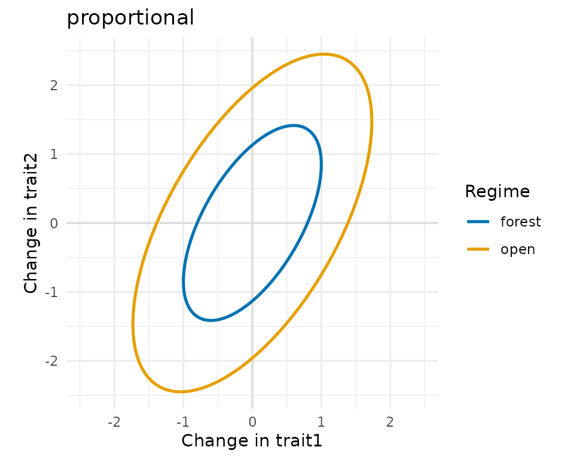
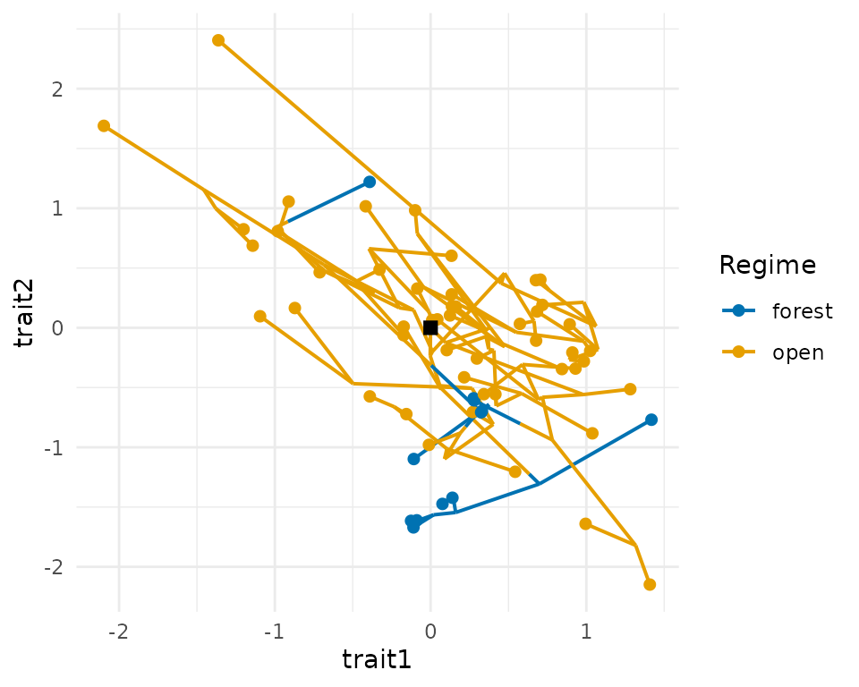
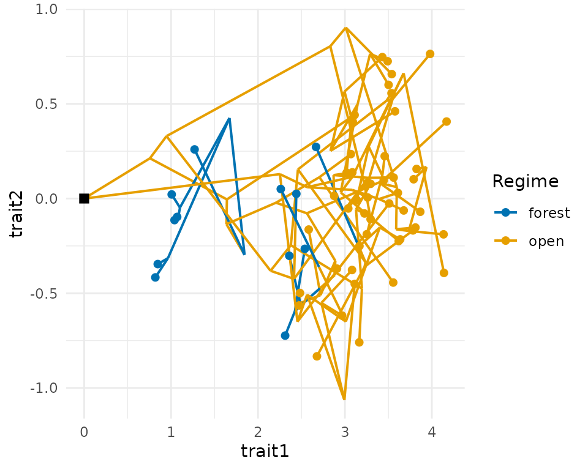
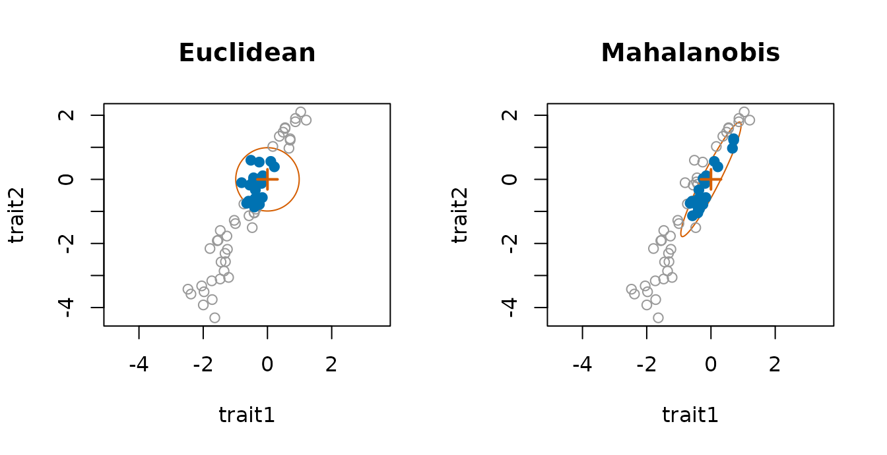
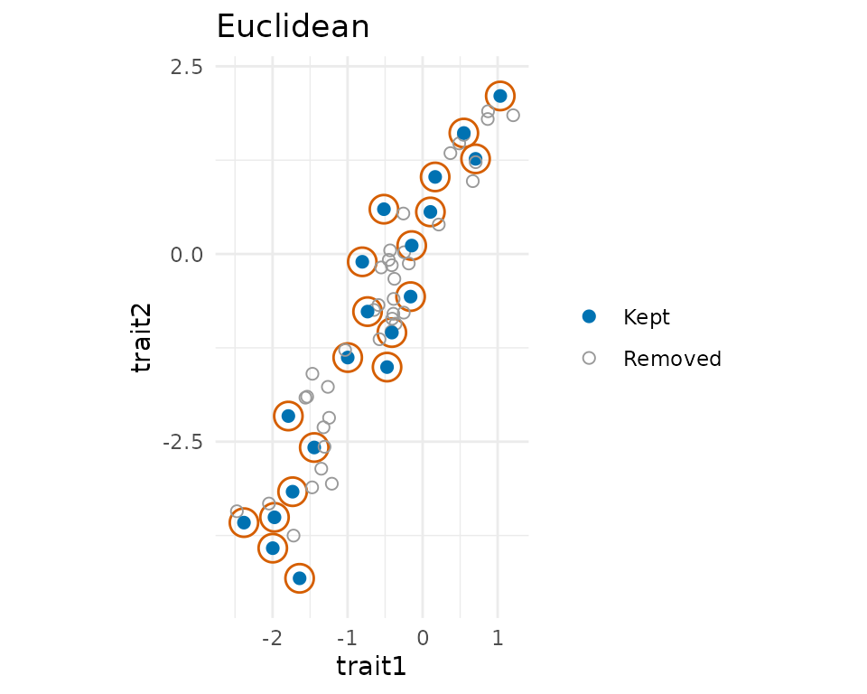

# Correlated traits and assembly in trait space

Species differ in several traits at once, and those traits rarely evolve
independently. This article shows how comdynamite simulates several
correlated traits along a tree, how selective regimes can change the
rates, the correlations and the optima, and how community assembly then
uses distances in a space of several traits.

``` r

library(comdynamite)
set.seed(4)
tree <- treeshapesim::sim_tree_shape(60)
```

## Evolutionary rate matrices

Under multivariate Brownian motion, the changes of the traits per unit
time have a covariance matrix, the evolutionary rate matrix: its
diagonal holds the rate of each trait and its off-diagonal elements the
evolutionary covariances.
[`rate_matrix()`](https://provetelab.org/comdynamite/reference/rate_matrix.md)
builds it with the structures that mvMORPH fits (Clavel et al. 2015).
With one matrix for the whole tree:

``` r

rate_matrix(c(1, 0.5), correlation = 0.8)
#> <rate_matrix> default structure, 2 traits
#>           trait1    trait2
#> trait1 1.0000000 0.5656854
#> trait2 0.5656854 0.5000000
rate_matrix(1, correlation = 0.3, constraint = "equal", n_traits = 3)
#> <rate_matrix> equal structure, 3 traits
#>        trait1 trait2 trait3
#> trait1    1.0    0.3    0.3
#> trait2    0.3    1.0    0.3
#> trait3    0.3    0.3    1.0
```

With selective regimes, each regime can have its own matrix, constrained
in the ways of `mvMORPH::mvBM()`: proportional matrices, shared
eigenvectors, the same variances or the same correlations. Each matrix
is drawn as the ellipse of the changes of two traits in one unit of
time.

``` r

op <- par(mfrow = c(1, 2))
prop <- rate_matrix(c(1, 2), correlation = 0.6, constraint = "proportional",
                    scale = c(forest = 1, open = 3))
plot(prop, main = "proportional")
flip <- rate_matrix(c(1, 1), correlation = list(forest = 0.8, open = -0.8),
                    constraint = "variance")
plot(flip, main = "equal variances")
```



``` r

par(op)
```

## Traits on a history of habitats

[`trait_mk()`](https://provetelab.org/comdynamite/reference/trait_mk.md)
simulates a discrete character on the tree, here the habitat of each
lineage, with changes inside branches.
[`trait_ou()`](https://provetelab.org/comdynamite/reference/trait_ou.md)
takes that mapped history as `regimes`, so that the rates (and, with
`alpha > 0`, the optima) change at the moment the habitat changes.
[`plot_traits()`](https://provetelab.org/comdynamite/reference/plot_traits.md)
draws the result as a phylomorphospace, with the branches coloured by
habitat, or, for one trait, as a traitgram.

``` r

habitat <- trait_mk(tree, q = 0.4, states = c("forest", "open"))
x <- trait_ou(habitat, sigma2 = flip, regimes = habitat)
op <- par(mfrow = c(1, 2))
plot_traits(x, habitat, regimes = habitat)
plot_traits(x, habitat, traits = 1, regimes = habitat)
```



``` r

par(op)
```

Optima can also differ between traits. With a matrix `theta`, one row
per regime and one column per trait, the open habitat below moves the
optimum of the first trait only.

``` r

theta <- rbind(forest = c(0, 0), open = c(4, 0))
y <- trait_ou(habitat, alpha = 2, sigma2 = rate_matrix(c(1, 1), correlation = 0.5),
               theta = theta, regimes = habitat)
plot_traits(y, habitat, regimes = habitat)
```



## Assembly in a space of several traits

[`assemble_community()`](https://provetelab.org/comdynamite/reference/assemble_community.md)
removes species by their distances in trait space. With correlated
traits, Euclidean distances count the shared direction of variation more
than once; the Mahalanobis distance treats each independent direction as
one axis, and `"standardized"` divides each trait by its standard
deviation in the pool. The help of
[`assemble_community()`](https://provetelab.org/comdynamite/reference/assemble_community.md)
discusses which to choose.
[`plot_assembly()`](https://provetelab.org/comdynamite/reference/plot_assembly.md)
shows the result in the metric of the assembly: for filtering, the
boundary of the filter around the optimum.

``` r

z <- trait_ou(tree, sigma2 = rate_matrix(c(1, 4), correlation = 0.9))
op <- par(mfrow = c(1, 2))
plot_assembly(assemble_community(z, 20, rule = "filtering", optimum = c(0, 0)),
              main = "Euclidean")
plot_assembly(assemble_community(z, 20, rule = "filtering", optimum = c(0, 0),
                                 distance = "mahalanobis"), main = "Mahalanobis")
```



``` r

par(op)
```

Under limiting similarity, the contours have half the smallest distance
between the species kept, so that they touch but do not overlap.

``` r

op <- par(mfrow = c(1, 2))
plot_assembly(assemble_community(z, 20), main = "Euclidean")
plot_assembly(assemble_community(z, 20, distance = "mahalanobis"), main = "Mahalanobis")
```



``` r

par(op)
```

## A niche with several environmental axes

In the dynamic model,
[`simulate_metacommunity()`](https://provetelab.org/comdynamite/reference/simulate_metacommunity.md)
takes one set of traits per environmental axis and a matrix `env` with
one column per axis; the growth rate of a species is the product of its
responses to each axis.
[`as_mc_data()`](https://provetelab.org/comdynamite/reference/mc_data.md)
keeps every axis, and
[`summary_stats()`](https://provetelab.org/comdynamite/reference/summary_stats.md)
uses the first unless given another.

``` r

land <- landscape_grid(side = 6)
temperature <- species_traits(tree)
moisture <- species_traits(tree, rmax_range = c(1, 1))
env <- cbind(temperature = land$env, moisture = rev(land$env))
sim <- simulate_metacommunity(land, list(temperature = temperature, moisture = moisture),
                              competition_matrix(tree, "phylo"), n_steps = 200, env = env)
sim
#> <mc_sim> 36 sites x 60 species
#> species persisting: 44 of 60 
#> mean local richness: 6.08
head(as_mc_data(sim)$traits)
#>    optimum_temperature optimum_moisture
#> t1           14.297495         64.01584
#> t2            3.754062         40.16451
#> t3           37.814580         36.49067
#> t4           38.411454         39.94681
#> t5            9.640216         37.70469
#> t6           14.992236         34.72507
```

## Validation

[`data-raw/validation_mvtraits.R`](https://github.com/diogoprov/comdynamite/blob/main/data-raw/validation_mvtraits.R)
compares
[`trait_ou()`](https://provetelab.org/comdynamite/reference/trait_ou.md)
with mvMORPH (version 1.2.3). Over 20000 simulations with two regimes
that change within branches, the covariances of the tips stayed within
2.9 Monte Carlo standard errors of their expected value, \sum_k R_k
\otimes C_k (mvMORPH’s `mvSIM()`: 2.8), and under an Ornstein-Uhlenbeck
process within 3.1 standard errors of the covariance of Hansen (1997).
Fitting `mvBM()` with the same constraint to simulated traits of 100
tips recovered each structure, with the median of 30 fits within 9% of
each element of the true matrices.

## References

Clavel, J., Escarguel, G., & Merceron, G. (2015). mvMORPH: an R package
for fitting multivariate evolutionary models to morphometric data.
*Methods in Ecology and Evolution*, 6, 1311–1319.
<https://doi.org/10.1111/2041-210X.12420>

Hansen, T. F. (1997). Stabilizing selection and the comparative analysis
of adaptation. *Evolution*, 51, 1341–1351.
<https://doi.org/10.1111/j.1558-5646.1997.tb01457.x>
