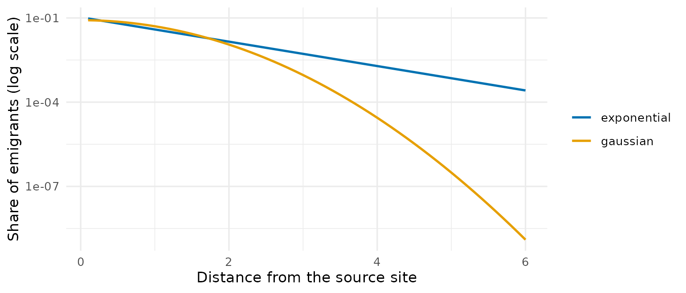
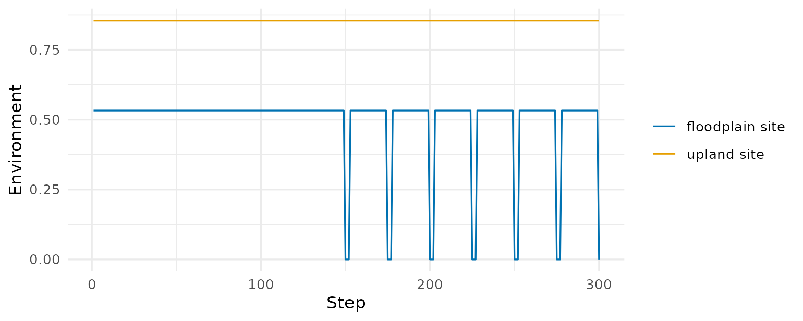
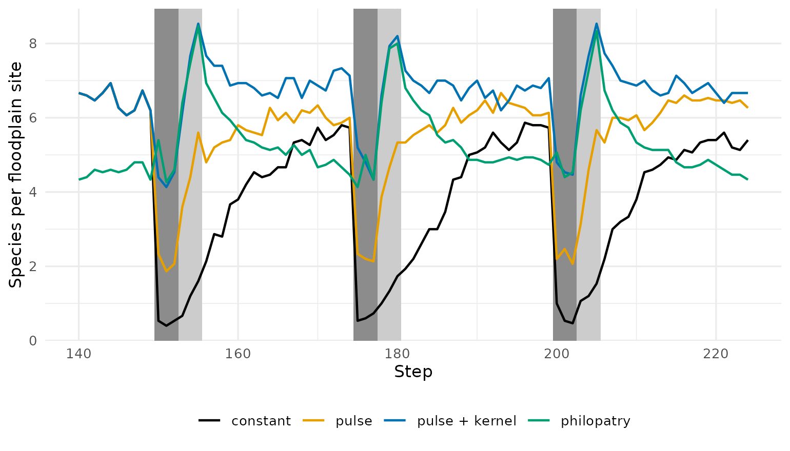

# Dispersal and disturbance through time

Many metacommunities are not connected in the same way all year round.
Floods join ponds and lakes that are isolated in the dry season, animals
disperse in a breeding season and stay home for the rest of the year,
and disturbances come back at a regular interval instead of once. This
article shows the three tools of `comdynamite` for these cases: the
shape of the dispersal kernel, recurrent pulses of disturbance with
[`env_pulse()`](https://provetelab.org/comdynamite/reference/env_pulse.md),
and dispersal that changes through time with the arguments
`dispersal_time`, `kernels` and `kernel_step` of
[`simulate_metacommunity()`](https://provetelab.org/comdynamite/reference/simulate_metacommunity.md).
It ends with a flood-pulse example in which the three are combined.

``` r

library(comdynamite)
library(ggplot2)
```

## Shape of the dispersal kernel

In a spatially explicit landscape, an emigrant from site s reaches site
t with a probability proportional to \exp(-d/\text{scale}) for the
exponential kernel (the default) or \exp(-d^2/(2\\\text{scale}^2)) for
the Gaussian one, where d is the distance between the sites. The `scale`
is the mean dispersal distance of the exponential kernel and the
standard deviation of the Gaussian one. For the same scale, the Gaussian
kernel sends more emigrants to near sites and far fewer to distant
sites, that is, it has a thin tail, whereas the exponential kernel keeps
some long-distance dispersal.
[`dispersal_kernel()`](https://provetelab.org/comdynamite/reference/dispersal_kernel.md)
builds the matrix from distances, and
[`landscape_grid()`](https://provetelab.org/comdynamite/reference/landscape_grid.md)
and
[`landscape_points()`](https://provetelab.org/comdynamite/reference/landscape_points.md)
take the shape through `disp_shape`.

``` r

d <- as.matrix(dist(cbind(seq(0, 6, by = 0.1), 0)))
shape <- rbind(
  data.frame(distance = d[1, -1], shape = "exponential",
             p = dispersal_kernel(d, scale = 1)[1, -1]),
  data.frame(distance = d[1, -1], shape = "gaussian",
             p = dispersal_kernel(d, scale = 1, shape = "gaussian")[1, -1]))
ggplot(shape, aes(distance, p, colour = shape)) +
  geom_line(linewidth = 0.8) +
  scale_y_log10() +
  scale_colour_manual(values = c("#0072B2", "#E69F00")) +
  labs(x = "Distance from the source site", y = "Share of emigrants (log scale)",
       colour = NULL) +
  theme_minimal(base_size = 11)
```



Notice that the two kernels send a similar share of emigrants to the
nearest sites, but at a distance of 5 the Gaussian kernel sends several
orders of magnitude fewer than the exponential one. In a landscape:

``` r

set.seed(1)
xy <- expand.grid(x = 1:6, y = 1:5)
ls_gauss <- landscape_points(xy, env = runif(30), disp_scale = 0.7, disp_shape = "gaussian")
```

In both shapes the diagonal of the dispersal matrix is zero: the kernel
only says where emigrants go. How many individuals stay at home is set
by the emigration probability, `dispersal`. Any other kernel can be
passed as a matrix to
[`landscape_matrix()`](https://provetelab.org/comdynamite/reference/landscape_matrix.md).

## Recurrent pulses of disturbance

[`env_pulse()`](https://provetelab.org/comdynamite/reference/env_pulse.md)
changes the environment of some sites for some steps, so that
disturbance acts on growth through the niches of species, as in the
[replication of Hajian-Forooshani & Chase
(2026)](https://provetelab.org/comdynamite/articles/replication-disturbance.md).
With `every`, the pulse comes back at a fixed period until the last
step, and the frequency of disturbance is `1 / every`. Below, the sites
of a floodplain (the three western columns of a 6 × 5 grid) are flooded
for 3 steps every 25 steps from step 150 on, and their environment falls
to 0 during each flood. The other sites, in the uplands, are never
flooded.

``` r

set.seed(1)
plain <- xy$x <= 3
env <- runif(30, 0.4, 0.9)
n_steps <- 300
et <- env_pulse(env, n_steps, sites = plain, start = 150, duration = 3, value = 0,
                every = 25)
two <- data.frame(step = rep(seq_len(n_steps), 2),
                  site = rep(c("floodplain site", "upland site"), each = n_steps),
                  env = c(et[which(plain)[1], ], et[which(!plain)[1], ]))
ggplot(two, aes(step, env, colour = site)) +
  geom_line() +
  scale_colour_manual(values = c("#0072B2", "#E69F00")) +
  labs(x = "Step", y = "Environment", colour = NULL) +
  theme_minimal(base_size = 11)
```



## Dispersal that changes through time

Two arguments of
[`simulate_metacommunity()`](https://provetelab.org/comdynamite/reference/simulate_metacommunity.md)
(and of
[`mc_dynamics()`](https://provetelab.org/comdynamite/reference/mc_dynamics.md))
make dispersal change through time.

- `dispersal_time` changes how many individuals leave. As a vector, it
  gives one multiplier of `dispersal` per step, so
  `ifelse(flooded, 5, 1)` multiplies emigration by five in flooded steps
  (probabilities above 1 are set to 1). As a matrix, it gives the
  emigration probability of each step directly, in one column or one
  column per species. Low values in some steps express philopatry: most
  individuals stay at their natal site in those steps.
- `kernels` and `kernel_step` change where emigrants go. `kernels` is a
  list of dispersal matrices on the same sites, for instance the
  `dispersal` of landscapes with different scales or shapes, or matrices
  written by hand; `kernel_step` gives, for each step, the index or the
  name of the matrix in use. Rows are rescaled to sum to 1 and the
  diagonal is ignored.

The two are independent and can be combined. The evolving engine
(`evolution` in
[`simulate_metacommunity()`](https://provetelab.org/comdynamite/reference/simulate_metacommunity.md))
does not support them yet.

## A flood-pulse example

The example combines the three tools in a landscape loosely inspired by
a seasonal floodplain such as the Pantanal. The floodplain sites are
disturbed by the recurrent floods above. Each high-water season lasts 6
steps: the first 3 are the floods, and the last 3 are the receding
water, when the plain is still connected but its environment has
returned to normal. We compare four scenarios.

- **constant**: emigration of 0.02 per step and a short exponential
  kernel (scale 0.7) at every step.
- **pulse**: emigration multiplied by 5 during high water, with the same
  short kernel.
- **pulse + kernel**: as *pulse*, and during high water emigrants follow
  a long kernel (scale 3), as water connects distant sites.
- **philopatry**: as *pulse + kernel*, but outside high water emigration
  falls to a tenth.

``` r

dry <- landscape_points(xy, env = env, disp_scale = 0.7)
wet <- landscape_points(xy, env = env, disp_scale = 3)
k <- 10
traits <- data.frame(optimum = seq(0.4, 0.9, length.out = k), sigma = 0.1 * sqrt(2),
                     r_max = 5, row.names = paste0("sp", 1:k))
alpha <- competition_matrix(k, "random", inter_max = 0.5)
high <- seq_len(n_steps) >= 150 & (seq_len(n_steps) - 150) %% 25 < 6
regime <- ifelse(high, "wet", "dry")

run <- function(...) {
  set.seed(2)
  simulate_metacommunity(dry, traits, alpha, dispersal = 0.02, n_steps = n_steps,
                         env_time = et, record_steps = seq_len(n_steps),
                         immigration = "multinomial", ...)
}
sims <- list(
  "constant" = run(),
  "pulse" = run(dispersal_time = ifelse(high, 5, 1)),
  "pulse + kernel" = run(dispersal_time = ifelse(high, 5, 1),
                         kernels = list(dry = dry, wet = wet), kernel_step = regime),
  "philopatry" = run(dispersal_time = ifelse(high, 5, 0.1),
                     kernels = list(dry = dry, wet = wet), kernel_step = regime))
#> simulate_metacommunity() implements the method of:
#>   Thompson, P. L., Guzman, L. M., De Meester, L., Horváth, Z., Ptacnik, R., Vanschoenwinkel, B., Viana, D. S., & Chase, J. M. (2020). A process-based metacommunity framework linking local and regional scale community ecology. Ecology Letters, 23, 1314-1329. https://doi.org/10.1111/ele.13568
#> Please cite these papers together with comdynamite (citation("comdynamite")).
#> This message is shown once per session; options(comdynamite.cite = FALSE) turns it off.
```

The figure shows the mean number of species per floodplain site over
three flood cycles. Floods are shaded in dark grey and the receding
water in light grey.

``` r

richness <- do.call(rbind, lapply(names(sims), function(s) {
  h <- sims[[s]]$history[plain, , ]
  data.frame(scenario = s, step = seq_len(n_steps),
             richness = colMeans(apply(h > 0, c(1, 3), sum)))
}))
richness$scenario <- factor(richness$scenario, names(sims))
cycles <- data.frame(start = seq(150, n_steps, by = 25))
ggplot(subset(richness, step >= 140 & step < 225), aes(step, richness, colour = scenario)) +
  geom_rect(data = subset(cycles, start < 225), inherit.aes = FALSE, fill = "grey80",
            aes(xmin = start - 0.5, xmax = start + 5.5, ymin = -Inf, ymax = Inf)) +
  geom_rect(data = subset(cycles, start < 225), inherit.aes = FALSE, fill = "grey55",
            aes(xmin = start - 0.5, xmax = start + 2.5, ymin = -Inf, ymax = Inf)) +
  geom_line(linewidth = 0.7) +
  scale_colour_manual(values = c("#000000", "#E69F00", "#0072B2", "#009E73")) +
  labs(x = "Step", y = "Species per floodplain site", colour = NULL) +
  theme_minimal(base_size = 11) + theme(legend.position = "bottom")
```



With constant dispersal, each flood empties the floodplain, which is
then recolonised slowly from the uplands through the short kernel and
has not fully recovered when the next flood arrives. A dispersal pulse
during high water speeds up recolonisation, because the receding water
brings five times more emigrants from the uplands. When high water also
connects distant sites, the floodplain keeps some species even during
floods, as upland emigrants keep arriving, and richness overshoots right
after the flood, a mass effect that fades in the dry season. Philopatry
in the dry season leaves the response to floods almost unchanged but
lowers richness between floods, since without dispersal each site keeps
only the species that do best in its environment. These results come
from a single run of an illustrative parameterisation; they show what
the arguments do, not how a real floodplain behaves.

The same tools describe other temporal structures. A breeding migration
is a `dispersal_time` that is high in breeding steps only; seasonal
philopatry with dispersal of juveniles is a matrix `dispersal_time` with
one column per species when species breed at different times; and
corridors that open and close are matrices in `kernels` with some routes
set to zero.
