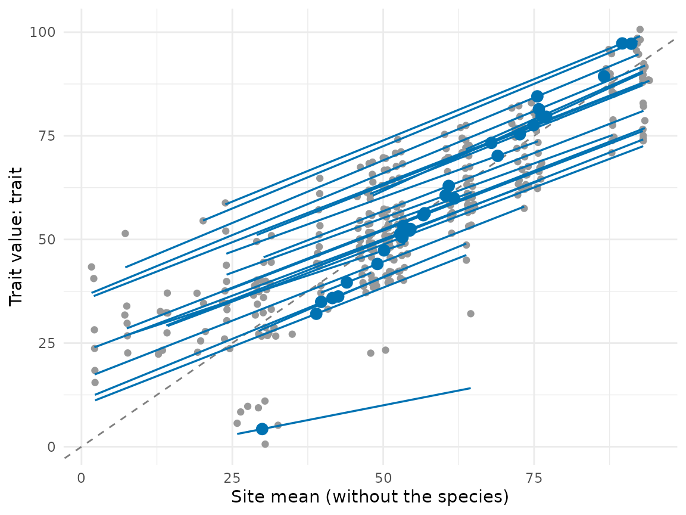
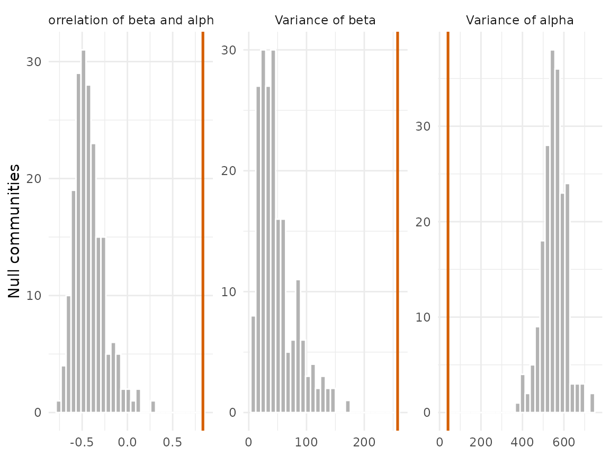

# Trait-gradient analysis

The trait-gradient analysis of Ackerly & Cornwell (2007) places each
species along the gradient defined by the mean trait of the communities
it lives in. The species mean \bar t_i splits into \beta_i, the mean of
the communities of the species, and \alpha_i = \bar t_i - \beta_i, its
difference from the species it co-occurs with. The gradient is built
from the trait itself, so no environmental variable has to be chosen
beforehand. \beta measures where a species sorts among communities, and
\alpha measures how it differs within them.

[`trait_gradient()`](https://provetelab.org/comdynamite/reference/trait_gradient.md)
follows the original analysis with three changes, described in its help
page: site means leave out the focal species, the weights of site means
and of species means are chosen apart, and the tests use a null model
with fixed margins and a phylogenetic model that carries the sampling
error of each value. The results below are simulated.

``` r

library(comdynamite)

set.seed(1)
tree <- treeshapesim::sim_tree_shape(30)
sim <- simulate_metacommunity(landscape_implicit(25), species_traits(tree, lambda = 1),
                              competition_matrix(tree, "none"), n_steps = 100,
                              seed_steps = 1:5)
ind <- sample_individuals(sim, n = 5, local_adaptation = 0.5, intraspecific_sd = 1)
tg <- trait_gradient(ind, abundance = "abundance")
tg
#> Trait-gradient analysis of 29 species in 25 sites
#> Site means: without the focal species | weights of sites: abundance | of species: abundance 
#> Correlation of beta and alpha: 0.834 
#> Variance of species means: 470
#>   of beta: 258
#>   of alpha: 40.9
```

## The gradient

Each grey point is a population, at the mean of its site without the
species itself. Lines are the slopes of species over the range of their
sites, and large points are the species means at (\beta_i, \bar t_i).
Species above the dashed line have positive \alpha: they carry larger
values than the species they live with.

``` r

plot(tg)
```



## Leaving the focal species out

With the focal species inside the site means, \beta_i contains \bar t_i,
and the more so the fewer species share its sites. The original \beta is
pulled toward the mean of the species itself; below are the species
where the two versions differ most.

``` r

original <- trait_gradient(ind, abundance = "abundance", leave_one_out = FALSE)
both <- data.frame(species = tg$species$species, mean = tg$species$mean,
                   beta = tg$species$beta, beta_original = original$species$beta)
head(both[order(-abs(both$beta - both$beta_original)), ])
#>    species      mean     beta beta_original
#> 7      t16  4.261821 29.94307      9.697106
#> 13     t21 32.069204 38.91281     37.845875
#> 16     t24 97.217766 91.11292     91.942343
#> 17     t25 84.520701 75.53700     76.354633
#> 10     t19 44.084085 49.03554     48.442121
#> 18     t26 97.288470 89.60545     90.039499
```

The raw correlation of \beta and \alpha is not readable on its own under
either version, because \alpha = \bar t - \beta: read it against a null
model, as below. In simulations without trait sorting, the curveball
test of the correlation rejected in 49% of replicates with the original
site means and in 5% with the leave-one-out means.

## Weights

Abundance weights let the dominant species set the gradient.
[`trait_gradient_weights()`](https://provetelab.org/comdynamite/reference/trait_gradient_weights.md)
runs the four combinations of weights for sites and species and
correlates them with the first.

``` r

trait_gradient_weights(ind, abundance = "abundance")$correlation
#>                 weights      beta     alpha
#> 1   abundance/abundance 1.0000000 1.0000000
#> 2  abundance/occurrence 0.8605559 0.9270340
#> 3  occurrence/abundance 0.9971254 0.9671218
#> 4 occurrence/occurrence 0.8757289 0.9458010
```

## Null models

[`trait_gradient_test()`](https://provetelab.org/comdynamite/reference/trait_gradient_test.md)
exchanges the trait means of species among species and keeps the
communities as observed, which tests whether species with similar traits
live in similar communities.

``` r

test <- trait_gradient_test(tg, n_null = 199)
test
#> Null model of the trait-gradient analysis: 199 communities, species 
#>       statistic observed null_mean null_sd   ses    p
#>  cor_beta_alpha    0.834     -0.42   0.168  7.44 0.01
#>        var_beta  258.000     48.30  32.200  6.51 0.01
#>       var_alpha   40.900    553.00  58.500 -8.76 0.01
plot(test)
```



The curveball null moves species among sites instead, keeping the
richness of every site and the number of sites of every species. It also
breaks the turnover of species along the gradient, so its tests of the
variances reject whenever composition changes among sites; use it for
the correlation of \beta and \alpha only. The help page of
[`trait_gradient_test()`](https://provetelab.org/comdynamite/reference/trait_gradient_test.md)
gives the error rates of both nulls in simulations.

``` r

trait_gradient_test(tg, n_null = 199, null = "curveball")$statistics[1, ]
#>        statistic observed  null_mean   null_sd      ses    p
#> 1 cor_beta_alpha 0.833901 -0.2733103 0.2338977 4.733741 0.01
```

## Phylogeny

[`trait_gradient_phylo()`](https://provetelab.org/comdynamite/reference/trait_gradient_phylo.md)
asks whether \beta, \alpha and the species mean are conserved. Each
value has a bootstrap standard error, added to the covariance of the
model, so a species seen in few sites does not pass for fast evolution.

``` r

ph <- trait_gradient_phylo(tg, tree, n_boot = 199)
ph
#> Phylogenetic models of the trait-gradient analysis: 26 species
#>  response model    mu sigma2     a half_life at_bound loglik n_par aic
#>      beta white 60.10  215.0    NA        NA       NA -105.0     2 214
#>      beta    BM 60.80  398.0    NA        NA       NA  -97.7     2 199
#>      beta    OU 60.70  481.0 0.517      1.34    FALSE  -97.6     3 201
#>     alpha white -0.77   36.8    NA        NA       NA  -83.7     2 171
#>     alpha    BM -0.39   70.0    NA        NA       NA  -75.9     2 156
#>     alpha    OU -0.39   70.1 0.001        NA     TRUE  -75.9     3 158
#>      mean white 59.80  453.0    NA        NA       NA -114.0     2 232
#>      mean    BM 60.70  863.0    NA        NA       NA -105.0     2 215
#>      mean    OU 60.70  934.0 0.232      2.98    FALSE -105.0     3 217
#>  delta_aic
#>      15.04
#>       0.00
#>       1.75
#>      15.59
#>       0.00
#>       2.00
#>      16.70
#>       0.00
#>       1.95
```

In this simulation the optima evolve by Brownian motion (`lambda = 1`),
so \beta, which follows the optima, should prefer Brownian motion over
the model without phylogeny. A fit of the OU process with its strength
at a bound is marked in `at_bound`: at the lower bound it is Brownian
motion.

## References

Ackerly, D. D., & Cornwell, W. K. (2007). A trait-based approach to
community assembly: partitioning of species trait values into within-
and among-community components. *Ecology Letters*, 10, 135–145.
<https://doi.org/10.1111/j.1461-0248.2006.01006.x>

Strona, G., Nappo, D., Boccacci, F., Fattorini, S., & San-Miguel-Ayanz,
J. (2014). A fast and unbiased procedure to randomize ecological binary
matrices with fixed row and column totals. *Nature Communications*, 5,
4114. <https://doi.org/10.1038/ncomms5114>
