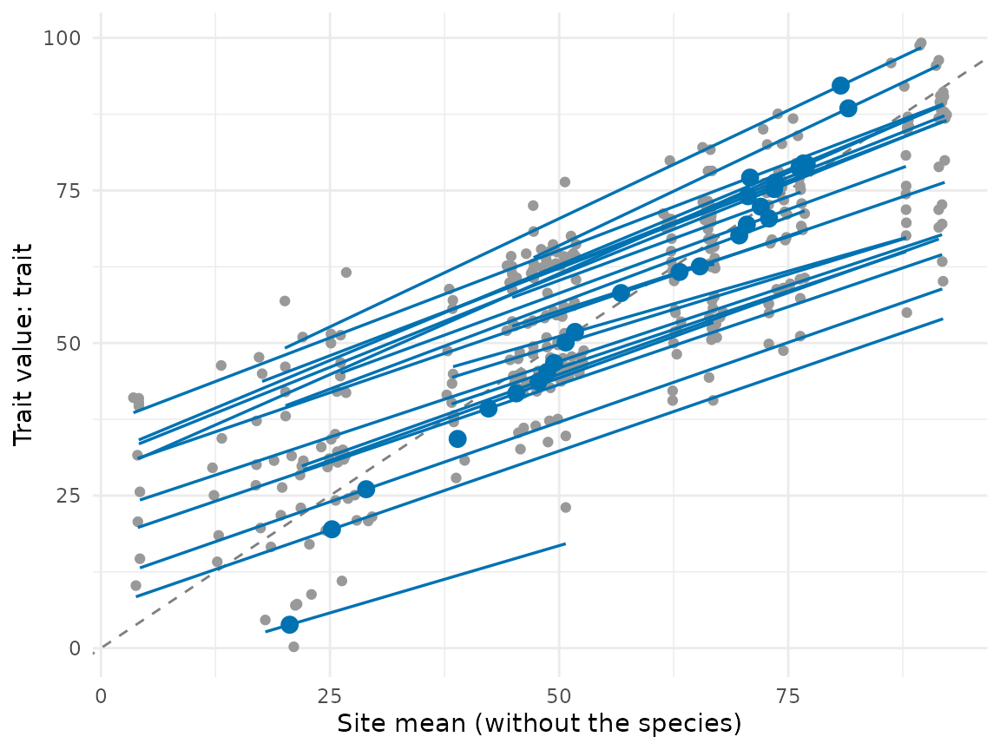
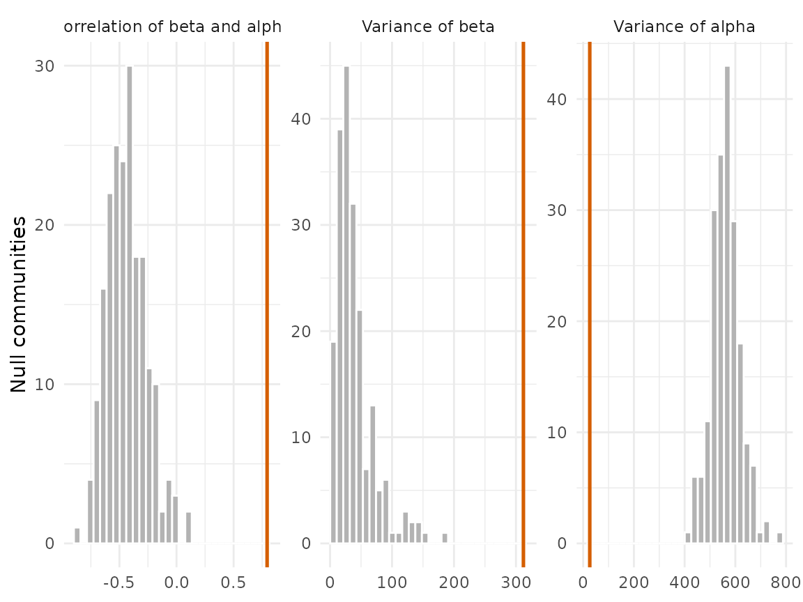

# Trait-gradient analysis

The trait-gradient analysis of Ackerly & Cornwell (2007) places each
species along the gradient defined by the mean trait of the communities
it lives in. The species mean \bar t_i splits into \beta_i, the mean of
the communities of the species, and \alpha_i = \bar t_i - \beta_i, its
difference from the species it co-occurs with. The gradient is built
from the trait itself, so no environmental variable has to be chosen
beforehand. \beta measures where a species sorts among communities, and
\alpha measures how it differs within them.

[`trait_gradient()`](https://provetelab.org/comdynamite/reference/trait_gradient.md)
follows the original analysis with three changes, described in its help
page: site means leave out the focal species, the weights of site means
and of species means are chosen apart, and the tests use a null model
with fixed margins and a phylogenetic model that carries the sampling
error of each value. The results below are simulated, with this code:

``` r

library(comdynamite)

set.seed(1)
tree <- treeshapesim::sim_tree_shape(30)
sim <- simulate_metacommunity(landscape_implicit(25), species_traits(tree, lambda = 1),
                              competition_matrix(tree, "none"), n_steps = 100,
                              seed_steps = 1:5)
ind <- sample_individuals(sim, n = 5, local_adaptation = 0.5, intraspecific_sd = 1)
```

The same seed gives a different metacommunity on different operating
systems, because small differences in floating-point arithmetic change
some random draws of the simulation. So that every reader gets the
numbers shown here, the tree and the individuals are read from
[`data-raw/vignette_trait_gradient.R`](https://github.com/diogoprov/comdynamite/blob/main/data-raw/vignette_trait_gradient.R),
which ran the code above (on macOS), and the analysis starts from them:

``` r

library(comdynamite)
res <- readRDS("trait-gradient.rds")
tree <- res$tree
ind <- res$individuals
tg <- trait_gradient(ind, abundance = "abundance")
#> trait_gradient() implements the method of:
#>   Ackerly, D. D., & Cornwell, W. K. (2007). A trait-based approach to community assembly: partitioning of species trait values into within- and among-community components. Ecology Letters, 10, 135-145. https://doi.org/10.1111/j.1461-0248.2006.01006.x
#> Please cite these papers together with comdynamite (citation("comdynamite")).
#> This message is shown once per session; options(comdynamite.cite = FALSE) turns it off.
tg
#> Trait-gradient analysis of 27 species in 25 sites
#> Site means: without the focal species | weights of sites: abundance | of species: abundance 
#> Correlation of beta and alpha: 0.793 
#> Variance of species means: 481
#>   of beta: 312
#>   of alpha: 26
```

## The gradient

Each grey point is a population, at the mean of its site without the
species itself. Lines are the slopes of species over the range of their
sites, and large points are the species means at (\beta_i, \bar t_i).
Species above the dashed line have positive \alpha: they carry larger
values than the species they live with.

``` r

plot(tg)
```



## Leaving the focal species out

With the focal species inside the site means, \beta_i contains \bar t_i,
and the more so the fewer species share its sites. The original \beta is
pulled toward the mean of the species itself; below are the species
where the two versions differ most.

``` r

original <- trait_gradient(ind, abundance = "abundance", leave_one_out = FALSE)
both <- data.frame(species = tg$species$species, mean = tg$species$mean,
                   beta = tg$species$beta, beta_original = original$species$beta)
head(both[order(-abs(both$beta - both$beta_original)), ])
#>    species      mean     beta beta_original
#> 7      t16  3.838063 20.59497      11.80809
#> 8      t17 19.482053 25.21034      23.17181
#> 3      t11 92.188646 80.72369      82.08792
#> 10     t19 43.666212 47.74811      47.09960
#> 6      t14 34.288191 38.92643      38.44228
#> 16     t25 77.108860 70.83459      71.25842
```

The raw correlation of \beta and \alpha is not readable on its own under
either version, because \alpha = \bar t - \beta: read it against a null
model, as below. In simulations without trait sorting, the curveball
test of the correlation rejected in 49% of replicates with the original
site means and in 5% with the leave-one-out means.

## Weights

Abundance weights let the dominant species set the gradient.
[`trait_gradient_weights()`](https://provetelab.org/comdynamite/reference/trait_gradient_weights.md)
runs the four combinations of weights for sites and species and
correlates them with the first.

``` r

trait_gradient_weights(ind, abundance = "abundance")$correlation
#>                 weights      beta     alpha
#> 1   abundance/abundance 1.0000000 1.0000000
#> 2  abundance/occurrence 0.8816057 0.9162971
#> 3  occurrence/abundance 0.9996782 0.9480404
#> 4 occurrence/occurrence 0.8699525 0.9219668
```

## Null models

[`trait_gradient_test()`](https://provetelab.org/comdynamite/reference/trait_gradient_test.md)
exchanges the trait means of species among species and keeps the
communities as observed, which tests whether species with similar traits
live in similar communities.

``` r

test <- trait_gradient_test(tg, n_null = 199)
#> trait_gradient_test() implements the method of:
#>   Ackerly, D. D., & Cornwell, W. K. (2007). A trait-based approach to community assembly: partitioning of species trait values into within- and among-community components. Ecology Letters, 10, 135-145. https://doi.org/10.1111/j.1461-0248.2006.01006.x
#> Please cite these papers together with comdynamite (citation("comdynamite")).
#> This message is shown once per session; options(comdynamite.cite = FALSE) turns it off.
test
#> Null model of the trait-gradient analysis: 199 communities, species 
#>       statistic observed null_mean null_sd   ses    p
#>  cor_beta_alpha    0.793    -0.435   0.173  7.10 0.01
#>        var_beta  312.000    39.600  30.800  8.85 0.01
#>       var_alpha   26.000   563.000  57.000 -9.42 0.01
plot(test)
```



The curveball null moves species among sites instead, keeping the
richness of every site and the number of sites of every species. It also
breaks the turnover of species along the gradient, so its tests of the
variances reject whenever composition changes among sites; use it for
the correlation of \beta and \alpha only. The help page of
[`trait_gradient_test()`](https://provetelab.org/comdynamite/reference/trait_gradient_test.md)
gives the error rates of both nulls in simulations.

``` r

trait_gradient_test(tg, n_null = 199, null = "curveball")$statistics[1, ]
#>        statistic  observed  null_mean   null_sd     ses    p
#> 1 cor_beta_alpha 0.7933778 -0.3706455 0.2115029 5.50358 0.01
```

When niches are conserved, a trait that merely carries the same
phylogenetic structure looks sorted along the gradient under the
exchange of means among all species. The phylogenetic permutations of
Lapointe & Garland (2001) exchange means preferably among relatives;
`phylo_k` closer to 1 keeps exchanges closer in the tree.

``` r

trait_gradient_test(tg, n_null = 199, null = "phylo", tree = tree)
#> Null model of the trait-gradient analysis: 199 communities, phylo 
#>       statistic observed null_mean null_sd   ses    p
#>  cor_beta_alpha    0.793     -0.26    0.16  6.57 0.01
#>        var_beta  312.000    106.00   58.50  3.52 0.01
#>       var_alpha   26.000    484.00   88.90 -5.15 0.01
```

## Phylogeny

[`trait_gradient_phylo()`](https://provetelab.org/comdynamite/reference/trait_gradient_phylo.md)
asks whether \beta, \alpha and the species mean are conserved. Each
value has a bootstrap standard error, added to the covariance of the
model, so a species seen in few sites does not pass for fast evolution.

``` r

set.seed(2)
ph <- trait_gradient_phylo(tg, tree, n_boot = 199)
#> trait_gradient_phylo() implements the method of:
#>   Ackerly, D. D., & Cornwell, W. K. (2007). A trait-based approach to community assembly: partitioning of species trait values into within- and among-community components. Ecology Letters, 10, 135-145. https://doi.org/10.1111/j.1461-0248.2006.01006.x
#> Please cite these papers together with comdynamite (citation("comdynamite")).
#> This message is shown once per session; options(comdynamite.cite = FALSE) turns it off.
ph
#> Phylogenetic models of the trait-gradient analysis: 24 species
#>  response model     mu sigma2     a half_life at_bound converged loglik n_par
#>      beta white 58.700  308.0    NA        NA       NA      TRUE -100.0     2
#>      beta    BM 60.900  347.0    NA        NA       NA      TRUE  -86.8     2
#>      beta    OU 60.900  347.0 0.001        NA     TRUE      TRUE  -86.8     3
#>     alpha white -0.404   25.0    NA        NA       NA      TRUE  -72.2     2
#>     alpha    BM  0.789   64.2    NA        NA       NA      TRUE  -69.3     2
#>     alpha    OU  0.498  111.0 1.830     0.379    FALSE      TRUE  -68.3     3
#>      mean white 58.400  490.0    NA        NA       NA      TRUE -106.0     2
#>      mean    BM 61.800  675.0    NA        NA       NA      TRUE  -93.6     2
#>      mean    OU 61.800  675.0 0.001        NA     TRUE      TRUE  -93.6     3
#>  aic delta_aic
#>  205     27.22
#>  178      0.00
#>  180      2.00
#>  148      5.89
#>  143      0.05
#>  143      0.00
#>  215     23.88
#>  191      0.00
#>  193      2.00
```

In this simulation the optima evolve by Brownian motion (`lambda = 1`),
so \beta, which follows the optima, should prefer Brownian motion over
the model without phylogeny. A fit of the OU process with its strength
at a bound is marked in `at_bound`: at the lower bound it is Brownian
motion.

## A Bayesian model with latent beta

[`trait_gradient_phylo()`](https://provetelab.org/comdynamite/reference/trait_gradient_phylo.md)
first computes \beta and then models it with a standard error.
[`trait_gradient_bayes()`](https://provetelab.org/comdynamite/reference/trait_gradient_bayes.md)
instead fits in Stan one bivariate model in which \beta and the species
mean are latent species effects, with a phylogenetic and a
non-phylogenetic part, estimated from every site of every species. The
phylogenetic share \lambda of \beta, \alpha and the mean has its own
prior and comes with a credible interval. It needs cmdstanr and many
species (see the Limits section of its help page). Abundance weights
make the posterior too narrow, so the model below uses occurrence
weights for species.

In simulations with about 40 species, \lambda of \beta near 0 and near 1
was recovered, while intermediate signal came out low with wide
intervals; the help page gives the numbers.

The site is built without cmdstanr, so this code is not run here; its
output below was saved by `data-raw/vignette_trait_gradient.R` (cmdstan
2.40.0), which runs the same code with the seeds of the sampler fixed.

``` r

tg_occ <- trait_gradient(ind, abundance = "abundance", species_weights = "occurrence")
bayes <- trait_gradient_bayes(tg_occ, tree, parallel_chains = 4, seed = 3)
bayes$diagnostics   # R-hat, effective sample sizes, divergent transitions
bayes$signal
bayesplot::pp_check(bayes, resp = "sitemean")
# an OU structure with the strength fitted to beta by trait_gradient_phylo()
a <- ph$models$a[ph$models$response == "beta" & ph$models$model == "OU"]
ou <- trait_gradient_bayes(tg_occ, tree, ou_alpha = a, parallel_chains = 4, seed = 4)
# cross-validation one response at a time, since the two are fitted to different populations
loo::loo_compare(bayes$fit$loo(variables = "log_lik_p"), ou$fit$loo(variables = "log_lik_p"))
```

The sampler converged (R-hat at most 1.006, no divergent transitions):

``` r

res$bayes$diagnostics
#>   max_rhat min_ess_bulk min_ess_tail divergent max_treedepth   ok
#> 1 1.005708     1041.291     1837.445         0             0 TRUE
res$bayes$signal
#>               quantity  estimate      lower     upper
#> 1          lambda_beta 0.8729290  0.3809386 0.9954069
#> 2         lambda_alpha 0.8688132  0.4502830 0.9849526
#> 3          lambda_mean 0.9314219  0.5569639 0.9970500
#> 4  cor_phylo_beta_mean 0.8507108  0.4055330 0.9811387
#> 5 cor_phylo_beta_alpha 0.5468470 -0.2075849 0.9283035
```


The replicated site means cover the centre and the spread of the
observed ones, but not their several peaks, which a model with normal
errors cannot produce; read the estimates with that misfit in mind. The
phylogenetic share of \beta is high, as expected with optima that evolve
by Brownian motion, but its 95% interval is wide (0.38 to 0.995). In
this simulation the strength of the OU process fitted to \beta is at its
lower bound (0.001), so the OU structure is Brownian motion and the
cross-validation has nothing to tell apart:

``` r

res$loo
#>    elpd_diff    se_diff
#> 1  0.0000000 0.00000000
#> 2 -0.1340604 0.06818054
```

## References

Ackerly, D. D., & Cornwell, W. K. (2007). A trait-based approach to
community assembly: partitioning of species trait values into within-
and among-community components. *Ecology Letters*, 10, 135–145.
<https://doi.org/10.1111/j.1461-0248.2006.01006.x>

Lapointe, F.-J., & Garland, T., Jr. (2001). A generalized permutation
model for the analysis of cross-species data. *Journal of
Classification*, 18, 109–127.
<https://doi.org/10.1007/s00357-001-0007-0>

Strona, G., Nappo, D., Boccacci, F., Fattorini, S., & San-Miguel-Ayanz,
J. (2014). A fast and unbiased procedure to randomize ecological binary
matrices with fixed row and column totals. *Nature Communications*, 5,
4114. <https://doi.org/10.1038/ncomms5114>
