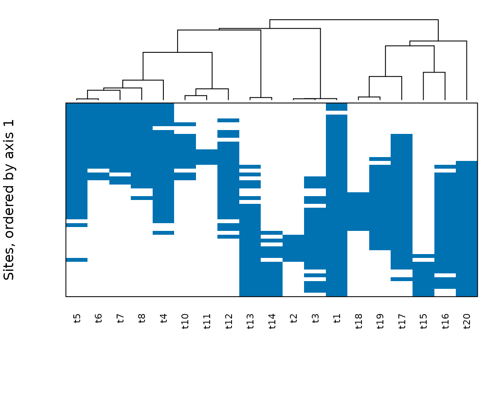

# Testing the whole tree

[`node_test()`](https://provetelab.org/comdynamite/reference/node_test.md)
asks which clades respond to the environment. Peres-Neto & Kembel (2015)
proposed two frameworks that ask whether phylogenetic composition
follows the environment across the whole tree, and both are in the
package. The results below are simulated.

``` r

library(comdynamite)

set.seed(1)
tree <- treeshapesim::sim_tree_shape(20)
traits <- species_traits(tree, lambda = 1, optima_range = c(-1, 101), rmax_range = c(0, 30))
env <- runif(50, 0, 100)
comm <- simulate_static(traits, env, incidence = TRUE)$abundance
keep <- rowSums(comm) > 0
comm <- comm[keep, ]
env <- env[keep]
```

## Phylogenetic community composition

[`pcc_test()`](https://provetelab.org/comdynamite/reference/pcc_test.md)
takes the principal coordinates of the distances among species, averages
them within sites, and regresses each average on the predictors. The
test statistic is the variance of the adjusted R2 across eigenvectors,
and the value to report is the mean of the positive adjusted R2.

``` r

pcc <- pcc_test(comm, tree, env, n_perm = 199)
pcc
#> <mc_pcc> phylogenetic community composition
#> mean positive adjusted R2: 0.0965 
#> permutations: 199 free of sites, 199 of species; smallest possible p: 0.005
#> p (sites): 0.005  p (species): 0.005  p (max): 0.005
```

## Phylogenetic beta diversity

[`phylo_beta_test()`](https://provetelab.org/comdynamite/reference/phylo_beta_test.md)
starts from the distance between communities given by
[`phylo_beta()`](https://provetelab.org/comdynamite/reference/phylo_beta.md),
the mean phylogenetic distance between their species, and fits a
distance-based redundancy analysis.

``` r

beta <- phylo_beta_test(comm, tree, env, n_perm = 199)
beta
#> <mc_phylo_beta> phylogenetic beta diversity
#> adjusted R2: 0.221  pseudo-F: 14.9 
#> permutations: 199 free of sites, 199 of species; smallest possible p: 0.005
#> p (sites): 0.005  p (species): 0.005  p (max): 0.005
```

`scores` holds the sites on the principal coordinates of the predicted
matrix, which the authors suggest using to order sites in a heatmap of
the community matrix.
[`plot_phylo_beta()`](https://provetelab.org/comdynamite/reference/plot_phylo_beta.md)
draws it, with species in the order of the tree, so that clades replace
each other along the sites when composition follows the environment.

``` r

plot_phylo_beta(beta, comm, tree)
```



## Reading the two p-values

Both functions permute sites, which breaks the link between composition
and environment, and species across the tips, which breaks the link
between composition and phylogeny. The association requires both links,
so the p-value to report is `p_max`, the larger of the two. A small
`p_site` with a large `p_species` says that composition follows the
environment, but that the phylogeny adds nothing to it.

The scripts `data-raw/validation_pcc.R` and
`data-raw/validation_phylo_beta.R` compare the rejection rates of these
tests with those published.

## Sites that are neighbours

Permutations of sites treat them as exchangeable. When they are
neighbours, `site_permutations` takes a restricted null model, such as
those of
[`torus_permutations()`](https://provetelab.org/comdynamite/reference/torus_permutations.md)
for a grid on a torus.

## Reference

Peres-Neto, P. R., & Kembel, S. W. (2015). Phylogenetic gradient
analysis: environmental drivers of phylogenetic variation across
ecological communities. *Plant Ecology*, 216, 709–724.
<https://doi.org/10.1007/s11258-014-0405-0>
