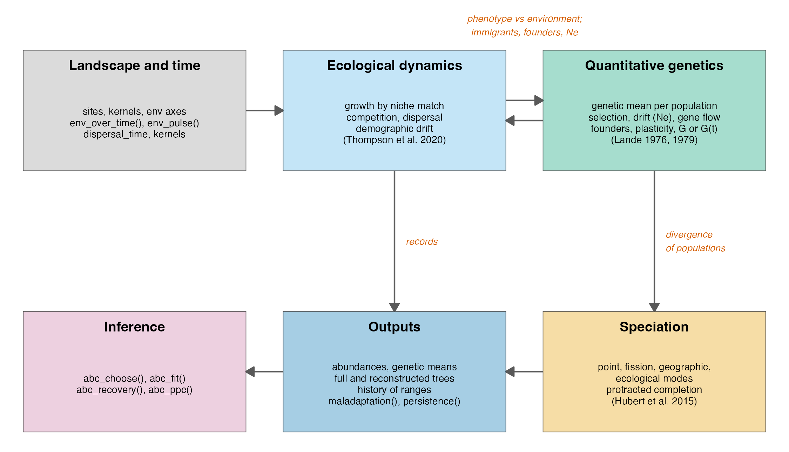
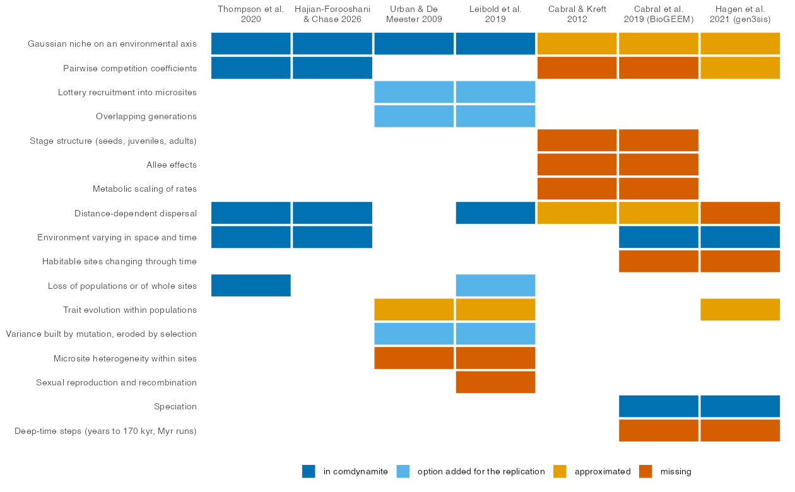
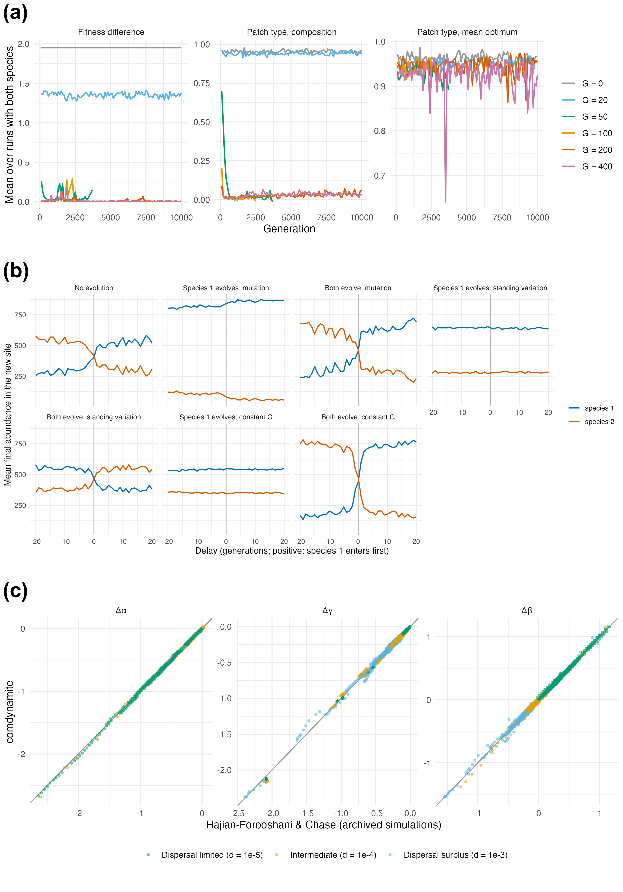
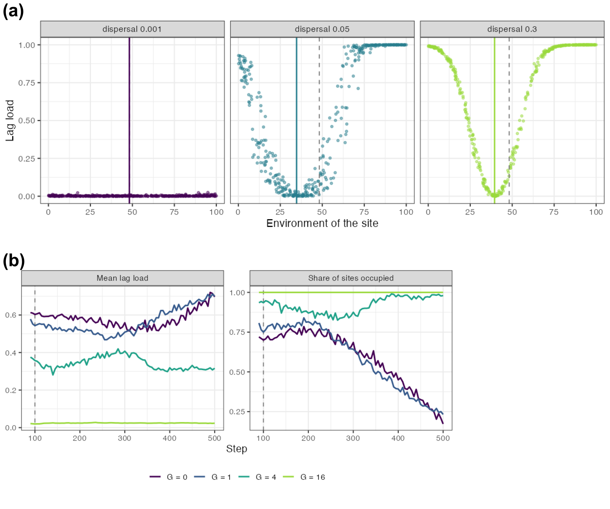

# Introduction

The distribution of species across a landscape emerges from environmental filtering, competition, dispersal and drift acting across scales, and metacommunity theory organises these processes into a continuum of scenarios [@leibold2004metacommunity; @leibold2018metacommunity; @Thompson_2020]. Most metacommunity models, however, treat the niche of each species as a fixed property. This assumption is convenient but seems to be at odds with the speed at which populations adapt to local conditions, often within the time scales over which colonisation and local extinction operate [@urban2008evolutionary; @De_Meester_2016]. When populations adapt, the first species to colonise a site can evolve to fit it and exclude better pre-adapted competitors [@Loeuille_2008; @Urban_2009], species with different ancestral niches can converge to similar regional distributions [@Leibold_2019], and the response of biodiversity to climate change depends on the balance between evolution in place and range shifts [@Norberg_2012]. As a result, the match between species and environment that biogeographers use to infer niches and potential ranges may reflect local adaptation and the history of colonisation as much as the ancestral niche.

Models that let niches evolve within metacommunities follow two traditions. The first is individual-based, with explicit loci and sexual reproduction, and was built to answer one question at a time, such as the monopolization of sites by early colonists [@Urban_2009] or the evolution of regional neutrality [@Leibold_2019]. These models are realistic in their genetics but costly to run, and their code is rarely reused beyond the original study. The second tradition simulates diversification over deep time on dynamic landscapes, as gen3sis [@Hagen_2021], BioGEEM [@Cabral_2019] and MESS [@overcast2021unified], in which species are sets of populations and speciation, dispersal and trait evolution are tied to geological and climatic change. These engines explain broad biogeographic patterns, but their time steps of centuries to millennia leave out the ecological dynamics of local communities. Concurrently, models of speciation in metacommunities showed that the mode of speciation, from point mutation to fission and protracted completion, shapes both the species abundance distribution and the reconstructed tree [@Etienne_2012; @DesjardinsProulx_2012; @Hubert_2015].

Between these traditions lies a gap: a model in which populations of many species adapt, drift, exchange genes and speciate within the ecological dynamics of a metacommunity, fast enough to be replicated thousands of times and coupled to methods that infer process from pattern. Mechanistic models can be used for inference when observed patterns are compared with simulated ones [@hartig2011statistical; @pontarp2019latitudinal], and @cabral2017mechanistic argued that such models should be modular, so that alternative mechanisms can be switched on and off and contrasted. A quantitative-genetic approximation suits this purpose, since the response of a population mean to Gaussian selection, its drift and its mixing by gene flow have closed forms [@Lande_1976; @Lande_1979; reviewed in @Walsh_2018; @Arnold_2023], which keeps runs fast and gives analytical expectations against which the implementation can be checked.

Here, I describe the eco-evolutionary engine of comdynamite, an R package for simulating and analysing metacommunities with traits, phylogenies and biogeography. After describing the model, I evaluate it in three ways: (i) against analytical expectations and reference models, (ii) by replicating three published models whose results depend on adaptation or disturbance, reporting where it departs from them and where their archived code departs from their text, and (iii) by asking whether the genetic variance can be recovered by approximate Bayesian computation. I then illustrate how local adaptation changes range limits and potential ranges, and apply the engine to a pond amphibian metacommunity. Throughout, the aim is not to replace individual-based or deep-time models, but to provide a module in ecological time that can be compared with them [@cabral2017mechanistic].

# Materials and Methods

## Population dynamics

The engine builds on the process-based metacommunity model of @Thompson_2020, implemented in `simulate_metacommunity()` and validated against its archived code [@Thompson_2020code] and against the independent R implementation mcomsimr [@Thompson_mcomsimr]. Local abundances change in discrete time by density-independent growth, which depends on the match between the niche optimum of each species and the environment of the site under a Gaussian response of breadth $\sigma$, by Beverton–Holt competition with pairwise coefficients, by dispersal among sites and by demographic stochasticity. Landscapes can be spatially implicit, grids, or sites at given coordinates, with exponential or Gaussian dispersal kernels and environments of one or several axes. Recruitment can follow the original model or a lottery into vacated microsites with overlapping generations, two mechanisms of the individual-based models replicated below (@tbl-components). Optima, niche breadths and growth rates can be drawn on a phylogeny with a chosen phylogenetic signal, and competition can decline with relatedness, so that niche conservatism and competition among relatives can be set independently.

: Components of the eco-evolutionary engine of comdynamite and the functions that implement them. All functions take and return objects that the analytical functions of the package read. {#tbl-components}

| Component | What it adds | Main functions and arguments |
|:----------------|:------------------------------|:------------------------|
| Population dynamics | Growth by niche match, competition, dispersal, drift [@Thompson_2020]; lottery recruitment and overlapping generations | `simulate_metacommunity()`, `landscape_grid()`, `landscape_points()`, `competition_matrix()` |
| Quantitative genetics | Selection, drift, gene flow, founders, plasticity, one or several traits | `evolution_control()`, `genetic_matrices()` |
| Genetic variance | Constant $G$, or variance per population built by mutation and eroded by drift and selection | `mutation_var`, `variance_selection` |
| Speciation | Point mutation, fission, geographic and ecological modes; protracted completion | `simulate_evolving_metacommunity()`, `speciation_control()` |
| Time | Environments that drift, warm or pulse; dispersal that varies in amount and direction | `env_over_time()`, `env_pulse()`, `dispersal_time`, `kernels` |
| Outputs | Maladaptation, persistence, divergence under drift, history of ranges | `maladaptation()`, `persistence()`, `drift_test()`, `range_history()`, `as_herodotools()` |
| Inference | Approximate Bayesian computation with random forests | `abc_table()`, `abc_choose()`, `abc_fit()`, `abc_ppc()`, `abc_recovery()` |

## Quantitative genetics within populations

With the argument `evolution`, set by `evolution_control()`, each population, that is, each species in each site, carries its own genetic mean $\bar z$ of the niche optimum and an additive genetic variance $G$ (@fig-model). Its mean phenotype adds a linear reaction norm, $\bar p = \bar z + b(E - E_0)$, so that plasticity can be separated from genetic change, and individuals vary around $\bar p$ with phenotypic variance $P = G + V_E$. Under the Gaussian niche, the response of the genetic mean to selection by the environment $E$ of the site follows @Lande_1976 [see @Walsh_2018, @Arnold_2023]:

$$
\Delta \bar z = \frac{1}{g}\,\frac{G}{\sigma^2 + P}\,(E - \bar p) + \epsilon, \qquad \epsilon \sim N\!\left(0, \frac{G}{g\,N_e}\right),
$$

where $g$ is the number of time steps per generation and $N_e$ is the effective size, a fraction of the census size, so that drift is stronger in small populations. Immigrants bring the genetic means of their sources, weighted by their numbers, which is how gene flow opposes local adaptation. Populations founded by $k$ individuals draw their mean around that of their sources with variance $(G + V_B)/k$, where $V_B$ is the variance among the sources, so that founder effects arise from the colonisation history rather than being imposed. Without genetic variance, plasticity or founder sampling, the abundances are exactly those of the model without evolution for the same seed, which makes the effect of evolution a paired contrast.

With several environmental axes, one trait evolves per axis, $G$ and $V_E$ become covariance matrices, and the response follows the multivariate equation of @Lande_1979, $\Delta \bar{\mathbf z} = \mathbf G (\boldsymbol\Omega + \mathbf P)^{-1}\mathbf d$, where $\boldsymbol\Omega$ holds the squared niche breadths and $\mathbf d$ the deviation of the phenotype from the environment on each axis. A trait can therefore change without being selected, through its genetic covariance with traits that are, and the orientation of $\mathbf G$ relative to the environmental covariation of the landscape sets how fast populations adapt. The function `genetic_matrices()` builds $\mathbf G$ for each species as proportional to a common phenotypic matrix, without common structure, or sharing its principal components.

By default $G$ is constant, as in most quantitative-genetic models of range limits and evolutionary rescue. Since the replications below showed that results can hinge on this assumption, two options let the variance change. With `mutation_var`, each population carries its own variance, which loses $1/(2N_e)$ per generation by drift, gains the mutational variance, is reduced at founding and averaged by gene flow; with `variance_selection`, stabilising selection also erodes it, towards a balance between mutation, selection and drift [@Walsh_2018]. Three functions summarise the evolutionary state. The function `maladaptation()` returns the deviation of each population from its site and the lag load, the share of growth lost to that deviation, with the Mahalanobis distance for several traits. The function `drift_test()` asks whether divergence among groups is proportional to the variation within them, as expected under drift [@Lande_1979], by the regression of @Ackermann_2004. Finally, `persistence()` estimates colonisation and extirpation rates of each lineage from its record of presences.

```{r}
#| label: fig-model
#| fig-cap: "Structure of the eco-evolutionary engine of comdynamite. Each population (a species in a site) carries abundance and a genetic mean of its niche optimum; ecological dynamics and quantitative genetics are updated in every step and interact through the match between phenotype and environment, the numbers of immigrants and founders, and the effective size that sets drift. Notice that the phylogeny and the history of ranges are outputs of the simulation, produced when groups of populations diverge, and that the same outputs enter the analytical and inferential functions of the package. Function names are examples."
#| out-width: 100%

```

## Speciation within the metacommunity

The function `simulate_evolving_metacommunity()` adds speciation to the engine, so that species bud when their populations diverge and go extinct with their last population. Four modes of initiation, set by `speciation_control()`, follow the classification of metacommunity speciation models by @Hubert_2015. In the point mode, each individual starts a new species with a given probability, the neutral limit of @Etienne_2012. In the fission mode, species split at a given rate into the populations nearest a random site or into a random partition. In the geographic mode, clusters of populations linked by migration accumulate divergence until a threshold, and divergence is reset when gene flow resumes. In the ecological mode, groups of populations split when their genetic means differ beyond a threshold, in units of phenotypic standard deviations, for a number of generations with reduced gene flow, so that drift in small populations does not split species in a uniform environment. New species can shift their genetic mean at speciation, and a layer of protracted completion, fixed or exponential in time as in the protracted birth–death model [@Etienne_2012], keeps incipient lineages separate in the dynamics and groups them into good species at the end.

The simulation returns the full and the reconstructed trees, the times of initiation and completion, a series of occupancy, abundance and genetic mean of every lineage, and a log of every change of presence of every lineage in every site. The function `range_history()` maps this log on the tree as a stochastic map whose states are the combinations of areas occupied, which gives the true ancestral ranges against which biogeographic reconstructions can be evaluated. Through `as_metacommunity()` and `as_herodotools()`, the output enters the phylogenetic analyses of comdynamite and the tip-based metrics and ancestral ranges of Herodotools [@Nakamura_2023]. Competition can decline with phylogenetic distance and, optionally, with the difference between phenotypes in each site, so that divergence feeds back on coexistence.

## Environments and dispersal through time

The environment of each site can change through time as a temporally autocorrelated process, a trend such as warming, or recurrent pulses of disturbance with a set duration and frequency (`env_pulse()`), in which the environment of some sites departs from its usual value and acts on growth through the niches of species, as in @Hajian_2026. Dispersal can also vary through time in amount (`dispersal_time`), for instance seasonal philopatry or a breeding migration, and in direction, by a list of dispersal matrices (`kernels`) used at different steps, such as the long-distance connections of a flood pulse. These options act on the ecological dynamics of `simulate_metacommunity()`; the time-varying dispersal does not yet work with evolving populations.

## Inference by approximate Bayesian computation

Since the engine is fast enough to generate large reference tables, its output can be compared with observed data by approximate Bayesian computation. The function `abc_table()` simulates under priors and summarises each run with the same statistics computed on the observed data, including diversity at several scales, distance decay, the relation between traits and environment and phylogenetic structure, with imperfect detection added by `observe_detection()`. Model choice uses random forests [@Pudlo_2016], parameter estimation uses regression forests [@Raynal_2019], and `abc_recovery()`, `abc_cv()` and `abc_ppc()` measure recovery on pseudo-observations, prediction across spatial blocks and posterior predictive fit. In the package vignette on urban anurans, dispersal, competition and niche breadth were recovered from community statistics with coefficients of determination of 0.88 to 0.99 in simulated data, whereas the phylogenetic signal of the niche was not (at most 0.07).

## Validation and replication

I evaluated the engine in three ways. First, unit tests compare the genetic engine and the speciation layer with analytical expectations at every change of the code, and saved scripts compare the ecological dynamics with a reference implementation. Second, since reproducing a published pattern is not the same as nesting a model, as two models can reach a pattern through different mechanisms [@cabral2017mechanistic], I mapped seven published models onto comdynamite, recording which mechanisms each has and whether the package has them, approximates them or lacks them (@fig-nesting), and replicated the three closest in level and time scale (@fig-replications). For each, I followed the published design as far as the text and supplements allowed and report the differences explicitly; the full designs, with the location of each parameter in its source, are in articles of the package website. Third, I tested whether the genetic variance can be recovered by approximate Bayesian computation, as described below.

Where the code of a published model was archived, I compared it with the text of the article and followed the code where they differed, since the code produced the published figures. In the archived code of @Thompson_2020 [@Thompson_2020code], spatial and temporal beta diversity are $\gamma/\alpha$ rather than the $\gamma - \alpha$ of the text, empty patches are left out of $\alpha$ and $\gamma$, the environment is converted to ranks over patches and steps, species are seeded every 20 rather than 10 steps, emigrants are Poisson rather than binomial, and 15 rather than 30 landscapes are run; their Fig. 3 agrees with the code (spatial beta near 10 where $\gamma \approx 40$ and $\alpha \approx 4$). The conversion to ranks mattered most: without it, the standard deviation of the environment among sites fell from 0.29 to 0.11 and the peak of spatial beta diversity at intermediate niche breadths disappeared. In the archived code of @Hajian_2026 [@Hajian_2025data], the niche breadth $n$, called a standard deviation in the text, enters as $\exp(-((z - e)/2n)^2)$, a standard deviation of $\sqrt{2}\,n$, and disturbed patches have an environment of 0.1, given in the text only as below 0.5, so that the pulse filters species by their optima rather than emptying patches. I found no report of these differences in the repositories nor a registered correction (November 2026). The two individual-based models had no archived code, so I translated them from the parameter tables of their supplements.

To ask whether the genetic variance can be recovered from data, I simulated eight species with ancestral optima spread along an environmental gradient on a $10 \times 10$ grid, with six parameters drawn from uniform priors: $\log_{10} G$ ($-1$ to 1.5), $\log_{10}$ emigration probability ($-3$ to $-0.5$), niche breadth $\sigma$ (8 to 25), and three nuisance parameters that could be confounded with $G$, $\log_{10} N_e/N$ ($-1.3$ to 0), the ratio of inter- to intraspecific competition (0.2 to 1) and $\log_{10} V_E$ ($-0.5$ to 1.5); an unknown $V_E$ prevents the variance of measured individuals from revealing $G$. The environment was static for 400 steps or warmed by 0.1 per step over the last 100. Each run was summarised in three views: (i) abundances with the environment and coordinates of sites; (ii) plus the mean trait of each species; and (iii) plus the mean trait of each population measured on 10 individuals, giving the slope and $R^2$ of trait on environment within species and the spread of population means. For each environment I simulated 10,200 runs and left 200 out as pseudo-observations (`abc_recovery()`). A parameter was recoverable, by a criterion set before running, when $R^2$ between estimates and truth was at least 0.5 and the coverage of the 90% credible interval lay between 85% and 95%.

A second test asked whether the orientation of $\mathbf G$ can be recovered, and whether the phenotypic matrix $\mathbf P$ is a good proxy for it, as the conjecture of @Cheverud_1988 proposes. Six species with two traits, one per environmental axis, lived on a $10 \times 10$ grid whose two axes were correlated ($r = 0.6$). I set $\mathbf G = g\,\mathbf R(\theta)\,\mathrm{diag}(1, e)\,\mathbf R(\theta)^\top$, where $\theta$ is the angle between the leading eigenvector of $\mathbf G$ and the major axis of environmental variation and $e$ the ratio of its eigenvalues, and gave $\mathbf V_E$ its own size and angle, so that $\mathbf P = \mathbf G + \mathbf V_E$ departs from $\mathbf G$. Seven parameters were drawn from uniform priors ($\log_{10} g$, $e$, $\theta$, $\log_{10}$ of the size of $\mathbf V_E$, its angle, $\log_{10}$ dispersal and $\sigma$), and each of 10,300 runs was summarised with community data alone or adding 10 individuals measured per population, from which I estimated $\mathbf P$ (pooled within populations) and the covariance among population means within species ($\mathbf D$). I compared the angular error of the ABC estimate of $\theta$, in 300 pseudo-observations with $e \leq 0.5$, with that of the leading eigenvectors of $\mathbf P$ and $\mathbf D$ taken directly as estimates.

## Application to pond amphibians

I applied the engine to 135 farmland ponds in Brie, France, with counts of 11 amphibian species from five transects per pond [@Jeliazkov_2014], as distributed in the CESTES database [@Jeliazkov_2020]. Ponds kept their coordinates, and the environment was the first axis of a principal component analysis of the eight quantitative environmental variables, a gradient from woodland to crops and towns (22% of the variance). I compared three models by ABC with random forests: neutral (infinite niche breadth), species sorting with fixed niches, and local adaptation with constant $G$. All shared priors for emigration, dispersal distance, competition, carrying capacity and the detection probability of individuals, with $\sigma$ in both niche models and $G$ and $V_E$ in the third; the optima of species were drawn anew in each run. Simulated counts were binomial samples of abundances after 400 steps, summarised as the observed data. With 8,200 runs per model, I measured model choice and recovery on pseudo-observations before classifying the data, and checked the fit on two statistics held out of the fit, distance decay and the share of the most abundant species.

# Results

## Analytical expectations and reference models

The unit tests check the genetic engine against analytical results at every change of the code (@tbl-validation). Drift alone made the variance among isolated populations accumulate at $G\sum 1/N_e$, as expected from @Lande_1976, and two populations connected by migration reached the divergence predicted by migration–selection balance. Full plasticity removed selection on the genetic mean, founder sampling made new populations differ from their source by the expected variance, selection moved an unselected trait through its genetic covariance, and drift with several traits produced a covariance among populations of $\mathbf G\sum 1/N_e$. The ecological dynamics, on which the engine rests, were checked against mcomsimr in 16 scenarios with 200 replicates each, with none of 80 comparisons of distributions of diversity and abundance significant at a false discovery rate of 5%, and reproduced five of the six hypotheses of @Thompson_2020 following their archived code.

: Validation of the eco-evolutionary engine. Scripts and saved results are in the `data-raw/` folder and the unit tests in `tests/` of the repository. {#tbl-validation}

| Component | Reference | Result |
|:----------------|:------------------|:-------------------------|
| Drift of genetic means | @Lande_1976; @Lande_1979 | Variance among populations $G\sum 1/N_e$ (one trait) and $\mathbf G\sum 1/N_e$ (several) |
| Gene flow and selection | Migration–selection balance | Divergence of two populations as predicted |
| Ecological dynamics | mcomsimr; @Thompson_2020 | 80 distributions in 16 scenarios not different; five of six hypotheses reproduced |
| Point speciation | Ewens sampling formula | Richness within 1–4% of the expectation |
| Protracted speciation | @Etienne_2012 | $\gamma$ statistic fell with completion time; completion rate recovered at intermediate times |
| Disturbance pulses | Archived simulations of @Hajian_2026 | Correlations of mean changes 0.998–0.999 over 2268 settings |
| Evolving priority effects | @Urban_2009 | Two results reproduced; three departures, two explained by added mechanisms |
| Regional neutrality | @Leibold_2019 | Regional neutrality reproduced; local dominance weaker, regional drift faster |
| Recovery of $G$ | ABC on 200 pseudo-observations | $R^2$ 0.63–0.71 from abundances, 0.93–0.96 with trait means |
| Orientation of $\mathbf G$ | ABC on 300 pseudo-observations; @Cheverud_1988 | Median angular error 1.7° with population traits; $\mathbf P$ a good proxy only when $g \gg V_E$ |

Speciation was checked in its neutral limit and against the protracted birth–death model. With equivalent species and point speciation in one community, the model behaves as a Wright–Fisher population with mutation, and mean richness matched the Ewens sampling formula [@Ewens_1972] within 1% to 4% for values of $\theta$ from 1 to 10 and communities of 250 and 500 individuals (20 replicates), although the excess grew with $\theta$, for reasons I could not pin down. With fission and exponential completion, the $\gamma$ statistic [@Pybus_2000] of reconstructed trees fell from $-0.98$ without delay to $-3.28$ and $-4.58$ with mean completion times of 25 and 100 generations, the apparent slowdown expected under protracted speciation [@Etienne_2012]. The protracted birth–death model fitted to these trees recovered the completion rate at the intermediate time (0.045 against 0.04), but underestimated it at the longest (0.002 against 0.01), when few completed nodes inform the fit. A qualitative check of geographic speciation against the prediction that poorly connected sites accumulate endemic species [@DesjardinsProulx_2012] gave the expected sign but a weak correlation (mean Spearman $\rho = -0.12$).

## Replication of published models

```{r}
#| label: fig-nesting
#| fig-cap: "Mechanisms of seven published models and their status in comdynamite. Blank cells are mechanisms that the model does not have. Notice that the options added for the replications (light blue) fill most of the gaps of the individual-based models, whereas the stage structure, metabolic constraints and changing landscapes of the deep-time models remain missing, which places those models outside the scope of the package."
#| out-width: 100%

```

The model of @Hajian_2026 adds pulses of disturbance to the equations of @Thompson_2020, so it is a special case of the engine. Its authors archived their simulations, which allowed a comparison setting by setting. Over the 2268 combinations of niche breadth, dispersal, extent and time shared with our runs, the correlations between their mean changes in alpha, gamma and beta diversity and ours were 0.998 to 0.999, the mean absolute differences 0.008 to 0.014 without bias, and 94% to 96% of our means lay within their 95% confidence intervals, as expected if both implementations sample the same model (@fig-replications c). Interestingly, an undisturbed control, which the original design lacked, showed that beta diversity also declined without disturbance at intermediate and high dispersal, through competitive exclusion that was still under way when the disturbance began. Part of the homogenisation attributed to disturbance at small extents thus seems to be background change.

The model of @Urban_2009 asks whether local adaptation turns the order of arrival into a lasting priority effect. The engine reproduced two of its results: a species that evolves by mutation wins a new site against one that does not, whatever the order of arrival, and evolution in both species makes the new site more often dominated by one species (@fig-replications b). It departed in three ways. With standing variation, the priority effect appeared only with constant $G$, because a variance that depends on population size carries a load that reverses it; adding the erosion of variance by selection restored it. Over a grid of dispersal, evolution made the poorer disperser win through gene-flow-induced maladaptation, as in one region of their parameter space, but no setting favoured the better disperser until overlapping generations were added, whereas lottery recruitment changed nothing.

The model of @Leibold_2019 asks whether fast local adaptation in disturbed patches makes species regionally equivalent. With $G$ of at least 100, fitness differences vanished within patch types, and patch type stopped predicting composition while it still predicted the traits of populations, which reproduces their regional neutrality (@fig-replications a). However, local dominance was weaker than in their model at intermediate and high dispersal, and regional drift removed one species faster, more so with evolution. Drift of the population means explained most of the loss of species, and filtering maladapted immigrants changed neither result. With a genetic variance that depends on population size, regional neutrality emerged without the loss of species, but local dominance disappeared, and neither lottery recruitment, overlapping generations nor a variance built by mutation restored it.

```{r}
#| label: fig-replications
#| fig-cap: "Replications of three published models with the eco-evolutionary engine. (a) Leibold et al. (2019): fitness difference between species, share of composition explained by patch type and share of the evolved optimum explained by patch type over 10,000 generations, for genetic variances from 0 to 400 (means over runs in which both species persist). Notice that with $G \\geq 100$ fitness differences vanish and patch type stops predicting composition while it still predicts the optimum, the signature of regional neutrality. (b) Urban & De Meester (2009): mean final abundance of two species in a new site against the delay between their arrivals, without evolution and with evolution by mutation, standing variation or constant $G$. (c) Hajian-Forooshani & Chase (2026): mean changes in diversity after disturbance in comdynamite against those of the simulations archived by the authors, for 2268 shared settings; the grey line is the identity."
#| out-width: 68%

```

Taken together, the two population models built on the equations of @Thompson_2020 were reproduced without new mechanisms, whereas the two individual-based models departed in ways explained only in part. Their results seem to depend on how genetic variance is generated and lost, which a quantitative-genetic engine represents only through its assumptions about $G$, so the departures identify which features of the individual-based models drive their conclusions.

## Recovery of the genetic variance

The genetic variance could be recovered from community data alone, although with wide intervals. With abundances, environment and coordinates only, estimates of $\log_{10} G$ explained 71% of the variation in the truth in the static environment and 63% under warming, with intervals that spanned 57% and 63% of the prior range and contained the truth in 91% and 94% of the pseudo-observations. Adding the mean trait of each species raised $R^2$ to 0.95 and 0.93 and narrowed the intervals to about 30% of the prior, whereas population means added little (0.96 in both). With trait data the intervals were slightly conservative (coverage 0.955 to 0.98), so that the criterion set beforehand failed in all four of these combinations through excess rather than lack of coverage. Dispersal and competition were recovered in every view ($R^2 \geq 0.91$), and the niche breadth only moderately (0.54 to 0.69). Neither the effective size nor $V_E$ was recovered in any view ($R^2 \leq 0.45$), so that drift could not be separated from selection with these data. However, the ancestral optima were the same in all runs, so the departure of species means from them carried information that a study of real species, whose ancestral optima are unknown, would lack; the gain from species means is therefore probably an upper bound. These results also come from the model that generated the pseudo-observations, and say nothing about the consequences of fitting a misspecified model.

The orientation of $\mathbf G$ was recovered closely when traits were measured in populations, but not from community data. With population data, estimates of $\theta$ had a median angular error of 1.7° (90% of errors below 5.1°, coverage 0.98), and the size, eccentricity and angle of $\mathbf G$ were recovered ($R^2$ of 0.97, 0.93 and 0.82). With community data alone the median error was 13.9°, against an expected 30° for a random guess, and only the size of $\mathbf G$ was recovered ($R^2 = 0.85$). Taken directly, the leading eigenvector of $\mathbf D$ erred by a median of 2.9°, close to the ABC estimate, as expected if divergence among populations follows $\mathbf G$ [@Lande_1979]. The leading eigenvector of $\mathbf P$ erred by a median of 6.1°, but with a long tail (90% of errors below 35.9°): its error was 1.3° when $g$ exceeded the size of $\mathbf V_E$ more than threefold and 16° when $\mathbf V_E$ was at least as large as $g$. Thus $\mathbf P$ seems to be a good proxy for the orientation of $\mathbf G$ only when heritabilities are high, whereas the divergence of populations along environmental gradients carries the orientation of $\mathbf G$ regardless of $\mathbf V_E$.

## Local adaptation and the limits of ranges

To illustrate the consequences of local adaptation for biogeographic inference, I simulated a single species on a $20 \times 20$ grid along an environmental gradient from 0 to 100, with a niche breadth of 12 (@fig-ranges). With an emigration probability of 0.001, nearly every population adapted to its site (mean lag load 0.002 after 300 steps). With more dispersal, gene flow kept populations away from their local optima, and the mean load rose to 0.51 and 0.66 at emigration probabilities of 0.05 and 0.3. Surprisingly, the load was not symmetric around the regional mean environment: the abundance-weighted mean phenotype settled below it, and sites above the mean carried most of the load (0.80 against 0.26 below it). Gene flow thus seems to pull populations towards the phenotype of the most productive part of the range rather than towards the centre of the gradient, so that the populations at one end persist as sinks. Evolution also widened the range, from 336 to 386 of the 400 sites.

When the environment of every site warmed by 0.15 per step, the outcome depended on the genetic variance (@fig-ranges b). With $G$ of 0 or 1, the range collapsed to 17% and 23% of the sites. With $G = 4$, occupancy fell to 82% and then recovered to 98% of the sites with a load lower than before warming, the trajectory of evolutionary rescue, and with $G = 16$ the species kept every site. Finally, in a community of five species with priority effects, 33% of the sites occupied by species with evolution lay outside the potential range set by their ancestral niches, against 3% without evolution, because local adaptation turned unsuitable sites into suitable ones. A potential range estimated from the ancestral niche can thus misjudge both where a species should be and where it is, a point that matters for the correlative models of distribution used in biogeography [@Cabral_2012]. These are single runs, which illustrate mechanisms rather than estimate their size.

```{r}
#| label: fig-ranges
#| fig-cap: "Local adaptation along a gradient, from single runs on a 20 × 20 grid. (a) Lag load of each population against the environment of its site after 300 steps, for three emigration probabilities; the dashed line marks the regional mean environment and the solid line the abundance-weighted mean phenotype of the species. Notice that the load concentrates at the upper end of the gradient, where populations persist as sinks. (b) Share of sites occupied and mean lag load over time when every site warms by 0.15 per step from step 100 (dashed line), for four genetic variances; with $G = 4$ the range contracts and then recovers, the trajectory of evolutionary rescue."
#| out-width: 100%

```

## Application to pond amphibians

The neutral model was rejected: it was almost never confused with the niche models (error below 1%), and no tree voted for it given the data. Species sorting and local adaptation, however, were confused in 30% and 42% of the pseudo-observations, and the data favoured sorting with a posterior probability of only 0.64. In this design only the emigration probability and detection were recoverable ($R^2$ of 0.52 and 0.68), whereas $G$ was not ($R^2 = 0.26$), nor was the niche breadth (0.18 to 0.41). The estimated emigration probability was about 0.002 per step (90% interval $10^{-3.9}$ to $10^{-1.1}$). The models reproduced 12 of the 13 statistics, but not distance decay: Bray–Curtis dissimilarity increased with distance in the data ($r = 0.05$) and not in the simulations (posterior predictive $p = 0.02$ under sorting and 0.08 under adaptation), which suggests a spatially structured process that the gradient does not capture. Thus, without trait data and with optima unknown, a single survey of a real metacommunity rejected neutrality but could not tell whether niches evolve, as the simulation tests anticipated.

# Discussion

The engine described here lets populations of many species adapt, drift, exchange genes and speciate within the ecological dynamics of a metacommunity, and returns the phylogeny and the history of ranges as outcomes. I am not aware of another R package that combines a quantitative-genetic response of every population with the process-based metacommunity model of @Thompson_2020, speciation inside a competitive metacommunity, and an inference layer with known truth. The individual-based models that inspired it [@Urban_2009; @Leibold_2019] have richer genetics, and the deep-time engines [@Hagen_2021; @Cabral_2019; @overcast2021unified] have richer landscapes and longer histories; the contribution lies in the level between them, with analytical expectations and runs fast enough for replicated designs. In the terms of @cabral2017mechanistic, it is one module of a modular framework rather than a general model of biodiversity. It also differs in purpose from MetaCommunityMetrics.jl [@cheung2026metacommunitymetrics], which computes efficiently in Julia the spatiotemporal metrics used to infer metacommunity processes from data [@guzman2022accounting]; comdynamite simulates the dynamics those metrics summarise, so the two are complementary.

The replications show what this level of description can and cannot do. Where the published model shared the population dynamics of the engine, the replication was quantitative, to the point that our runs were statistically indistinguishable from the archived simulations of @Hajian_2026. Where the published model was individual-based, the engine reproduced the main qualitative results, but the departures were informative: the priority effects of @Urban_2009 depended on whether genetic variance was constant, built by mutation or eroded by selection, and the local dominance of @Leibold_2019 could not be reproduced with any of the variance regimes tested. This seems to mean that conclusions about evolving metacommunities depend on how genetic variance is maintained, a feature that individual-based models fix implicitly through their numbers of loci and mutation rates. Consequently, I suggest that the variance regime be treated as a factor of the design, as the options of the engine allow, rather than as a technical detail.

The illustration points to a consequence for biogeography. Correlative models of distribution assume that the niche observed across the range of a species is the niche of the species, but in the simulations gene flow created sink populations at one end of the gradient, and local adaptation placed a third of the occupied sites outside the ancestral potential range. Both processes would bias niches estimated from occurrence data, and in opposite directions. Since the engine records the true genetic mean of every population, it can be used to ask how often such biases arise under given rates of dispersal and adaptation, and whether methods that incorporate intraspecific variation or local adaptation in distribution models recover the truth. Similarly, the true ancestral ranges given by `range_history()` allow reconstructions of biogeographic history and tip-based metrics [@Nakamura_2023] to be evaluated on phylogenies that emerged from metacommunity dynamics, rather than on trees simulated apart from the communities they are meant to explain. The recovery tests add that the design of the data matters as much as the model: abundances carried the size of the genetic variance, its orientation required traits measured in populations, and drift could not be separated from selection with any of the data tested. In particular, the divergence of populations along environmental gradients recovered the orientation of $\mathbf G$ even where $\mathbf P$ did not, which suggests that substituting $\mathbf P$ for $\mathbf G$ [@Cheverud_1988] is safest when heritabilities are high, and that the trait data along gradients common in intraspecific and phylogeographic studies can be used to infer the genetic constraints on adaptation. The application makes the same point with real data: counts alone separated niche from neutral dynamics but not fixed from evolving niches, so studies that aim at local adaptation in metacommunities should measure traits in populations, not only species, as done for adult anurans along an urbanisation gradient (L. Menezes et al., unpublished data).

The engine is part of a larger package whose functions read its output. Phylogenies can carry traits evolving under Brownian motion, Ornstein–Uhlenbeck, Mk or variable-rate models, and comdynamite implements node-based and whole-tree tests of phylogenetic composition along environments [@Leibold_2010; @Peres_Neto_2012; @Peres_Neto_2015; @Duarte_2016], the dynamic null model DAMOCLES [@Pigot_2015], diversity-dependent rates with biogeography [@Drury_2016], tip diversification rates [@Jetz_2012] and T-statistics of intraspecific variation [@Violle_2012]. Since the engine records the persistence and speciation of every lineage, these methods, and the link between metapopulation dynamics and diversification [@Januario_2025], can be tested where the causal structure is known before they are applied to real metacommunities.

The engine has limitations that users should know. First, phenotypes are Gaussian around the population mean and the genetic variance is either constant or summarised by one variance per population, so that the engine cannot represent the effects of a few loci of large effect, linkage or sexual reproduction, which seem to be what the individual-based replications missed. Second, it runs in ecological time on static landscapes: stage structure, metabolic constraints and habitable areas that change over geological time are outside its scope, and deep-time questions remain better served by gen3sis or BioGEEM [@Hagen_2021; @Cabral_2019]. Third, the time-varying dispersal and the filtering of immigrants by fitness do not yet work with speciation or with several traits. Fourth, a model that can generate many patterns is not necessarily identifiable from the data at hand. The effective size was not recovered in any design tested, and the genetic variance only where ancestral optima were known or traits measured. I therefore recommend that the recovery functions of the package be run on the design of a study before its parameters are interpreted. Finally, the illustrations are single runs, and the replications used 10 to 100 replicates per setting, which is enough to show the direction of effects but not to map the parameter space of the original models.

In summary, a quantitative-genetic approximation makes it feasible to simulate eco-evolutionary metacommunities with speciation in ecological time, to check them against theory, and to compare them with published models whose genetics is richer. The package is open source, and its replications, with their departures, are documented so that users can judge when the approximation is adequate for their questions.

