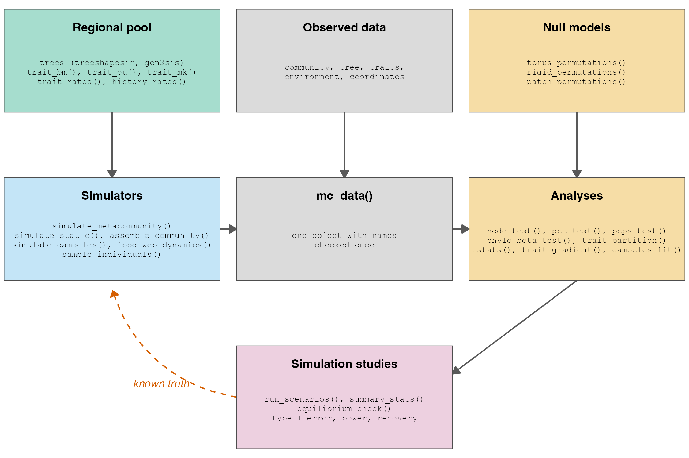
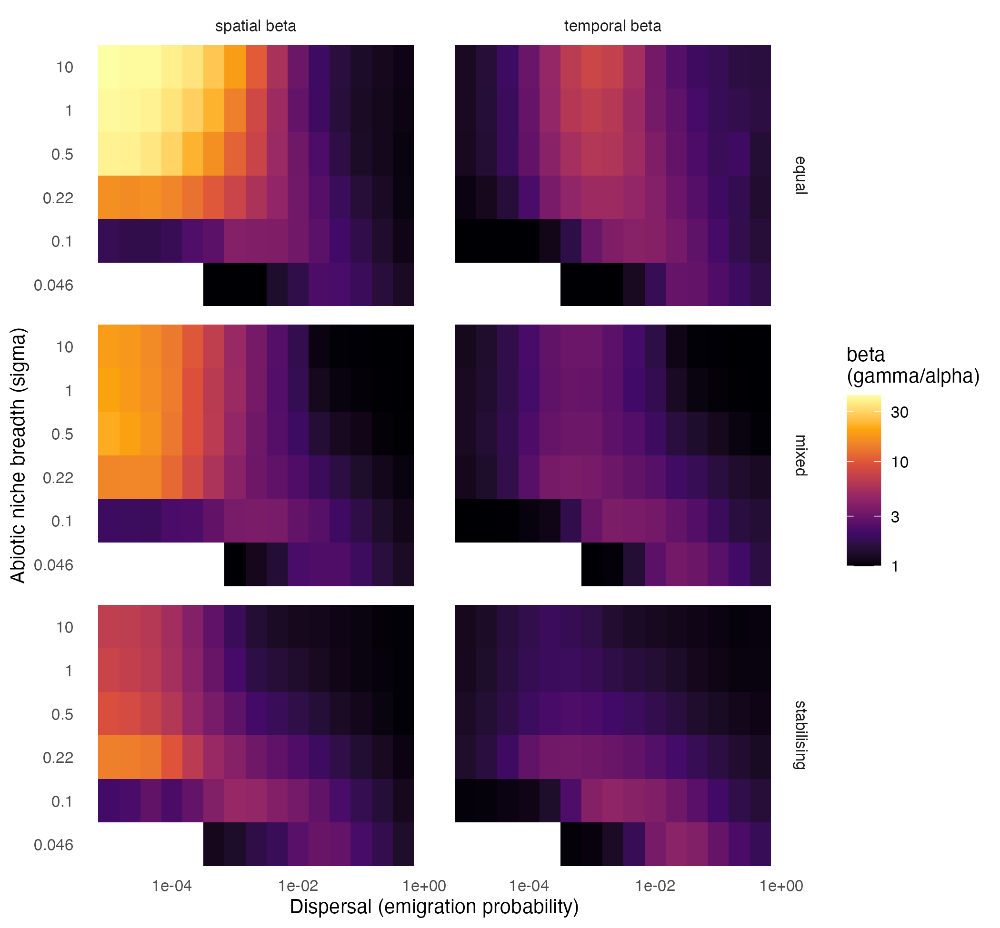
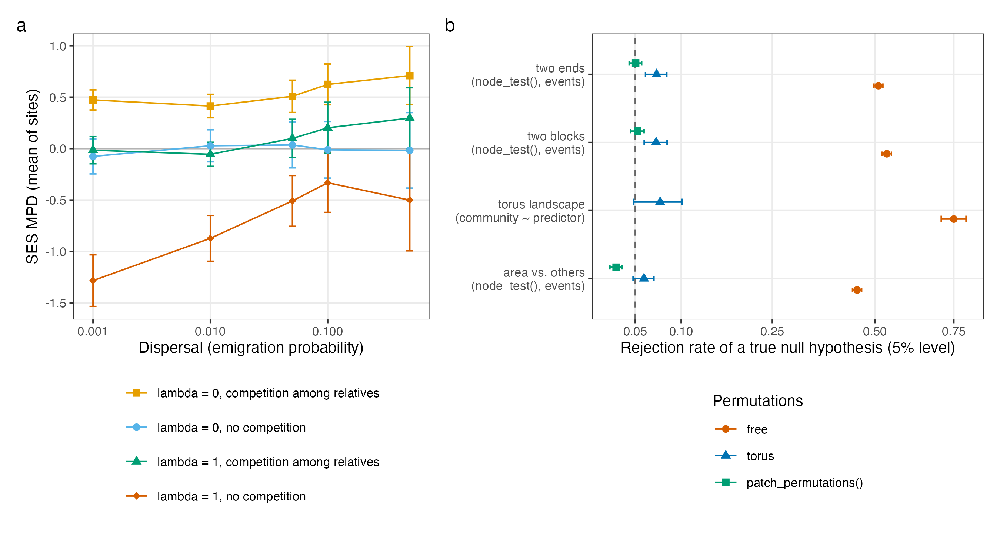

# Introduction

Ecological communities are connected by dispersal, and the composition of each local community emerges from the interplay between environmental filtering, biotic interactions, dispersal and stochastic drift operating across scales [@leibold2004metacommunity; @leibold2018metacommunity]. Metacommunity theory gave ecologists a common vocabulary for these processes, organised around the paradigms of species sorting, mass effects, patch dynamics and neutral dynamics, and more recently as a continuum of process-based scenarios [@Thompson_2020]. However, the species that interact in a metacommunity are not independent units: they share a history of descent, their niches and traits carry phylogenetic signal to varying degrees, and the regional pool from which local communities are assembled is itself the outcome of speciation, extinction and dispersal over evolutionary time [@Webb_2002; @cavenderbares2009merging; @mittelbach2015ecological]. As a result, a growing body of work has tried to integrate phylogenies, traits and biogeographic history into the analysis of metacommunities [@urban2008evolutionary; @Leibold_2010; @pillar2010framework; @Peres_Neto_2012].

This integration produced a rich set of methods. Some ask which clades respond to environmental gradients or to biogeographic events, as the node-based regression of @Leibold_2010; others decompose the phylogenetic variation of communities into environmental and spatial components [@Peres_Neto_2012], test whether phylogenetic composition follows the environment across the whole tree [@Peres_Neto_2015; @Duarte_2016], or model community assembly as a dynamic process of colonisation and local extinction along the branches of the tree [@Pigot_2015]. Concurrently, trait-based ecology moved from species means towards the variance within and among populations [@Violle_2012; @bolnick2011intraspecific; @siefert2015global], with methods that partition trait variation across organisational levels [@Ackerly_2007; @Leps_2011; @Taudiere_2015]. Nonetheless, inferring assembly processes from these patterns remains a challenge. The same phylogenetic pattern can arise from different processes, competition can produce both phylogenetic clustering and overdispersion depending on the balance between niche and fitness differences [@mayfield2010opposing; @hillerislambers2012rethinking], and environmental filtering is often inferred from pattern without evidence that abiotic conditions limit the species [@cadotte2017environmental; but see @gerhold2015phylogenetic].

A practical way to evaluate whether a method can recover a process is to apply it to data in which the process is known. Simulation studies are the standard tool for this in statistics [@morris2019simulation], and the virtual ecologist approach brought the same logic to ecology, by simulating both the ecological system and the observation process [@zurell2010virtual]. In community ecology, a review of the filtering framework concluded that it has rarely produced generalisable conclusions and recommended that methods be validated by simulation before they are applied [@munkemuller2020dos], and simulations of metacommunities showed that adding temporal patterns to spatial ones improves the inference of metacommunity processes [@guzman2022accounting]. Mechanistic eco-evolutionary models can also be used directly for inference, by comparing observed patterns with those simulated under alternative processes [@hartig2011statistical; @cabral2017mechanistic; @pontarp2019latitudinal; @overcast2021unified]. However, simulation-based evaluation requires a simulator in which the processes of interest (e.g., niche conservatism, competition among relatives, dispersal limitation) can be set independently, and an implementation of the method that reads the same data.

On the other hand, many of the methods above were never available as maintained software. The node-based regression of @Leibold_2010 and the phylogenetic gradient analysis of @Peres_Neto_2012 were published as MATLAB code in the supplementary material, which limits their use by ecologists who work in R [@lai2019evaluating]. This is not a minor obstacle, because scientists tend to adopt software that colleagues use rather than software they have evaluated [@joppa2013troubling], and the availability of an implementation in the language of the community strongly affects the uptake of a method [@wallace2017openmee; @tikhonov2020hmsc]. Additionally, code published with ecological papers is often unavailable or unchecked [@culina2020low; @mislan2016elevating], so errors in original implementations can propagate without notice. To the best of my knowledge, no R package brings together the simulators needed to generate metacommunities with phylogenetic and trait structure and the analytical methods that link phylogenies, traits and biogeography to community composition, in a way that every method can be tested on simulated data.

Here, I describe comdynamite, an R package that fills this gap. The package has two goals: (i) to make published methods that link traits, phylogenies and biogeography to metacommunities usable in R, implemented from the published equations and validated against the original code or reference packages; and (ii) to provide simulators in which the truth is known, so that each method can be evaluated for type I error, power and parameter recovery before it is applied to empirical data. In what follows, I describe the design of the package, give an overview of its functionality, summarise the validation of each implementation, including the errors it found in some original implementations, and illustrate two simulation studies that show why such evaluation matters.

# Design principles

The package follows four principles. First, simulation and analysis share a single data structure. The function `mc_data()` holds a community matrix, a phylogeny, traits, environmental variables, coordinates, areas and time series in one object, and checks once that species and sites match across them. Every analysis accepts an `mc_data` object as its first argument and fills from it whatever the call leaves out, and every simulation returns an object that can be converted into one with `as_mc_data()`, keeping the tree from which its traits were drawn. This means that a simulated metacommunity can be passed to an analysis without reformatting, which is the main requirement for evaluating methods by simulation (@fig-structure). The same object also keeps empirical data in a consistent form, and the article "Preparing your data" on the package website shows how to build it from usual field tables.

Second, every model and method was written from the published equations, not translated from code. When the original code was available, it was used only to compare numbers, either by running it (e.g., the MATLAB supplements of @Leibold_2010 and @Peres_Neto_2012 in GNU Octave) or by comparison with the reference R package. This choice keeps the package under the MIT license, since several reference packages are under GPL and some supplementary code carries no license, and it also makes each divergence between an article and its code visible. Where the article and the code disagree, the package follows the article by default, documents the difference in the help page, and offers the behaviour of the original code as an option when it is useful for comparison.

Third, dependencies are light. The package imports only ape [@paradis2019ape] and base R packages, and every other package is in Suggests, called only when a function needs it: ggplot2 for plots, vegan [@oksanen2026vegan] and adespatial for specific tests, future.apply for parallel permutations, and cmdstanr for the Bayesian trait-gradient model. As a result, the package installs quickly on any platform, and an analysis does not fail because of an unrelated dependency.

Fourth, results are reproducible and paired by design. Permutation tests run in parallel under a plan of the future package chosen by the user, and give the same results with `set.seed()` for any number of workers. The function `run_scenarios()` crosses factors of a simulation study, draws once per replicate what the scenarios share (for instance, a tree and a landscape), and assigns one seed to each cell of the design, so that scenarios are compared on the same regional pool. All validation scripts are kept in the `data-raw/` folder of the repository with their saved results, so that every number reported here and in the documentation can be reproduced.

```{r}
#| label: fig-structure
#| fig-cap: "Structure of comdynamite. Notice that simulated and observed data enter the analyses through the same object, `mc_data()`, so that every analysis can be applied to data in which the process is known. The regional pool (a tree with traits that evolved under a chosen model) feeds the simulators, restricted null models feed the analyses, and simulation studies compare the output of the analyses with the known truth (dashed arrow) to estimate type I error, power and parameter recovery. Function names are examples, not an exhaustive list."
#| out-width: 100%

```

# Overview of functionality

The package exports about 95 functions, organised by the question they answer (@tbl-functions). The website (<https://provetelab.org/comdynamite/>) maps each question to its functions and to an article that shows a complete analysis. Below, I describe the main groups.

: Main groups of functions in comdynamite and the question each group answers. {#tbl-functions}

| Group | Question | Main functions |
|---|---|---|
| Data | How do I keep community, tree, traits, environment and space together? | `mc_data()`, `as_mc_data()` |
| Metacommunity simulators | What composition do growth, competition, dispersal and drift produce? | `simulate_metacommunity()`, `simulate_static()`, `simulate_logistic()`, `assemble_community()` |
| Landscapes | On which landscape do species disperse? | `landscape_implicit()`, `landscape_grid()`, `dispersal_kernel()`, `env_over_time()` |
| Trait evolution | How did the traits of the regional pool evolve? | `species_traits()`, `trait_bm()`, `trait_ou()`, `rate_matrix()`, `trait_mk()`, `trait_rates()`, `history_rates()`, `turnover_rates()` |
| Coevolution | How do abundances and mean traits of a resource, consumer and predator change together? | `food_web_dynamics()`, `food_web_rates()` |
| Clades and biogeography | Which clades respond to the environment or to biogeographic events? | `node_contrasts()`, `biogeography_matrix()`, `node_test()` |
| The whole tree | Does phylogenetic composition follow the environment? | `pcc_test()`, `pcps_test()`, `phylo_beta_test()` |
| Environment and space | How much phylogenetic or trait variation is due to environment and space? | `phylo_vector()`, `trait_partition()` |
| Restricted null models | Which permutations are valid when sites are neighbours? | `torus_permutations()`, `rigid_permutations()`, `patch_permutations()` |
| Dynamic null model | Is community structure consistent with colonisation and extinction along the tree? | `simulate_damocles()`, `damocles_fit()`, `damocles_test()`, `damocles_partition_test()` |
| Intraspecific variation | How is trait variation distributed among individuals, populations and communities? | `sample_individuals()`, `tstats()`, `population_shifts()`, `trait_gradient()`, `trait_flex()`, `nested_variance()`, `community_index()` |
| Simulation studies | Does a method work, and when? | `run_scenarios()`, `summary_stats()`, `equilibrium_check()` |

## Simulating metacommunities

The core simulator, `simulate_metacommunity()`, implements the process-based framework of @Thompson_2020, in which local abundances change by density-independent growth that depends on the match between the environmental optimum of each species and the environment of the site, by density-dependent competition, by dispersal among sites and by demographic stochasticity. I extended this model in four ways. First, the optima, niche breadths and maximum growth rates of species can be drawn on a phylogeny with a chosen phylogenetic signal (`species_traits()`), or taken from elsewhere, for instance from models fitted with mvMORPH [@Clavel_2015]. Second, interspecific competition can be structured by relatedness (`competition_matrix(type = "phylo")`), so that niche conservatism and competition among relatives can be set independently. Third, landscapes can be spatially implicit or grids on a torus, with environments that change over time and a niche with several environmental axes. Fourth, each species can be restricted to the sites where it can occur (`pool`), such as its range or a biogeographic reconstruction, and the simulation can start from given abundances (`initial`), which allows a phylogeny produced by an eco-evolutionary engine such as gen3sis [@Hagen_2021] to be used as the regional pool. Immigrants follow a Poisson distribution, as in the code archived with @Thompson_2020, or are conserved by a multinomial distribution, as in the R implementation mcomsimr (<https://github.com/plthompson/mcomsimr>). The simulator is written in base R and runs 50 species on 100 sites for 2200 time steps in about 0.7 s on one core, which makes simulation studies with thousands of replicates feasible on a laptop.

Three generators without population dynamics complement the dynamic model. The function `simulate_static()` draws abundances from Gaussian responses to one or more gradients [@Dray_2008], as used in the simulations of @Peres_Neto_2012 and @Peres_Neto_2015, and `simulate_logistic()` draws presences from logistic responses following the scenarios of @Ives_2011 and @Peres_Neto_2012. The function `assemble_community()` implements rule-based assembly by limiting similarity, habitat filtering and neutral sampling, as in @Kraft_2007, with the limiting-similarity rule of @Colwell_1984 and distances in trait space measured by Euclidean, standardised or Mahalanobis distance, the latter being equivalent to filtering by a multivariate Gaussian niche.

## Simulating trait evolution and histories along the tree

Since the regional pool is an input, the package offers several models of trait evolution, each of which keeps the truth that estimation methods should recover. The function `trait_ou()` simulates one or several correlated traits under Brownian motion or Ornstein–Uhlenbeck processes with one or several optima [@Hansen_1997; @Butler_2004], with selective regimes painted on clades or given by a stochastic map, so that regimes, optima and evolutionary rate matrices change within branches. The rate matrices can take the structures fitted by mvMORPH [@Clavel_2015], built by `rate_matrix()`. The function `trait_mk()` simulates discrete characters under the Mk model [@Lewis_2001] with gamma-distributed rates among branches or hidden rate classes [@Beaulieu_2013; @Revell_2024], and keeps every change in the format of phytools [@revell2012phytools; @revell2024phytools]. The function `trait_rates()` simulates continuous traits whose rate varies among branches, by shifts drawn as a Poisson process along the branches, as in the prior of BAMM [@Rabosky_2014], by a log-rate that evolves by Brownian motion, or by independent lognormal rates, and returns the rate of each branch as the known truth for methods that estimate them [@Eastman_2011; @Revell_2021; @Martin_2022].

Rates can also be derived from ecological and biogeographic processes. The function `history_rates()` converts the history of a discrete character, such as the region of each lineage, into rates per branch, including the diversity-dependent model with biogeography of @Drury_2016, in which the rate depends on the number of lineages in the same region. The function `turnover_rates()` converts the turnover of co-occurring species in a simulated metacommunity into rates for the tip branches, linking assembly to the speed of trait evolution. Finally, `food_web_dynamics()` implements the joint dynamics of abundances and mean traits of a resource, a consumer and a predator described by @McPeek_2017 and @McPeek_2017book, with Holling type II feeding, optional omnivory and attack coefficients that depend on traits, integrated by a fourth-order Runge–Kutta method. Its rates of trait change can be used as rates per lineage through `food_web_rates()`. Together with `tip_history_metrics()`, `arrival_ages()` and `as_herodotools()`, which give the inputs and the true answers for the tip-based metrics and arrival ages of Herodotools [@Luza_2021; @Nakamura_2023], these functions allow biogeographic and macroevolutionary reconstructions to be evaluated against a known history.

## Analysing clades, the whole tree, and environment and space

The function `node_test()` implements the node-based approach of @Leibold_2010, in which the relative abundance of the two daughter clades of each node, coded by `node_contrasts()`, is regressed on environmental variables and biogeographic events, with permutations of sites and of species. The package adds the coding with branch lengths of the supplement of the original article, semi-partial correlations of each predictor, false discovery rate correction across nodes [@Benjamini_1995], and `biogeography_matrix()`, which builds the matrix of events from the area of each site, either as pairs of areas defined a priori, as in @Leibold_2010 and @leibold2018metacommunity, or as each area against the others. Results can be drawn on the tree, as in Figure 3 of @Leibold_2010, or as a heatmap of nodes by predictors.

Three functions ask whether phylogenetic composition follows the environment across the whole tree. The function `pcc_test()` implements the phylogenetic community composition approach of @Peres_Neto_2015, and `phylo_beta_test()` its phylogenetic beta-diversity framework, a distance-based redundancy analysis [@Legendre_1999] of the mean phylogenetic distance between communities. The function `pcps_test()` implements the principal coordinates of phylogenetic structure of @Duarte_2016, based on the phylogenetic fuzzy weighting of @pillar2010framework, with tests of the whole dissimilarity and of each axis. Complementarily, `phylo_vector()` and `trait_partition()` implement the phylogenetic gradient analysis of @Peres_Neto_2012, which selects phylogenetic eigenvectors related to the environment and partitions the variation of traits or phylogenetic composition into environmental, spatial and shared fractions [@Peres_Neto_2006; @Desdevises_2003], with semi-partial correlations of each predictor and a test of the shared fraction by Moran spectral randomisation [@wagner2015generating; @Bauman_2018].

## Restricted null models for sites that are neighbours

Permutation tests assume that sites are exchangeable, which is violated when both the community and the predictor are spatially autocorrelated [@legendre1993spatial; @lennon2000redshifts; @dormann2007methods; @crabot2019testing]. All permutation-based analyses in the package accept a matrix of restricted permutations (`site_permutations`), and three functions generate them. The function `torus_permutations()` shifts, rotates and reflects a grid on a torus, keeping the distances among sites. The function `rigid_permutations()` moves the whole biogeographic event by rotations, reflections and translations within a landscape with edges, keeping the shape of each area and the distance between them. The function `patch_permutations()` moves the patches of each area and keeps their number and size, for landscapes with edges and irregular areas. To the best of my knowledge, no published method covers exact permutations of binary areas in landscapes with edges and irregular shape, so the last two functions are new and were evaluated only by simulation (see below). In `trait_partition()`, each set of predictors moves alone in the tests of its fractions, with the response and the other set kept in place, which avoids comparing space with an environment that no longer explains anything [@Anderson_1999; @Freedman_1983].

## Dynamic null model of community assembly

The functions `simulate_damocles()`, `damocles_loglik()`, `damocles_fit()` and `damocles_test()` implement DAMOCLES [@Pigot_2015], a dynamic null model in which each lineage colonises the local community at rate $\gamma$ and goes locally extinct at rate $\mu$ along the tree. The likelihood follows the pruning algorithm of the original article and is computed exactly in base R. The package extends the model in three directions: (i) rates can differ among regimes of the edges, such as clades defined a priori or rate shifts estimated by methods of diversification such as BAMM or ClaDS, or change with an edge covariate such as the tip diversification rate DR [@Jetz_2012]; (ii) a probability of sympatry at speciation relaxes the strictly allopatric rule of the original model; and (iii) one pair of rates can be estimated from several communities on the same tree. Nested fits are compared by likelihood-ratio tests, intervals are obtained by profile likelihood, and `damocles_partition_test()` asks whether a partition of the tree into regimes is better placed than random partitions of the same complexity, rather than only whether rates vary.

## Intraspecific trait variation

A last group of functions deals with trait variation among individuals. The function `sample_individuals()` draws individuals from the populations of a simulated metacommunity, with trait values composed of the optimum of the species, local adaptation to the environment of the site, deviations of populations that do not track the environment, character displacement away from co-occurring competitors, and variation among individuals, with sampling schemes that mimic field protocols [@Pakeman_2007]. Since the simulator records the colonisation history of every population (the step of its founding, the number of founders and the immigrants received since then), populations can also deviate according to their arrival, by founder effects that are eroded by gene flow or by the monopolization of a site by early colonists that adapt to it before others arrive [@Urban_2009; @De_Meester_2016]. On the analytical side, `tstats()` computes the T-statistics of @Violle_2012 with the three null models of @Taudiere_2015, and adds a null model that exchanges population means among populations of each species. The function `population_shifts()` estimates local adaptation and character displacement together from population means, by a regression within species on the environment of the site and on the push predicted from co-occurring competitors. The function `trait_gradient()` implements the trait-gradient analysis of @Ackerly_2007, with site means that leave out the focal species by default, which removes a circularity of the original method, null models that exchange species means among species, including phylogenetic permutations [@Lapointe_2001], phylogenetic models of its components [@Hansen_1997], and a bivariate phylogenetic mixed model fitted in Stan (`trait_gradient_bayes()`), in which the phylogenetic share $\lambda$ of each component has its own prior. Finally, `trait_flex()` splits community-weighted means into species turnover, intraspecific variability and their covariation [@Leps_2011], `nested_variance()` gives variance components across nested or crossed levels [@Messier_2010], `community_index()` compares any trait index with four null models, and `trait_densities()` computes trait probability densities of populations and communities [@Carmona_2016; @Carmona_2019].

## Simulation studies

The functions `run_scenarios()`, `summary_stats()` and `equilibrium_check()` reduce the code that a simulation study requires. The function `summary_stats()` computes the same statistics for simulated and observed data, namely diversity at several scales, occupancy, abundance distributions, standardised effect sizes of the mean pairwise and mean nearest taxon distances [@Webb_2002; @Kembel_2010], distance decay, the relation between traits and environment, phylogenetic signal [@Blomberg_2003] and, when several time steps are recorded, temporal variation [@guzman2022accounting]. These statistics are meant for evaluating methods and for simulation-based inference such as approximate Bayesian computation [@hartig2011statistical]. Fast implementations of several metacommunity metrics for large spatiotemporal datasets, including the partition of beta diversity, occupancy and temporal variability, are available in Julia in MetaCommunityMetrics.jl [@cheung2026metacommunitymetrics], which can be applied to the output of comdynamite. The function `equilibrium_check()` warns when a simulation is still changing at the end of its record, which happened in the simulations described below with competition among relatives and high dispersal. Since tree shape can affect the performance of phylogenetic methods, the companion package treeshapesim (<https://github.com/diogoprov/treeshapesim>) simulates trees in which imbalance and the distribution of branching times are controlled separately, so that tree shape can be a factor in the design of a simulation study.

# Validation

Each model and method was validated in two complementary ways: against the original code or a reference package on the same inputs, to check the implementation, and against published results or analytical expectations, to check the behaviour (@tbl-validation). Unit tests (about 400 blocks in 44 files) run on macOS, Windows and Linux at every change, and line coverage is tracked with Codecov.

The translations of the MATLAB methods agreed with the original code to numerical precision. The coefficients of determination and F statistics of `node_test()` matched those of the supplement of @Leibold_2010 run in GNU Octave 11.3 with differences below $10^{-15}$, and the 13 contrasts of its example matched those of the original function. Similarly, `phylo_vector()` and `trait_partition()` reproduced the original code and Tables 1–4 of @Peres_Neto_2012. Likewise, the statistics of `pcps_test()` matched those of the PCPS package [@Debastiani_2014] to $8 \times 10^{-15}$ in 20 communities, the pseudo-F of `phylo_beta_test()` matched `vegan::adonis2()`, and the log-likelihoods of the DAMOCLES implementation matched those of the DAMOCLES package to $3 \times 10^{-14}$ in 180 comparisons, with maximum likelihoods equal to or higher than those of the reference package in all of ten communities. The type I error rates of `pcc_test()` and `phylo_beta_test()` reproduced those of Table 1 of @Peres_Neto_2015 (e.g., 0.049 and 0.040 for the species test of `pcc_test()`, against 0.054 and 0.052 in the original article), whereas power was somewhat lower than published (0.87 and 0.85, against 0.945 and 0.947), which I attribute to the use of different trees, since the original trees were not available.

The simulators were validated against independent implementations and published figures. Against mcomsimr, in 16 scenarios of dispersal, competition and landscape with 200 replicates each, none of 80 comparisons of the distributions of diversity and abundance was significant (Kolmogorov–Smirnov tests, false discovery rate of 5%), and mean differences were below 1%. The patterns of @Thompson_2020 were reproduced with 100 patches, 50 species and 30 landscapes per combination of 15 dispersal rates, six niche breadths and four competition scenarios (@fig-thompson shows three of them; the competition–colonisation scenario is in the validation article of the package website). In doing so, I found that the code archived with the article [@Thompson_2020code] differs from the text in points that change the results: beta diversity is computed as gamma divided by alpha rather than as the difference given in Table 1 of the article, the environment is converted into ranks, the lowest dispersal rate is $10^{-5}$ rather than $10^{-4}$, and the competition–colonisation scenario halves the number of immigrants. Following the code, five of the six hypotheses of the article appeared clearly, whereas the effect of niche breadth on spatial beta diversity (their hypothesis H4) seemed to depend on the competition scenario, as their Figure 4 also shows. The diversity-dependent model of trait evolution with biogeography gave tip covariance matrices equal to those of RPANDA [@morlon2016rpanda] to $3 \times 10^{-15}$ in 30 stochastic maps, the multivariate models matched the expected covariances of mvMORPH within three Monte Carlo standard errors over 20,000 simulations, and the food web reproduced the trajectories of Figure 3.2 of @McPeek_2017book within $10^{-4}$ of the integration of the author's code. Interestingly, one panel of Figure 3.11 could not be reproduced from the parameters given in its caption, at which the consumer cannot persist.

: Summary of the validation of the main implementations in comdynamite. Scripts and saved results are in the `data-raw/` folder of the repository. {#tbl-validation}

| Implementation | Reference | Comparison | Agreement |
|:------------------------------|:--------------------|:------------------|:------------------|
| `node_test()`, `node_contrasts()` | MATLAB supplement of @Leibold_2010 (Octave 11.3) | $R^2$, adjusted $R^2$ and F; contrasts | differences < $10^{-15}$; 13 of 13 contrasts equal |
| `phylo_vector()`, `trait_partition()` | MATLAB code and Tables 1–4 of @Peres_Neto_2012 | statistics and fractions | equal to the original code |
| `pcc_test()`, `phylo_beta_test()` | Table 1 of @Peres_Neto_2015; vegan | type I error, power; pseudo-F | type I error within the published range; F equal |
| `pcps_test()` | PCPS 1.0.9 [@Debastiani_2014] | statistics in 20 communities | differences < $10^{-14}$ |
| `damocles_loglik()`, `damocles_fit()` | DAMOCLES 2.3 [@Pigot_2015] | log-likelihoods, maximum likelihood, simulations | differences < $10^{-13}$ in 180 comparisons |
| `simulate_metacommunity()` | mcomsimr; code of @Thompson_2020 | 80 distributions in 16 scenarios; Figures 3–4 of the article | no significant difference; patterns reproduced |
| `history_rates(type = "sympatry")` | RPANDA [@morlon2016rpanda; @Drury_2016] | tip covariance matrices, 30 maps | differences < $10^{-14}$ |
| `trait_ou()`, `rate_matrix()` | mvMORPH 1.2.3 [@Clavel_2015] | covariance of tips, 20,000 simulations | within 3.1 Monte Carlo standard errors |
| `food_web_dynamics()` | @McPeek_2017book and code of @McPeek_2017 | trajectories of Figure 3.2 | within $10^{-4}$ |
| `tstats()` | cati 0.99.6 [@Taudiere_2015] | observed T-statistics | equal; errors in null models found (see text) |
| `tip_history_metrics()` | Herodotools 2.0.1 [@Nakamura_2023] | tip-based metrics, 30 histories | equal in 30 of 30 |

```{r}
#| label: fig-thompson
#| fig-cap: "Spatial and temporal beta diversity (gamma divided by alpha, median of 30 landscapes) simulated with `simulate_metacommunity()` along dispersal and abiotic niche breadth, for the equal, mixed and stabilising competition scenarios of Thompson et al. (2020), following the layout of their Figure 4. Notice that spatial beta diversity is highest at low dispersal and decreases as mass effects homogenise communities, and that it increases with niche breadth under equal competition at low dispersal, by drift, but peaks at intermediate niche breadth under stabilising competition. Cells where species persisted in fewer than 10 of the 30 landscapes are left blank, as in the original figure."
#| out-width: 85%

```

Validation also found errors in original implementations, which change results that users may have published. In the MATLAB code of @Leibold_2010, the statistic used to rank the random draws of sites depended on the scale of the response, and did not take into account that draws occupy different numbers of sites; the package uses F statistics instead, and keeps the coefficient of determination of the original code alongside a weighted version bounded between 0 and 1. In the code of @Peres_Neto_2012, the tests of the environmental and spatial fractions used the fraction itself as statistic, which lost power when the other set of predictors explained much of the variation: in 500 simulated data sets in which space had a strong effect and the environment a weak one, the original test rejected the environmental fraction in 15% of them, whereas the share of the component left unexplained by the other set, which is monotone in the partial F, rejected it in all of them, with type I error between 5.6% and 5.8%. In cati 0.99.6 [@Taudiere_2015], the null model of one of the T-statistics combined permutations of different sites, and the matching of site names by regular expressions pooled sites such as `site1` and `site10`; an audit of other functions of the same package, which the package replaces with functions written from the published definitions, found further errors that change results. All of these were reported to the maintainers (issues 11 to 21 of the cati repository on GitHub). Finally, contrary to what @Peres_Neto_2015 state, the matrix of mean phylogenetic distances between communities is not always Euclidean, although the pseudo-F of the distance-based redundancy analysis does not require it [@McArdle2001]. In all cases, the help page of the function describes the difference, and the original behaviour remains available as an option when that is useful for comparison.

# Illustration: two questions answered by simulation

To illustrate how the package can be used to evaluate methods, I present two simulation studies whose scripts are included in the package as vignettes. Both use only functions of comdynamite and were run with saved seeds, so that they can be reproduced exactly.

The first study asks under which conditions the phylogenetic structure of local communities reflects environmental filtering. I crossed dispersal (five emigration probabilities between 0.001 and 0.5), niche conservatism (optima without phylogenetic signal, $\lambda = 0$, or evolving by Brownian motion, $\lambda = 1$) and competition (none, or stronger between close relatives), in 30 replicates in which a tree of 30 species from treeshapesim and a landscape of 25 sites were drawn once and shared across scenarios. For each simulation, I computed the standardised effect size of the mean pairwise distance (SES MPD) of each site with picante [@Kembel_2010], using the whole tree as the regional pool. Communities were phylogenetically clustered only when niches were conserved, competition was absent and dispersal was low (mean SES MPD of $-1.28$ at an emigration probability of 0.001; Fig. -@fig-simulations, panel a). This clustering weakened as dispersal increased ($-0.33$ to $-0.50$ at the two highest rates), since immigrants maintained species in sites that did not suit them. Without phylogenetic signal, SES MPD remained close to zero at all dispersal rates, even though species were strongly sorted by the environment at low dispersal. Surprisingly, adding competition among relatives to conserved niches moved SES MPD from $-1.28$ to $-0.02$ at the lowest dispersal rate, that is, to the random expectation, although both processes were acting strongly. This means that a value of SES MPD near zero does not imply random assembly, a result that is consistent with the argument that phylogenetic patterns alone cannot identify the processes that produced them [@mayfield2010opposing; @cadotte2017environmental]. With random niches, competition among relatives produced overdispersion at all dispersal rates (0.41 to 0.71).

The second study asks whether permutation tests keep their nominal type I error in spatially structured landscapes. I evaluated two tests: the regression of clades on biogeographic events of `node_test()`, with events that had no effect on communities that followed a hidden, spatially autocorrelated environment, and a test of the association between community composition and a predictor that was autocorrelated but unrelated to the community, on a torus. Free permutations of sites rejected the true null hypothesis in 45% to 53% of the node tests at the 5% level, and in 75% of the tests of composition (Fig. -@fig-simulations, panel b). In contrast, `patch_permutations()` rejected it in 3.4% to 5.2% of the node tests, and the torus in 5.8% to 7.5% of all tests, slightly above the nominal level, which seems to reflect that the landscapes of the node tests had edges that the torus does not have. Similar inflation was found for `pcps_test()`, in which free permutations rejected between 29% and 80% of tests on a $10 \times 10$ grid with autocorrelated fields unrelated to each other, against 4% to 7% for the torus when the fields wrapped around the grid. Taken together, these results show that the choice of the null model can matter more than the choice of the statistic, and that restricted permutations should be the default whenever sites are neighbours [@legendre1993spatial; @crabot2019testing].

```{r}
#| label: fig-simulations
#| fig-cap: "Two questions answered by simulation with comdynamite. (a) Mean standardised effect size of the mean pairwise distance (SES MPD) of local communities along dispersal, for optima without ($\\lambda = 0$) or with ($\\lambda = 1$) phylogenetic signal, with or without competition among relatives (30 replicates; bars are two standard errors). Notice that clustering (negative values) appears only with conserved niches, no competition and low dispersal, and that competition among relatives brings conserved niches back to the random expectation. (b) Rejection rate of a true null hypothesis at the 5% level for free and restricted permutations, in the node test of biogeographic events of `node_test()` for three layouts of areas on a square landscape with edges, and in a test of community composition against an unrelated autocorrelated predictor on a torus (bars are two standard errors; the horizontal axis is on a square-root scale). The dashed line marks the nominal level."
#| out-width: 100%

```

# Discussion

comdynamite brings together, in a single R package, simulators of metacommunities with phylogenetic and trait structure and the analytical methods that link phylogenies, traits and biogeography to community composition. Its main contribution is not any single method, but the fact that every method reads the same data as the simulators, so that its type I error, power and ability to recover parameters can be evaluated on data in which the process is known before it is applied to an empirical metacommunity. This follows the recommendation that methods for inferring assembly processes should be validated by simulation [@munkemuller2020dos; @zurell2010virtual], and makes such validation a matter of a few lines of code. Additionally, the package makes methods that were available only as MATLAB supplements, such as those of @Leibold_2010 and @Peres_Neto_2012, usable by the large community of ecologists who work in R, a step that seems to be necessary for a method to be adopted at all [@wallace2017openmee; @tikhonov2020hmsc].

The validation of the package also showed that reimplementing a method from its equations is a form of review. By writing each method from the published text and comparing it with the original code, I found differences between articles and their code, and errors in some original implementations, that change the results of the tests. None of these was visible from the article alone, and some of them affect a popular package [@Taudiere_2015]. This is consistent with the concern that code in ecology is rarely treated as a scientific product in its own right [@mislan2016elevating; @culina2020low], and suggests that independent reimplementation, together with validation scripts that are kept with the code, should be part of how methods are published. In comdynamite, every divergence is recorded in the help page of the function and in the news file of the package, so that users can decide which behaviour they need.

The two illustrations make a point that goes beyond the package. First, phylogenetic structure did not identify the processes that produced it, since competition among relatives and environmental filtering on conserved niches cancelled each other out in the phylogenetic signature of local communities. Second, free permutations in spatially structured landscapes rejected true null hypotheses nine to 15 times more often than the nominal level, which means that a large fraction of significant relationships between communities and spatially structured predictors could be artefacts of the null model. These results agree with earlier warnings [@legendre1993spatial; @lennon2000redshifts; @mayfield2010opposing], but they also show how easily such problems can be quantified for a particular design with the package, which is the practical use I envisage for it. Indeed, pilot analyses with approximate Bayesian computation in the development of the package showed that the dispersal rate, the strength of competition and niche breadth could be recovered from community-level summary statistics, whereas the phylogenetic signal of the niche could not (coefficients of determination of 0.88 to 0.99 against at most 0.07, with 50,000 simulations); similarly, the T-statistics recovered local adaptation but hardly character displacement, which only a model of population means could recover. These pilots are documented in the repository, and they illustrate that the statistics used to compare simulated and observed data deserve the same scrutiny as the methods themselves.

The same logic applies to tests of macroevolutionary hypotheses that use community or metapopulation data. For instance, @Januario_2025 found no relationship between the metapopulation persistence of 189 demersal fishes and their tip speciation rates in phylogenetic generalised least squares (PGLS) models, and interpreted this as a decoupling of metapopulation dynamics from speciation. To ask whether such a test can detect a causal link when one exists, I simulated fully sampled trees of 200 species in which the speciation rate of each lineage increased with a latent trait that evolved by Brownian motion, used the same trait to set the dispersal of each species in `simulate_metacommunity()`, estimated persistence (equilibrium occupancy and a rate of recovery, $\tau$) from the simulated occupancy with a two-state Markov model, and regressed the tip diversification rate DR [@Jetz_2012] on persistence (200 replicates per scenario). Persistence was well estimated, and the same model fitted to the true speciation rates detected the link in 99% to 100% of the replicates. However, the PGLS of DR rejected the null hypothesis at about its nominal rate (6% to 10%) whatever the strength of the link, even when DR was correlated with the true rate (Spearman correlation of about 0.6). In contrast, a test of the correlation between DR and the trait with a null distribution simulated by Brownian motion on the tree (ES-sim; @Harvey_2018), which I implemented from its published description, detected the link through $\tau$ in 59%, 89% and 98% of the replicates as the link strengthened, while rejecting at most 2% of them without a link and in a negative control in which the trait affected local extinction instead of dispersal. Since $\tau$ was chosen after inspecting the estimates, I also tested both measures of persistence with a Bonferroni correction, which detected the link in 41%, 78% and 92% of the replicates. A possible explanation for the failure of the PGLS, which I did not test separately, is that DR averages rates along the path to the root, so that sister species have nearly identical values and the signal lies among clades, where the phylogenetic contrasts of the model carry little weight. Therefore, with fully sampled clades, a PGLS of DR on persistence seems to have no power to detect a link between persistence and speciation. This result does not show that the test of @Januario_2025 lacked power, because they estimated rates on a tree of thousands of species and analysed a sparse sample of 189 of them with model selection, which I did not simulate; in addition, the link between the trait and speciation was imposed in my simulations rather than emerging from metacommunity dynamics, and I did not test the rates estimated by BAMM that they also used. Nonetheless, it shows how the package can be used to measure the power of a design before a negative result is interpreted.

The package has limitations that users should know. One important limitation is that the phylogeny is an input of the simulations, not an outcome: the simulators run in ecological time on a fixed tree, without speciation, which is what simulation studies of methods need, since tree shape and phylogenetic signal can be set independently and replicates can be paired by tree, but it means that the joint dynamics of speciation and assembly are outside its scope. For those, engines such as gen3sis [@Hagen_2021] or MESS [@overcast2021unified] are better suited, and their output can enter comdynamite as a regional pool. Additionally, the mapping between ecological time and branch time, required when rates of trait evolution are derived from metacommunity dynamics, is set by the user through a time window and informs only the tip branches. The restricted null models also have limits: `rigid_permutations()` remains liberal for blocks placed at random off a regular lattice (6.8% to 8.0% at the 5% level), events that span the whole landscape have few or no valid placements, and I could not find a valid null model for areas far apart without knowing the range of spatial autocorrelation. Some parameters are poorly identified from a single community, such as the rates of DAMOCLES in a community of 60 species, which is why the package allows rates to be shared across communities. Finally, comparisons with the figures of @Thompson_2020 were visual, since the published values are not tabulated, and the package is young and developed by a single author, so its interface may still change before version 1.0.0; renamed functions and arguments continue to work, with a warning, until then.

Future development will add a module for speciation, and further tools for simulation-based inference that combine population-level and community-level statistics. In summary, comdynamite provides a common ground in which methods that link traits, phylogenies and biogeography to metacommunities can be used, compared and, above all, tested. I hope that it encourages ecologists to ask, before interpreting a pattern, whether their method could have detected the process they are interested in, given their sites, their tree and their sampling.

# Software availability

comdynamite is written in R [@rcoreteam2026r] and is distributed under the MIT license. The source code is at <https://github.com/diogoprov/comdynamite>, binaries for Linux, macOS and Windows are built by r-universe and installed with `install.packages("comdynamite", repos = c("https://diogoprov.r-universe.dev", "https://cloud.r-project.org"))`, and documentation, articles and the function reference are at <https://provetelab.org/comdynamite/>. Each release is archived on Zenodo, and the concept DOI <https://doi.org/10.5281/zenodo.23993533> points to the latest version [@Provete_2026]; this article describes version 0.7.0 (release <https://github.com/diogoprov/comdynamite/releases/tag/v0.7.0>), archived under the DOI <https://doi.org/10.5281/zenodo.24097553> [@Provete_2026v070]. The scripts that produced every validation result and the figures of this article are in the `data-raw/` and `paper/` folders of the repository.

# Funding

This study was supported by the Fundação de Apoio ao Desenvolvimento do Ensino, Ciência e Tecnologia do Estado de Mato Grosso do Sul (FUNDECT; grant 83/027.032/2024) and financed in part by the Coordenação de Aperfeiçoamento de Pessoal de Nível Superior – Brasil (CAPES) – Finance Code 001.

# Use of generative AI

I report the use of generative AI following the AIdIT framework [@drobniak2026aidit]. I used the following AI engine in the present study: Claude Opus (Anthropic), via Claude Code (v. claude-opus-5-5; timestamps: 2026-11-05 to 2026-11-10). Area(s) of generative AI usage: Claude Opus (Anthropic), via Claude Code: new code generation, code generation for visuals, data analysis, identification of literature to cite, text generation based on prompts, bibliography management, text editing for style/grammar/spelling. I declare that I have verified and approved all content generated or modified by the AI tools used. The use of AI in this paper was in compliance with the ethical regulations of all funders and host institutions. Representative prompts used in AI content generation are available upon request. The AI engine wrote the R code of the package, its tests, documentation and validation scripts under my direction, following the models and methods I chose and the decisions I made on how divergences between articles and their code should be resolved; every function was checked against published results, the original code or a reference package, as described in the Validation section, and the commits made with the AI engine are identified as such in the history of the repository. The AI engine also drafted the manuscript text from the documentation and the saved validation results of the package, wrote the script that draws every figure from those results, and searched for references, each of which was checked against Crossref metadata before inclusion.

# Conflict of interest

The author declares no conflict of interest.

# References {.unnumbered}

::: {#refs}
:::
