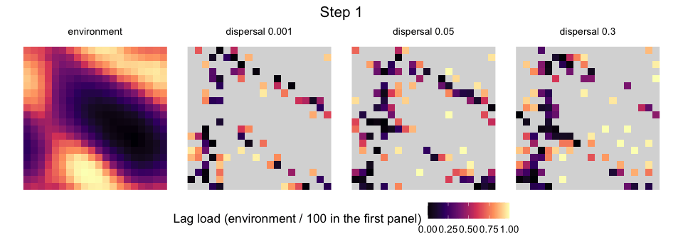
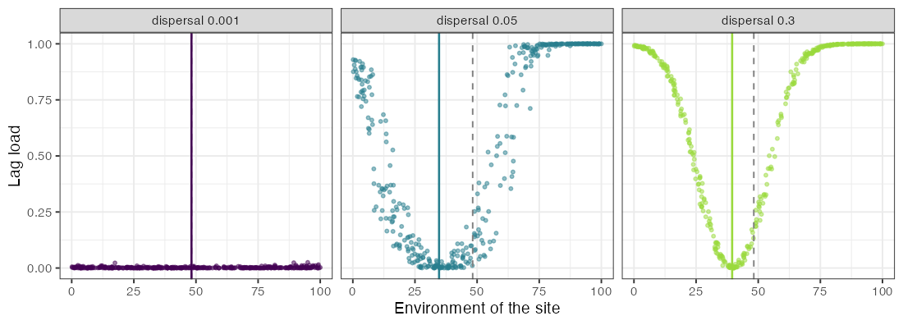
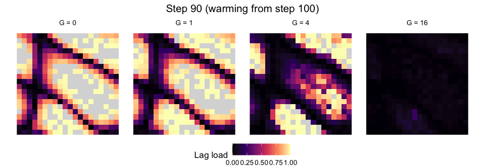
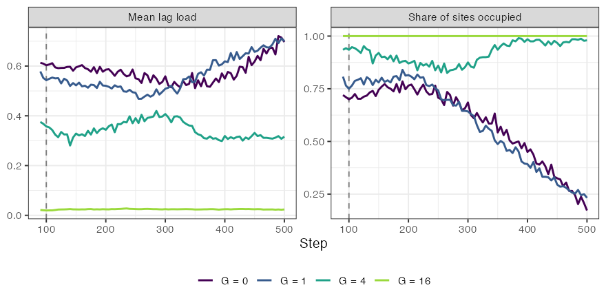
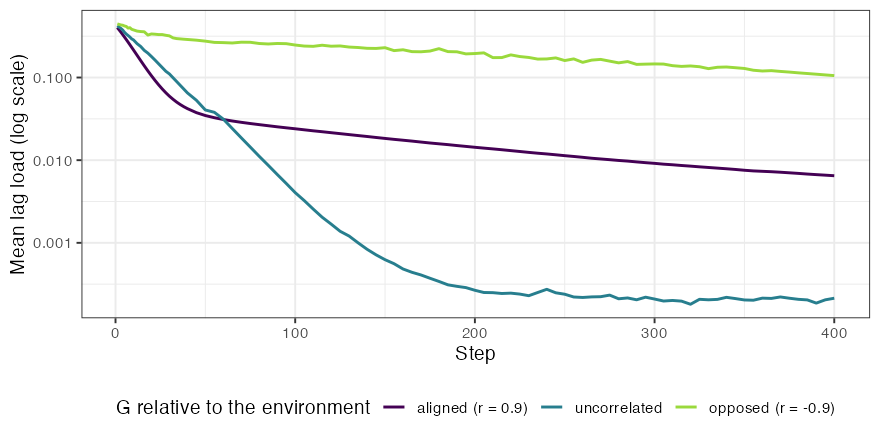
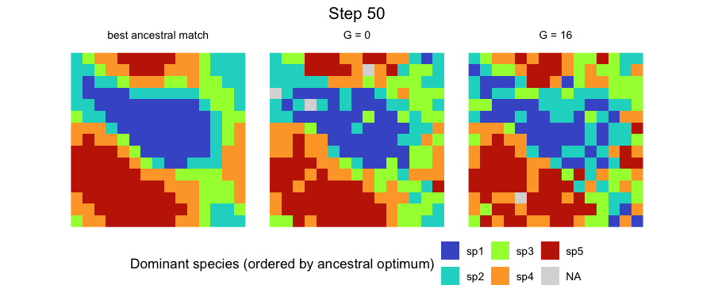
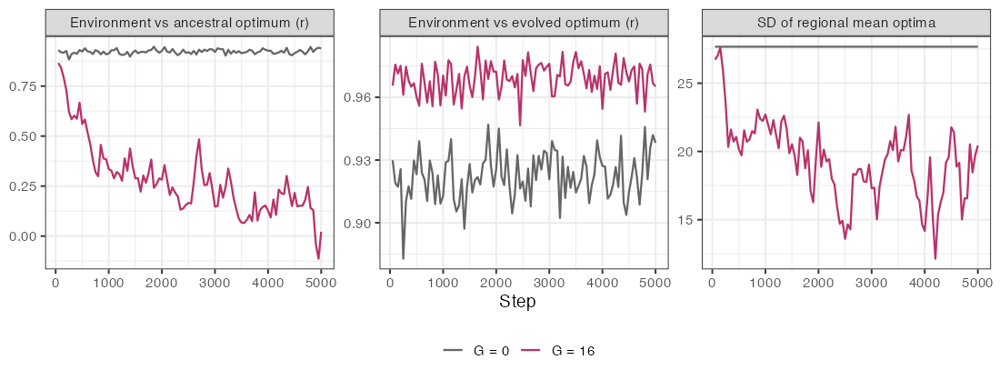

In the basic model of `simulate_metacommunity()`, every population of a species has the
niche optimum of its species, fixed for the whole simulation. With `evolution`, each
population instead carries its own genetic mean of the optimum. That mean responds to
selection by the environment of its site, drifts at a rate set by population size, mixes
with the means of immigrants, and is drawn anew when a population is founded by a few
individuals. Species sorting, mass effects and priority effects then act on populations
that can adapt, and the outcome can differ sharply from that of fixed niches.

This article shows what the extended model does, with animations of single runs. Each
panel is one run on one landscape, so the figures illustrate the mechanisms rather than
estimate their size; comparisons that matter need replicates, as in
`vignette("phylogenetic-structure")`. The complete script, which uses ggplot2, gganimate
and gifski, is
[`data-raw/animation_quantgen.R`](https://github.com/diogoprov/comdynamite/blob/main/data-raw/animation_quantgen.R),
and it takes about a minute.

## The model in brief

`evolution_control()` sets the quantitative genetics. Each population has a genetic mean
\(\bar z\) of its optimum and an additive genetic variance \(G\); its phenotype adds a linear
reaction norm, \(\bar p = \bar z + b\,(E - E_0)\), and individuals vary around \(\bar p\) with
phenotypic variance \(P = G + V_E\). Under the Gaussian niche of breadth \(\sigma\), the
response to selection in a generation follows Lande (1976),

\[
\Delta \bar z = \frac{G}{\sigma^2 + P}\,(E - \bar p) + \epsilon, \qquad
\epsilon \sim N\!\left(0, \frac{G}{N_e}\right),
\]

where \(N_e\) is the effective size, a fraction `ne_ratio` of the census size. Immigrants
bring the means of their sources, weighted by their numbers, and \(k\) founders draw their
mean around that of their sources with variance \((G + V_B)/k\), where \(V_B\) is the
variance among the sources; seeds and initial populations are founded the same way. With \(G = 0\), \(V_E = 0\) and
\(b = 0\) the abundances are those of the model without evolution for the same seed.

With a niche of several environmental axes, one trait evolves per axis and \(G\) and
\(E\) become covariance matrices. The response is the multivariate equation of Lande
(1979), \(\Delta \bar{\mathbf z} = \mathbf G (\boldsymbol\Omega + \mathbf P)^{-1} \mathbf d\),
in which \(\boldsymbol\Omega\) holds the squared niche breadths and \(\mathbf d\) the
difference between the environment and the phenotype on each axis. A trait can therefore
change although it is not selected at all, through its genetic covariance with traits that
are; an axis with `sigma = Inf` carries such a trait. `genetic_matrices()` builds \(G\) and
\(E\) for each species in three families, with \(G\) proportional to a common phenotypic
matrix, with no common structure, or sharing its principal components.

```{r, eval = FALSE}
library(comdynamite)
ev <- evolution_control(genetic_var = 4, env_var = 2, ne_ratio = 1)

# several traits: one covariance matrix per species
m <- genetic_matrices(c("sp1", "sp2"), n_traits = 2, family = "shared",
                      correlation = 0.6, heritability = 0.4)
ev2 <- evolution_control(genetic_var = m$genetic_var, env_var = m$env_var)
```

## Measuring maladaptation

`maladaptation()` returns, for every population present, the deviation of its mean
phenotype from the environment of its site and the share of growth lost to that deviation,
the lag load

\[
L = 1 - \exp\!\left(-\frac{(E - \bar p)^2}{2(\sigma^2 + P)}\right),
\]

which is 0 when the mean phenotype matches the site and approaches 1 as it moves away. With
several traits, the squared distance becomes the Mahalanobis distance
\(\mathbf d^\top(\boldsymbol\Omega + \mathbf P)^{-1}\mathbf d\), so that a deviation along a
direction of large phenotypic variance costs less than the same deviation along a direction
of small variance. The load does not depend on `r_max`, and it leaves out the cost of the
variance itself.

```{r, eval = FALSE}
sim <- simulate_metacommunity(land, traits, alpha, dispersal = 0.05, n_steps = 300,
                              record_steps = seq(10, 300, 10), evolution = ev)
m <- maladaptation(sim, step = seq(10, 300, 10))
head(m)
```

## Local adaptation and migration load

We start with one species on a 20 x 20 grid whose environment runs from 0 to 100, with a
niche breadth of 12 and the ancestral optimum at the regional mean. Populations colonise
the grid and adapt to their sites, and the three panels differ only in the emigration
probability. The first panel shows the environment.



With an emigration probability of 0.001, nearly every population adapts to its site, and
the mean load at step 300 is 0.002. With more dispersal, gene flow keeps populations away
from their local optima, and the mean load rises to 0.51 with dispersal 0.05 and to 0.66
with 0.3, against 0.67 and 0.72 for a species that does not evolve (\(G = 0\)) at the same
dispersal. The load is not symmetric around the regional mean environment (48), however.
The abundance-weighted mean phenotype of the species settled at 35 with dispersal 0.05 and
at 40 with 0.3, and the sites above the regional mean carried most of the load (0.80
against 0.26 below it, with dispersal 0.05). In this run, most individuals lived in the
lower half of the gradient, so most emigrants came from there; gene flow thus seems to pull
populations towards the phenotype of the most productive part of the range rather than
towards the centre of the gradient, and the populations of the upper end, with loads near
1, presumably persist as sinks fed by immigrants. Evolution also widened the range: with
dispersal 0.05, 386 of the 400 sites were occupied with evolution and 336 without it.



## Evolutionary rescue in a warming environment

Next, the environment of every site rises by 0.15 per step from step 100, passed to the
simulation through `env_time`. A population can follow the change by evolving in place or
the species can follow it by shifting its range; the panels differ only in the additive
genetic variance.





Before warming, at step 90, the species occupied 72%, 81%, 94% and 100% of the sites with
\(G\) = 0, 1, 4 and 16, with mean loads of 0.61, 0.58, 0.38 and 0.02; part of the load is
the migration load of the previous section. With \(G = 0\) or \(G = 1\), warming shrank the
range to 17% and 23% of the sites by step 500, and the load of the remaining populations
rose to 0.70. With \(G = 4\), occupancy fell to 82% around step 265 and then recovered to 98%
by step 500, with a load of 0.32, lower than before warming: the trajectory of evolutionary
rescue, in which adaptation catches up with the change before the range collapses. With
\(G = 16\), the species kept all sites and its load stayed near 0.02.

## Genetic constraints: the orientation of G

With two traits, the speed of adaptation depends on how much genetic variance lies in the
direction that selection pulls. Here the environment has two axes that covary across
sites (correlation 0.90), each matched by one trait with a niche breadth of 8. All sites
start with 50 individuals at the ancestral optimum, without founder sampling or drift
(`founder = FALSE`, `ne_ratio = Inf`), so the paths are the deterministic response to
selection, and dispersal is low (0.001). The three panels use
genetic matrices with the same variances but with a genetic correlation of 0.9 (aligned
with the environmental covariation), 0, or -0.9 (opposed to it), built with
`genetic_matrices()`. Crosses are the environments of the sites, points are the genetic
means of the populations, and the ellipse is \(G\), drawn at two standard deviations.

```{r, eval = FALSE}
m <- genetic_matrices("sp1", P = 4 * matrix(c(1, -0.9, -0.9, 1), 2), heritability = 0.5)
ev <- evolution_control(m$genetic_var, env_var = m$env_var)
```




With \(G\) opposed to the environmental covariation, populations first move along the long
axis of \(G\), the direction of greatest genetic variance, and only slowly turn towards their
sites. At step 50 the mean load was 0.03 with aligned \(G\), 0.04 with uncorrelated traits and
0.28 with opposed \(G\), and at step 400 it was still 0.11 with opposed \(G\). The aligned
matrix was not the fastest throughout, though: from about step 100 its load stayed above that
of uncorrelated traits (0.006 against 0.0002 at step 400). Our interpretation is that the
scatter of the environments around their main axis lies in the direction in which the
aligned \(G\) has little variance, so the last part of adaptation is slow. Maladaptation can
thus persist with almost no gene flow, only because selection points where genetic variance
is scarce.

## Evolving priority effects and regional neutrality

Urban & De Meester (2009) showed, with an individual-based simulation, that early colonists
can adapt to local conditions and reduce the establishment of an initially equivalent
competitor, and that local adaptation combined with stochastic colonisation can obscure the
relationship between species distributions and environmental gradients. Leibold et al.
(2019) studied a landscape of patches subject to disturbance, in which early colonists of
empty patches adapt fast enough to keep out species that were better adapted to begin with;
repeated over the landscape, these local priority effects led to niche convergence of
species at the regional scale and to neutral co-occurrence at the landscape level, while
species still tended to monopolise local patches.

The extended model shows the first part of this. Five species with ancestral optima from
15 to 85 compete with equal coefficients on a 15 x 15 grid, with extirpation (0.02 per
population and step) as disturbance and little dispersal (0.002). Without evolution, the
dominant species of 69% of the occupied sites at step 5000 was the one whose ancestral
optimum was closest to the site; with \(G = 16\), it was 21%, about what five species would
give by chance.





Over the last 1000 steps, the correlation between the environment and the ancestral optimum
of the local community averaged 0.92 without evolution and 0.15 with it, whereas the
correlation between the environment and the evolved optimum averaged 0.97, and the most
abundant species made up about 95% of the individuals of a site in both runs. All five
species persisted. Local adaptation combined with stochastic colonisation thus obscured the
relationship between species and the environment, as in Urban & De Meester (2009), while
each site remained dominated by one species adapted to it. The regional convergence of
niches was only partial: the standard deviation of the regional mean optima of the species
fell from 27.7 to an average of 18 over the last 1000 steps, fluctuating between 12 and 23
as populations were lost and replaced, so the species remained regionally distinct. The run
moves in the direction described by Leibold et al. (2019), but we did not measure neutrality,
and we did not try to match the structure or the parameters of their model. These are single
runs. The article [Replicating Leibold et al. (2019)](replication-leibold.html) follows their
model and measures regional neutrality.

## Potential and realised ranges

Mechanistic models of biodiversity distinguish the potential distribution of a species,
set by its environmental requirements, from the distribution it realises under demography,
dispersal and competition. In the plant model of Cabral & Kreft (2012), 53% of the species
did not fill their climatically determined potential range, and 11% reached their highest
local abundances in suboptimal conditions rather than in the most suitable habitat. With
evolution, the potential range itself is no longer fixed. In the run of the previous
section, the species occupied on average 38% of the sites where their ancestral optimum
could grow (between 30% and 50%) without evolution, a deficit due to competition,
disturbance and dispersal limitation, and 3% of
their sites lay outside that potential range. These potential ranges are wide (127 to 199
of the 225 sites, from growth above 1 after extirpation, ignoring competition). With \(G = 16\), 33% of the sites they
occupied lay outside their ancestral potential range, because local adaptation turned
unsuitable sites into suitable ones. A potential range estimated from the ancestral niche
can thus misjudge both where a species should be and where it is.

The design of these examples, switching one process off and comparing, is the one Cabral,
Wiegand & Kreft (2019) used to weigh the processes of their eco-evolutionary island model,
BioGEEM, a stochastic, grid-based model that combines metabolic constraints, demography,
dispersal, competition, mutation, speciation and geo-climatic dynamics. Cabral, Valente & Hartig (2017) argued that mechanistic
models in macroecology should be flexible and modular so that different theories can be
expressed and contrasted. The approaches differ in grain, however. The model of Cabral &
Kreft (2012) simulates stage-structured populations on a grid, with demographic rates and
carrying capacity following metabolic constraints. comdynamite follows the means and variances of populations in discrete
time with a quantitative-genetic approximation (constant \(G\), Gaussian phenotypes), which
makes analytical expectations available, such as the drift of the means at \(G/N_e\) per
generation, and keeps the runs fast enough for replicated designs.

## Limitations

The genetic variance is constant: \(G\) does not evolve, is not eroded by drift or selection,
and is not restored by mutation, so the model does not capture changes in evolvability.
Phenotypes are Gaussian around the population mean, and populations of the same species do
not differ in \(G\). With several traits, environments are static and speciation is not yet
available; `simulate_evolving_metacommunity()` takes a single trait. The patterns above come
from single runs and should be read as illustrations of mechanisms.

## References

Cabral, J. S., & Kreft, H. (2012). Linking ecological niche, community ecology and
biogeography: insights from a mechanistic niche model. *Journal of Biogeography*, 39,
2212--2224. <https://doi.org/10.1111/jbi.12010>

Cabral, J. S., Valente, L., & Hartig, F. (2017). Mechanistic simulation models in
macroecology and biogeography: state-of-art and prospects. *Ecography*, 40, 267--280.
<https://doi.org/10.1111/ecog.02480>

Cabral, J. S., Wiegand, K., & Kreft, H. (2019). Interactions between ecological,
evolutionary and environmental processes unveil complex dynamics of insular plant
diversity. *Journal of Biogeography*, 46, 1582--1597. <https://doi.org/10.1111/jbi.13606>

Lande, R. (1976). Natural selection and random genetic drift in phenotypic evolution.
*Evolution*, 30, 314--334. <https://doi.org/10.1111/j.1558-5646.1976.tb00911.x>

Lande, R. (1979). Quantitative genetic analysis of multivariate evolution, applied to
brain:body size allometry. *Evolution*, 33, 402--416.
<https://doi.org/10.1111/j.1558-5646.1979.tb04694.x>

Leibold, M. A., Urban, M. C., De Meester, L., Klausmeier, C. A., & Vanoverbeke, J. (2019).
Regional neutrality evolves through local adaptive niche evolution. *Proceedings of the
National Academy of Sciences*, 116, 2612--2617. <https://doi.org/10.1073/pnas.1808615116>

Urban, M. C., & De Meester, L. (2009). Community monopolization: local adaptation enhances
priority effects in an evolving metacommunity. *Proceedings of the Royal Society B*, 276,
4129--4138. <https://doi.org/10.1098/rspb.2009.1382>
