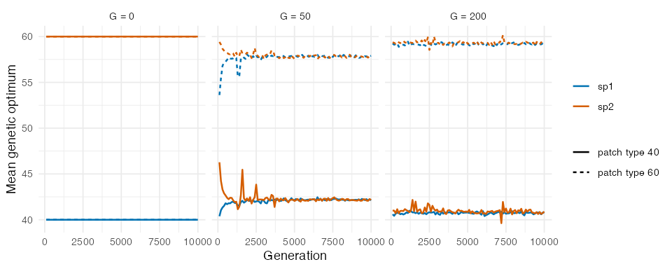
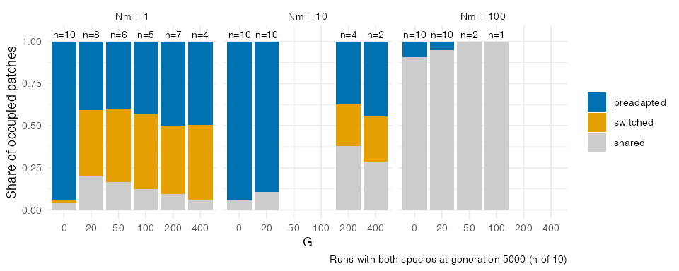
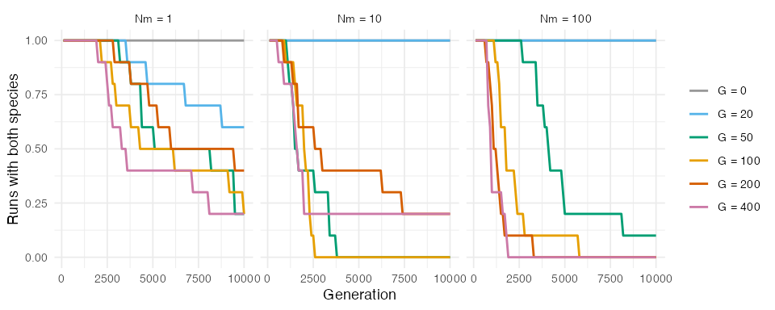
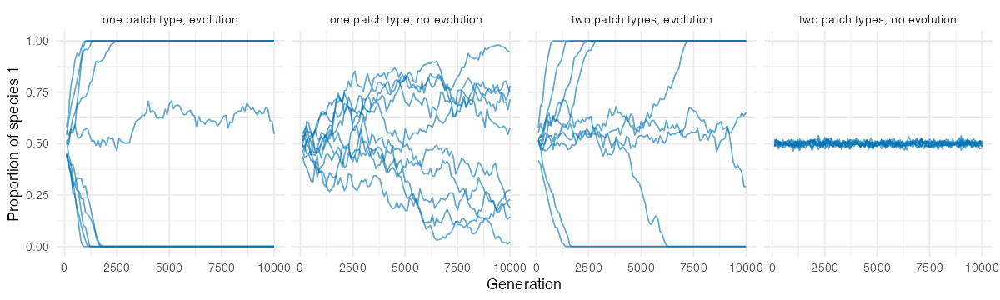

Leibold et al. (2019) proposed that neutrality at the regional scale can emerge from local,
niche-based adaptation. In their individual-based model, two species compete in a landscape
of two patch types subject to patch extinction. Early colonists of empty patches can adapt to
local conditions fast enough to keep out a species that was pre-adapted to them. Repeated over
the landscape, these evolution-mediated priority effects make both species adapt to both patch
types, so that patch type no longer predicts species composition, while each patch remains
dominated by one species. We asked whether the quantitative-genetic engine of comdynamite
reproduces these results, and where it departs from them. This article is part of the nesting
map of the package, which lists the settings that approximate each published model and the
mechanisms that are missing.

## Translation of the model

The script `data-raw/replication_leibold2019.R` follows the parameters of the main results in
Table S2 of their SI Appendix, with the environment and the traits multiplied by 100:

* a 10 x 10 grid of patches with two patch types (environment 40 or 60), placed at random,
  half each; a Gaussian niche of width 20 and a non-genetic phenotypic variance of 4;
* two species, each pre-adapted to one patch type, and every patch filled at the start with
  its pre-adapted species;
* Beverton-Holt growth with \(r_{max} = 5\) and equal competition within and between species
  (\(\alpha = 0.01\)), so that a patch holds about 400 individuals, as their carrying capacity;
* one step per generation, with about \(N_m = 1\), 10 or 100 dispersing offspring per patch and
  generation (`dispersal = Nm / 400`) and the exponential kernel of their model with
  \(\rho = 2\);
* patch extinction with probability 0.01 per generation, through the argument `disturbance`
  of `simulate_metacommunity()`, added for this replication;
* evolution of the optimum by Lande's equation with a constant additive genetic variance
  \(G\), drift with \(N_e / N = 0.5\) and founder sampling; \(G = 0\) is the run without
  evolution;
* 10 replicates of 10,000 generations for each combination of \(G\) and \(N_m\), and a control
  with a single patch type (50) and two identical species (their Fig. S2).

Their model has 10 diploid loci with mutation and no genetic variance at the start, sexual
reproduction, overlapping generations and microsite variation within patches. None of these is
translated. With a constant \(G\), the speed of adaptation is a parameter rather than an
outcome: a population moves a fraction \(G / (\sigma^2 + G + V_E)\) of its distance to the
optimum each generation, which is 5%, 11%, 20%, 33% and 50% for \(G\) = 20, 50, 100, 200 and
400. We therefore treat \(G\) as an axis of the comparison. We did not try to match the speed
of adaptation of their model, which depends on mutation and on the build-up of variance.

We recorded, every 100 generations, the proportion of each species in the metacommunity, the
mean genetic optimum of each species in each patch type, and the difference in mean growth
rate between the species within each patch type, the counterpart of their fitness difference.
As in their variation partitioning, we regressed Hellinger-transformed composition and the
community mean optimum on patch type and on PCNM spatial variables (`vegan::varpart()`), with
the edge patches left out. We report the adjusted \(R^2\) of patch type alone, since the pure
fraction exceeds 1 when the adjusted \(R^2\) of space is negative. At generation 5000, patches
were classified as dominated (90% or more of the individuals) by their pre-adapted species, by
the other species ("switched"), or shared. The script `data-raw/figures_leibold2019.R` makes the
figures and the numbers of this article.

## Regional neutrality

Without evolution, the run stayed in species sorting. Each species had a growth rate about 2
units higher in its own patch type, patch type explained 96% of the variation in composition
over generations 4000 to 5000 (\(N_m = 10\)), and 94% of the patches kept their pre-adapted
species. With \(G = 20\), adaptation was partial: the fitness difference fell to 1.36, and
composition still followed patch type (\(R^2 = 0.94\)).

With faster adaptation, the results of Leibold et al. (2019) appeared. With \(G \geq 100\) and
\(N_m = 10\), the fitness difference within patch types fell to about 0.01 in the first 200
generations, both species evolved optima close to each patch type, and patch type explained
11% or less of the variation in composition (3.5% with \(G = 400\)). The community mean optimum
still followed patch type (\(R^2\) between 0.92 and 0.95), so that traits, unlike species,
remained sorted by environment, as in their Fig. 6C. In runs that kept both species, these
values held until generation 10,000 (for example, \(R^2\) of composition 0.025 and of the mean
optimum 0.94 over generations 4000 to 5000 with \(G = 200\)).

## Local dominance

Evolution-mediated priority effects depended on dispersal, as in their Fig. 5. Among runs with
both species at generation 5000, the share of switched patches with evolution was 40 to 45%
with \(N_m = 1\), and only 6 to 20% of the patches were shared, so most patches were dominated
by one species, half of them by the species that was not pre-adapted. Interestingly, at this
low dispersal even \(G = 20\), which left the species distinct at \(N_m = 10\), gave 40% of
switched patches. With \(N_m = 10\), shared patches made up 29 to 38% with \(G\) of 200 and
400 (only 4 and 2 runs still had both species), and with \(N_m = 100\) nearly all patches were shared, with and without evolution, so mass
effects replaced local dominance. Local dominance was thus weaker than in their model, in which
local co-occurrence was rare at \(N_m = 10\). A probable cause is that comdynamite follows
populations rather than individuals: immigrants are merged into the mean of the resident
population, so maladapted immigrants are not selected out one by one, as they are in an
individual-based model. We did not test this explanation.

## Regional drift

The main departure from their results is the persistence of the two species. Without
evolution, or with \(G = 20\) at \(N_m\) of 10 and 100, both species persisted in all runs for
10,000 generations. Once regional neutrality emerged, one species was lost by drift in most
runs: with \(N_m = 10\), in all runs by generation 5000 with \(G\) of 50 and 100, and in 8 of
10 by generation 10,000 with \(G\) of 200 and 400, after a median of 1550 to 2150 generations.
Drift was slowest at \(N_m = 1\) and fastest at \(N_m = 100\). Leibold et al. (2019) also found
that regional neutrality increases drift in the proportions of the species, which grew with
lower dispersal, higher extinction and smaller metacommunities (their Figs. 3C and S1), but in
our runs drift seems to be faster, and it increased with dispersal rather than decreasing. We
did not extract the proportions of their Fig. S1, so we cannot say by how much drift differs.

The control with a single patch type points to a second difference. With two identical species
and no evolution, both persisted in all 10 runs; with \(G = 200\), one was lost in 9 runs, after
a median of 1300 generations. Our interpretation is that drift and founder sampling move the
optima of populations away from the environment, which creates fitness differences between
the two species that selection then amplifies, so that evolution accelerates the loss of a
species even where the species are equivalent. In their Fig. S2, a single patch type gave drift
through local neutrality both with and without evolution, and drift was stronger under local
than under regional neutrality; without evolution, our identical species drifted too slowly to
lose one in 10,000 generations.

## Summary

The quantitative-genetic engine reproduces the qualitative result of Leibold et al. (2019):
when local adaptation is fast relative to competitive displacement, both species adapt to both
patch types, fitness differences vanish within patch types, and patch type stops predicting
composition while it still predicts traits. It departs from their model in two ways: local
dominance is weaker at intermediate and high dispersal, and regional drift removes one species
faster, more so with higher dispersal and with evolution. Both departures probably come from
following populations with a constant \(G\) rather than individuals with loci, but this remains
to be tested, for example with immigrants that keep their own phenotype until selection acts on
them. These are 10 replicates per setting, and the speed of adaptation was set through \(G\)
rather than matched to their model.

## References

Leibold, M. A., Urban, M. C., De Meester, L., Klausmeier, C. A., & Vanoverbeke, J. (2019).
Regional neutrality evolves through local adaptive niche evolution. *Proceedings of the
National Academy of Sciences*, 116, 2612--2617. https://doi.org/10.1073/pnas.1808615116
