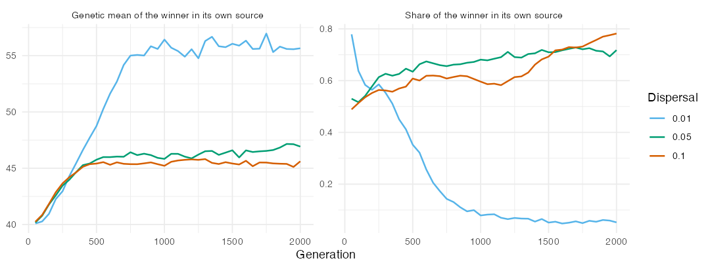

Urban & De Meester (2009) proposed that local adaptation can strengthen priority effects. In
their individual-based model, two initially equivalent species start in two source patches
and colonise a third, vacant patch whose environment differs from that of the sources. The
first species to arrive adapts to the new patch and then keeps the later species out, a
process they called community monopolization. When dispersal is high, gene flow from the
sources prevents adaptation, and the outcome turns on dispersal instead. We asked whether the
quantitative-genetic engine of comdynamite reproduces these results, and where it departs
from them. Like the [replication of Leibold et al. (2019)](replication-leibold.html), this
article is part of the nesting map of the package.

## Translation of the model

The script `data-raw/replication_urban2009.R` follows the parameters of Table S1 of their
electronic supplementary material, with the environment and the traits multiplied by 100:

* three sites with environment 40, 40 and 60, connected to each other, with emigrants split
  equally between the other two sites; species 1 fills site 1 and species 2 fills site 2 at
  the start, both with optimum 40;
* a Gaussian niche with \(\sigma = 35.4\), since their survival is
  \(\exp(-((z - e)/\omega)^2)\) with \(\omega = 0.5\), and a non-genetic variance of 12.5 for
  the phenotypic and microsite deviations (standard deviation 2.5 each);
* Beverton-Holt growth with \(r_{max} = 5\) and equal competition within and between species,
  so that a site holds about 1000 individuals, as their 1000 microsites;
* one step per generation, taken as 10 of their time steps (the lifespan \(1/b\) without
  selection, with baseline mortality \(b = 0.1\)), so 500 generations instead of 5000 steps,
  delays between the two species of -20 to 20 generations instead of -200 to 200 steps, and
  dispersal 0.05 per generation;
* the new site is opened to each species at its introduction time through the argument
  `pool_from` of `simulate_metacommunity()`, added for this replication, and is then colonised
  by dispersal from the sources; the first species can enter after 20 generations;
* a genetic variance per population with mutation and drift (`mutation_var` in
  `evolution_control()`, Lynch & Hill 1986): mutation adds \(V_m = L \mu a^2 = 0.05\) per
  generation for \(L = 20\) loci, \(\mu = 10^{-4}\) and an allelic effect \(a = 5\), and drift
  removes \(1/N\) of the variance per generation, as in a haploid population of \(N\), so that
  the equilibrium in a full site is 50;
* evolution by mutation starts without variance, and evolution from standing variation starts
  with \(L p (1 - p) a^2 = 120\) for an allele frequency \(p = 0.4\); a species that does not
  evolve has no genetic variance;
* 100 replicates of each setting, as in their figures.

Their model has 20 haploid loci with alleles of 0 or 1, lottery recruitment into microsites
vacated by mortality, overlapping generations with selection on survival, and microsite
variation within patches. None of these is translated. Two departures matter for what
follows. First, selection does not erode the genetic variance of `mutation_var`, so standing
variation persists and lowers mean fitness (a variance load), whereas selection on 20 loci in
their model erodes it. We therefore added two scenarios with a constant variance
\(G = 120\), as in the rest of the package. Second, growth comes before emigration, so
emigrants are a demographic cost to their site of origin. In a lottery model the offspring
outnumber the vacant microsites, and emigration costs the source little.

## Colonisation delay

Without evolution, the first species to enter the new site usually dominated it, but not
always (Fig. 1), as in their Fig. 2a. The first species to arrive ended with more individuals
in 68% of the runs with a lead of one generation and in 84% with a lead of 10 generations.
When species 1 alone evolved by mutation, it dominated the new site at every delay, with 88%
of the final abundance when it arrived 10 generations after species 2 and 95% when it
arrived 10 generations before. This matches their result that the evolving species wins even
when it arrives last.

When both species evolved by mutation, the first arrival held 74% of the new site with a
lead of 10 generations, against 70% without evolution, and one species held more than 90% of
the site in 39% of the runs, against 13% without evolution. Evolution therefore strengthened
monopolization, but less than in their model, where a lead of 5 to 10 of their time steps
(half a generation to one generation here) was enough for the first arrival to dominate.
Here, a lead of one generation gave the first arrival 57% of the runs, and a lead of five
generations, 80%.

Standing variation did not reproduce their results. When species 1 alone evolved from
standing variation, it held about 70% of the new site at every delay, whereas in their model
it dominated less when it arrived after its competitor. When both evolved from standing
variation, the priority effect was reversed: the second species to arrive held 61% of the
site with a lag of 10 generations, while in their model monopolization was stronger than
with mutation alone. This seems to come from the variance load of `mutation_var`, since the
reversal disappears when the variance is held constant, but we have not separated how the
load acts on the first and on the second species to arrive. With a
constant \(G = 120\) for both species, the first arrival held 84% of the site with a lead of
10 generations and won 96% of the runs, and one species held more than 90% of the site in
51% of the runs. This is closer to their result for standing variation. With a constant \(G\)
for species 1 alone, species 1 held 61% of the site at every delay.

## Dispersal

With both species evolving by mutation and entering together, the species with the lower
dispersal dominated the new site over most of the dispersal grid (Fig. 2). The relative
dominance \((N_1 - N_2)/1000\) ran from about \(-0.1\) to \(0.1\) near the diagonal to
\(-0.97\) when species 1 dispersed at 0.5 and species 2 at 0.005. Their Fig. 4 has two regions:
a monopolization region, where the better disperser arrives first and wins, and a region of
gene-flow-induced maladaptation at high dispersal, where the poorer disperser wins. We found
only the second pattern, and over the whole grid.

The source sites show why. The species with the higher dispersal also lost its own source
site: species 1 kept 20 individuals of 1000 in its source when it dispersed at 0.315 and
species 2 at 0.00792, against 947 in the reverse case. Without evolution, a run with
dispersal 0.2 for species 1 and 0.02 for species 2 left species 1 with 392 individuals in its
source and species 2 with 602 there (20 runs). The cost of emigration under growth before
dispersal is therefore a competitive disadvantage in its own right, which is absent from
their lottery model and seems to hide the monopolization region. Lottery recruitment is on the
list of mechanisms to add to the engine (`dev/ROADMAP.md`).

## Gene flow back into the sources

Their Fig. 3 shows that at high dispersal (\(m = 0.10\)) species 2 replaced species 1 in the
source of species 1. We ran 40 replicates of 2000 generations with both species evolving by
mutation and dispersal 0.01, 0.05 or 0.10, and asked whether the species that won the new
site kept its own source (Fig. 3). With dispersal 0.01, the winner of the new site held 5%
of its own source after 2000 generations, and the mean genetic optimum of its source
population had moved from 40 to about 56, close to the environment of the new site. Gene flow
from the large, adapted population of the new site seems to have maladapted the shrinking
source population, which was then taken over by the other species. With dispersal 0.05 and
0.10, the winner kept 72% and 78% of its source, and the loser of the new site kept only 29%
and 22% of its own. The replacement of a source by gene flow therefore happened here, but at
low rather than high dispersal, and we have not identified why the winner's source shrinks
at the start when dispersal is low.

## Summary

The quantitative-genetic engine reproduces two results of Urban & De Meester (2009): a
species that evolves by mutation wins a new site against one that does not, whatever the
order of arrival, and evolution in both species makes the first arrival more likely to
monopolize the new site. Monopolization is weaker than in their model with mutation, and is
reproduced for standing variation only with a constant \(G\), since the size-dependent
variance of `mutation_var` carries a variance load that reverses the priority effect. Over
the dispersal grid, the poorer disperser won almost everywhere, because emigration is a
demographic cost in an engine where growth precedes dispersal. Gene flow from the new site
replaced a source population, as in their Fig. 3, but at low dispersal. Lottery recruitment
into vacated microsites, overlapping generations and a genetic variance built from new
mutations and eroded by selection are the missing mechanisms that seem most likely to close
these gaps. One step was taken as 10 of their time steps, and the speed of adaptation was
set by \(V_m\) and the variance rather than matched to their loci.

## References

Lynch, M., & Hill, W. G. (1986). Phenotypic evolution by neutral mutation. *Evolution*, 40,
915--935. https://doi.org/10.1111/j.1558-5646.1986.tb00561.x

Urban, M. C., & De Meester, L. (2009). Community monopolization: local adaptation enhances
priority effects in an evolving metacommunity. *Proceedings of the Royal Society B*, 276,
4129--4138. https://doi.org/10.1098/rspb.2009.1382
