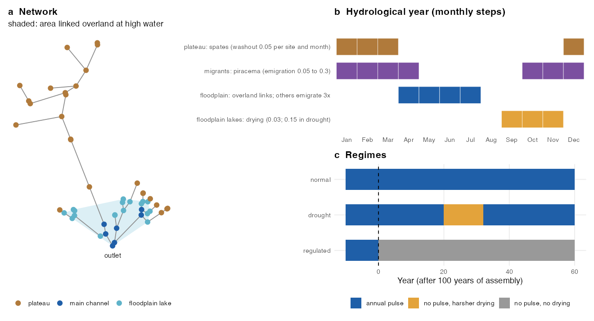

```{r, include = FALSE}
knitr::opts_chunk$set(collapse = TRUE, comment = "#>", fig.width = 7, fig.height = 4.5)
```

```{r setup, message = FALSE}
library(comdynamite)
library(ggplot2)
res <- readRDS("river-persistence.rds")
```

```{r helpers, include = FALSE}
# paired difference between two cells of the same replicates: mean and standard error
paired <- function(d, var, a, b, by) {
  x <- d[a(d), ]
  y <- d[b(d), ]
  key <- function(z) do.call(paste, z[by])
  y <- y[match(key(x), key(y)), ]
  diff <- x[[var]] - y[[var]]
  c(mean = mean(diff, na.rm = TRUE), se = stats::sd(diff, na.rm = TRUE) / sqrt(sum(!is.na(diff))))
}
fmt <- function(v, digits = 2) sprintf(paste0("%.", digits, "f ± %.", digits, "f"), v[1], v[2])
gen <- res$generic
pan <- res$pantanal
g_by <- c("rep", "branching", "floods")
landscape_diff <- function(var, a, b) {
  paired(gen, var, function(d) d$landscape == a, function(d) d$landscape == b, g_by)
}
flood_diff <- function(var, f) {
  paired(gen, var, function(d) d$floods == f, function(d) d$floods == "none",
         c("rep", "branching", "landscape"))
}
regime_diff <- function(var, g, dir) {
  paired(pan, var, function(d) d$regime == g & d$direction == dir,
         function(d) d$regime == "normal" & d$direction == dir, "rep")
}
```

Rivers are dendritic: sites are linked by a single path along the channel, flow carries
organisms downstream more easily than upstream, and headwaters sit at the tips of the network,
where they receive immigrants from one direction only. Experiments with protists in dendritic
and lattice landscapes of the same size showed that this topology alone changes local and
regional diversity (Carrara et al. 2012), and the network view of riverine metacommunities
generalises this to real rivers (Altermatt 2013). Rivers also pulse. In large floodplain rivers,
an annual, predictable flood links the channel with lakes and the flooded zone, whereas
low-order streams receive short, unpredictable spates that follow local rains (Junk et al.
1989; Junk 2005).

This article uses the river tools of the package, `river_network()`, `landscape_river()`,
`env_river()`, `env_seasonal()` and `river_floods()`, to ask two questions about long-term
persistence. First, in a generic study, how do network topology, the direction of dispersal and
seasonal floods change regional richness and the persistence of species? Second, in scenarios
inspired by the Pantanal, the floodplain of the upper Paraguay River, what happens to a
fish-like metacommunity when the flood pulse fails for 12 years, as in a multiyear drought, or
is removed for good, as downstream of a dam? Both studies were run beforehand
(`data-raw/river_persistence.R` and `data-raw/river_pantanal.R`), and this article reads their
results.

## The generic study

Each replicate grows a network of 50 sites with `river_network()`, little branched
(`branching = 0.2`) or much branched (0.6). The environment is a tail-up field along the
channel (`env_river()`), with a gradient from the outlet to the headwaters, slow change among
years and a seasonal cycle of larger amplitude in headwaters (`env_seasonal()`). Twenty species
with optima along the gradient compete for 150 years of 20 steps each. We crossed three ways
of dispersing (along the channel with the same scale downstream and upstream; along the
channel with an upstream scale a quarter of the downstream one; or with the same kernel on
straight-line distances among the same sites, the lattice-like control of Carrara et al. 2012)
with three flood regimes (none; washout harsher in large rivers; or harsher in headwaters, in
half of the years on average). Within a replicate, the network, the environment and the flood
years are shared by all cells, so that the contrasts below are paired.

```{r generic-code, eval = FALSE}
net <- river_network(50, branching = 0.2)
river <- landscape_river(net, scale_down = 2)                    # symmetric
downstream <- landscape_river(net, scale_down = 2, scale_up = 0.5) # downstream bias
rel <- net$distance / max(net$distance)
base <- env_river(river, n_steps = 2000, tail_up = c(25, 5), nugget = 2,
                  temporal_scale = 100, mean = 30 + 60 * rel)
env <- env_seasonal(base, period = 20, year_sd = 2,
                    amplitude = 2 + 6 * (1 - net$upstream_length / max(net$upstream_length)))
floods <- river_floods(river, n_steps = 2000, period = 20, size_effect = 1)
```

```{r generic-plot, fig.alt = "Mean regional richness at the end and mean local richness of headwaters and other sites for the three ways of dispersing, with standard errors over replicates."}
long <- rbind(
  data.frame(gen[c("landscape", "branching")], response = "regional richness",
             value = gen$regional_end),
  data.frame(gen[c("landscape", "branching")], response = "local richness, headwaters",
             value = gen$alpha_head),
  data.frame(gen[c("landscape", "branching")], response = "local richness, other sites",
             value = gen$alpha_other))
summ <- aggregate(value ~ landscape + branching + response, long,
                  function(v) c(m = mean(v), se = sd(v) / sqrt(length(v))))
summ <- data.frame(summ[1:3], summ$value)
summ$landscape <- factor(summ$landscape, c("euclidean", "river_symmetric", "river_downstream"),
                         c("straight line", "channel, symmetric", "channel, downstream"))
ggplot(summ, aes(landscape, m, colour = factor(branching))) +
  geom_pointrange(aes(ymin = m - 2 * se, ymax = m + 2 * se),
                  position = position_dodge(width = 0.4)) +
  facet_wrap(~response, scales = "free_y") +
  labs(x = NULL, y = "Species", colour = "branching") +
  theme_minimal() +
  theme(axis.text.x = element_text(angle = 20, hjust = 1))
```

Dispersal along the channel lowered regional richness relative to the same kernel on
straight-line distances, by `r fmt(landscape_diff("regional_end", "river_symmetric", "euclidean"))`
species (mean ± standard error of the paired differences), and the loss was larger in
headwaters (`r fmt(landscape_diff("alpha_head", "river_symmetric", "euclidean"))` species per
site) than at the other sites
(`r fmt(landscape_diff("alpha_other", "river_symmetric", "euclidean"))`). A downstream bias
made it much worse: relative to symmetric dispersal along the channel, regional richness fell
by `r fmt(landscape_diff("regional_end", "river_downstream", "river_symmetric"))` species and
local richness in headwaters by
`r fmt(landscape_diff("alpha_head", "river_downstream", "river_symmetric"))`, while the
dissimilarity among headwaters rose. Headwaters seem to lose because, at the tips of the
network, they receive few immigrants, and with a downstream bias almost none, so that a local
extinction is rarely reversed. The bias also lowered the occupancy expected from colonisation
and extirpation rates (`persistence()`;
`r fmt(landscape_diff("occupancy", "river_downstream", "river_symmetric"))`) and slowed
turnover (tau, the log of the sum of both rates;
`r fmt(landscape_diff("tau", "river_downstream", "river_symmetric"))`).

Floods mattered much less at the intensity simulated here. Washout harsher in large rivers
lowered regional richness by `r fmt(flood_diff("regional_end", "mainstem"))` species, and washout
harsher in headwaters had no detectable effect
(`r fmt(flood_diff("regional_end", "headwaters"))`). Branching changes the network itself, so
it cannot be paired in the same way; more branched networks, with more than twice as many
headwaters, had richer sites but about the same regional richness. In every cell regional
richness only declined after assembly, so that the minimum over the run was its value at the
end: the metacommunity is closed, and a species lost from the whole network never returns.

## Scenarios inspired by the Pantanal

### Hydrology

The Pantanal is a floodplain of about 138,000 km² between 80 and 150 m above sea level,
surrounded by plateaus from 200 to 1,200 m (Alho & Silva 2012). Its rivers have a monomodal annual pulse with an amplitude of 2 to 5 m and a
duration of 3 to 6 months (Harris et al. 2005). Rains from November to March flood up to
70% of the floodplain by July, and rivers withdraw from April to September; at Ladário, the
mean level of the Paraguay River is lowest in November and highest in June, and from 1962 to
1973 it stayed at or below 100 cm in every year (Marengo et al. 2021). In the floodplain of the Miranda
River, a dead arm is cut off in the dry season until the next flood, and a shallow pond may
dry out or keep water depending on the flood of each year (Resende 2000). Junk (2005)
contrasts this monomodal, predictable pulse of large tropical rivers with the polymodal,
unpredictable pulse of low-order streams, and notes that the multiyear dry period of the 1960s
left its mark on the vegetation of the Pantanal. Junk et al. (1989) describe the main channel
as a migration route and a refuge during low water.

We translated this into monthly steps on a network of 50 sites (`data-raw/river_pantanal_setup.R`).
The half of the sites nearest the outlet form the floodplain; within it, the sites of largest
Shreve magnitude are the main channel and the others are floodplain lakes. The other half form
the plateau. On the plateau, every site may be washed out in each month from December to March
(probability 0.05, independently among sites and months). In the floodplain, from April to
July, sites are also linked overland (half of the emigrants follow a kernel on straight-line
distances among floodplain sites, through `kernels` and `kernel_step`), and from September to
November floodplain lakes may dry out and lose all their populations (probability 0.03 per
month, 0.15 during a drought); the main channel never dries. After 100 years of assembly under
this regime, three regimes follow for 60 years: the pulse every year ("normal"), 12 years
without the pulse and with harsher drying (years 21 to 32, "drought"), or no pulse from the
first year, with neither lateral links, nor the lateral moves of high water, nor drying
("regulated").



### Biota

The upper Paraguay basin holds about 340 fish species; among those compiled by Fernando et al.
(2025), 17% occur only on the plateau and 14% only in the floodplain, and richness falls from
about 250 species per altitude class below 400 m to about 100 above it. We used 40 species with
optima evenly spaced along the gradient and calibrated niche breadth and competition so that,
in a snapshot after assembly, about 17% of the species present occurred only on the plateau and
17% only in the floodplain. Of the 101 species caught in the floodplain of the Miranda River,
15% are long-distance migrants, 43% are sedentary species of lakes and 42% are intermediate
(Resende & Palmeira 1999, cited by Junk 2005; we did not see the original). We split the 40
species into these guilds, each spread along the gradient, and gave each guild a monthly
emigration: migrants emigrate with probability 0.05, rising to 0.3 during the upstream
spawning migration from October to April (the piracema; Alho 2008); intermediate and sedentary
species emigrate with probabilities 0.03 and 0.01, tripled at high water, when fish move
laterally into the flooded zone. Only the order and timing of these rates come from the
literature. Tagged pacu, a migratory species, travelled up to 422 km in the Paraná River, and
91% moved away from where they were released (Makrakis et al. 2007), but we found no tagging
study from the Pantanal itself.

The animation follows one replicate across the drought. In May, the floodplain of the normal
regime is linked overland, whereas in the other two it is not; red crosses mark sites that lose
all their populations to a spate or to drying.


```{r pantanal-trajectory, fig.alt = "Difference in regional richness between the drought or regulated regime and the normal pulse, year by year, with two standard errors, for symmetric and downstream-biased dispersal. The drought years are shaded."}
traj <- do.call(rbind, lapply(c("symmetric", "downstream"), function(dir) {
  normal <- do.call(rbind, pan$regional_series[pan$regime == "normal" & pan$direction == dir])
  do.call(rbind, lapply(c("drought", "regulated"), function(g) {
    other <- do.call(rbind, pan$regional_series[pan$regime == g & pan$direction == dir])
    d <- other - normal
    data.frame(direction = dir, regime = g, year = seq_len(ncol(d)), mean = colMeans(d),
               se = apply(d, 2, sd) / sqrt(nrow(d)))
  }))
}))
ggplot(traj, aes(year, mean, colour = regime, fill = regime)) +
  annotate("rect", xmin = 20.5, xmax = 32.5, ymin = -Inf, ymax = Inf, alpha = 0.15) +
  geom_hline(yintercept = 0, colour = "grey60") +
  geom_ribbon(aes(ymin = mean - 2 * se, ymax = mean + 2 * se), alpha = 0.2, colour = NA) +
  geom_line() +
  facet_wrap(~direction) +
  labs(x = "Year after assembly", y = "Regional richness minus normal pulse") +
  theme_minimal()
```

### What the pulse does

```{r pantanal-values, include = FALSE}
rd <- function(var, g, dir = "symmetric", digits = 2) fmt(regime_diff(var, g, dir), digits)
nm <- function(var, dir = "symmetric") {
  round(mean(pan[[var]][pan$regime == "normal" & pan$direction == dir]), 2)
}
guild_diff <- function(g, year, dir) {
  a <- simplify2array(pan$guild_series[pan$regime == g & pan$direction == dir])
  b <- simplify2array(pan$guild_series[pan$regime == "normal" & pan$direction == dir])
  d <- a[year, , ] - b[year, , ]
  data.frame(guild = rownames(d), mean = rowMeans(d), se = apply(d, 1, sd) / sqrt(ncol(d)))
}
```

Under the normal pulse, floodplain sites held more species at high water than at low water
(`r nm("alpha_plain_high_pre")` against `r nm("alpha_plain_low_pre")` species per site with
symmetric dispersal, in years 11 to 20) and were more alike (mean Jaccard dissimilarity
`r nm("beta_plain_high_pre")` against `r nm("beta_plain_low_pre")`). Removing the pulse removed
this alternation: at high water, floodplain sites of the regulated regime held
`r rd("alpha_plain_high_pre", "regulated")` species fewer, and their dissimilarity was
`r rd("beta_plain_high_pre", "regulated", digits = 3)` higher. Thus, in the model, the lateral
links of high water homogenise the floodplain, and the dry season differentiates it again.
Regulation also lowered occupancy (`r rd("occupancy", "regulated", digits = 3)`) and slowed
turnover (`r rd("tau", "regulated")`), and the regulated metacommunity ended the 60 years with
`r rd("regional_end", "regulated")` species fewer than the normal one.

The drought lowered regional richness by `r rd("regional_drought_min", "drought")` species at
its worst with symmetric dispersal, and by
`r rd("regional_drought_min", "drought", "downstream")` with a downstream bias. Interestingly,
the pulse came back but the species did not: 28 years after the drought, the deficit was still
`r rd("regional_end", "drought")` species (mean of years 51 to 60). This follows from the
closed metacommunity, in which a species extinct in the whole network cannot be rescued from
outside, so the size of the deficit is an upper bound for a basin open to immigration.

```{r pantanal-guilds, fig.alt = "Loss of species of each guild at the end of the drought and at year 60, relative to the normal pulse, with two standard errors."}
guilds <- do.call(rbind, lapply(c("symmetric", "downstream"), function(dir) {
  rbind(cbind(guild_diff("drought", 32, dir), when = "drought, year 32", direction = dir),
        cbind(guild_diff("drought", 60, dir), when = "drought, year 60", direction = dir),
        cbind(guild_diff("regulated", 60, dir), when = "regulated, year 60", direction = dir))
}))
guilds$guild <- factor(guilds$guild, c("migrant", "intermediate", "sedentary"))
ggplot(guilds, aes(guild, mean, colour = direction)) +
  geom_hline(yintercept = 0, colour = "grey60") +
  geom_pointrange(aes(ymin = mean - 2 * se, ymax = mean + 2 * se),
                  position = position_dodge(width = 0.4)) +
  facet_wrap(~when) +
  labs(x = NULL, y = "Species minus normal pulse") +
  theme_minimal()
```

Surprisingly, the species lost to the drought were sedentary or intermediate; no migrant was
lost. In the model, migrants emigrate a lot every piracema and recolonise the lakes that dried,
whereas sedentary species, once extinct in a part of the floodplain, come back slowly. This is
the opposite of what was seen in three lagoons of the middle São Francisco River that were not
flooded for three years: only 7 of the 34 species of one lagoon survived, most of them able to
breathe air, and migratory species were far more likely to disappear (Pompeu & Godinho 2006).
Lagoons cut off in a dry year of the upper Paraná floodplain even held more species than
connected ones (Petry et al. 2003). The difference seems to lie in what the simulator lacks: a
dried lake loses all its populations at once, whatever their tolerance, and every species
travels the same distances. Species that resist drought or hypoxia, and migrants that need
long, connected routes to complete their life cycle, would reverse the ranking. These two
extensions, dispersal kernels and sensitivity to disturbance per species or guild, are in the
roadmap.

## Limitations

The scenarios are inspired by the Pantanal, not fitted to it. The network is random, not the
drainage of the upper Paraguay; the rates of spates, drying and emigration are assumptions
whose order and timing, but not values, come from the literature; and the guild shares come
from one river, through a secondary citation. Beyond the two missing extensions above, the
dispersal pulse of `dispersal_time` applies to every site in the same step, so that at high
water plateau species also emigrate more, and part of the loss of plateau richness under
regulation may come from this rather than from the floodplain. The metacommunity is closed, so
losses are permanent. Finally, the environment changes along the gradient from the outlet to
the headwaters but not with the flood itself; flooding acts only through connectivity and
disturbance.

## References

Alho, C. J. R. (2008). Biodiversity of the Pantanal: response to seasonal flooding regime and
to environmental degradation. *Brazilian Journal of Biology*, 68(4 suppl), 957–966.
<https://doi.org/10.1590/S1519-69842008000500005>

Alho, C. J. R., & Silva, J. S. V. (2012). Effects of severe floods and droughts on wildlife of
the Pantanal wetland (Brazil): a review. *Animals*, 2, 591–610.
<https://doi.org/10.3390/ani2040591>

Altermatt, F. (2013). Diversity in riverine metacommunities: a network perspective. *Aquatic
Ecology*, 47, 365–377. <https://doi.org/10.1007/s10452-013-9450-3>

Carrara, F., Altermatt, F., Rodriguez-Iturbe, I., & Rinaldo, A. (2012). Dendritic connectivity
controls biodiversity patterns in experimental metacommunities. *Proceedings of the National
Academy of Sciences*, 109, 5761–5766. <https://doi.org/10.1073/pnas.1119651109>

Fernando, A. M. E., Severo-Neto, F., Ferreira, F. S., Mateus, L., Tondato-Carvalho, K. K.,
Kashiwaqui, E. A. L., Gimenes Junior, H., Domingues, W. M., Pavanelli, C. S., Pinho, H. L. L.,
Penha, J., & Súarez, Y. R. (2025). Fish distribution across altitudinal gradients in the Upper
Paraguay River Basin: implications for conservation in the Pantanal region. *Conservation
Science and Practice*, 7, e13290. <https://doi.org/10.1111/csp2.13290>

Harris, M. B., Tomas, W., Mourão, G., Da Silva, C. J., Guimarães, E., Sonoda, F., & Fachim, E.
(2005). Safeguarding the Pantanal wetlands: threats and conservation initiatives.
*Conservation Biology*, 19, 714–720. <https://doi.org/10.1111/j.1523-1739.2005.00708.x>

Junk, W. J. (2005). Flood pulsing and the linkages between terrestrial, aquatic, and wetland
systems. *Verhandlungen der Internationalen Vereinigung für Theoretische und Angewandte
Limnologie*, 29, 11–38.
<https://doi.org/10.1080/03680770.2005.11901972>

Junk, W. J., Bayley, P. B., & Sparks, R. E. (1989). The flood pulse concept in river-floodplain
systems. In D. P. Dodge (Ed.), *Proceedings of the International Large River Symposium*
(pp. 110–127). Canadian Special Publication of Fisheries and Aquatic Sciences 106.

Makrakis, M. C., Miranda, L. E., Makrakis, S., Xavier, A. M. M., Fontes, H. M., & Morlis, W. G.
(2007). Migratory movements of pacu, *Piaractus mesopotamicus*, in the highly impounded Paraná
River. *Journal of Applied Ichthyology*, 23, 700–704.
<https://doi.org/10.1111/j.1439-0426.2007.01006.x>

Marengo, J. A., Cunha, A. P., Cuartas, L. A., Deusdará Leal, K. R., Broedel, E., Seluchi, M. E.,
Michelin, C. M., De Praga Baião, C. F., Chuchón Angulo, E., Almeida, E. K., Kazmierczak, M. L.,
Mateus, N. P. A., Silva, R. C., & Bender, F. (2021). Extreme drought in the Brazilian Pantanal in
2019–2020: characterization, causes, and impacts. *Frontiers in Water*, 3, 639204.
<https://doi.org/10.3389/frwa.2021.639204>

Petry, A. C., Agostinho, A. A., & Gomes, L. C. (2003). Fish assemblages of tropical floodplain
lagoons: exploring the role of connectivity in a dry year. *Neotropical Ichthyology*, 1,
111–119. <https://doi.org/10.1590/S1679-62252003000200005>

Pompeu, P. S., & Godinho, H. P. (2006). Effects of extended absence of flooding on the fish
assemblages of three floodplain lagoons in the middle São Francisco River, Brazil.
*Neotropical Ichthyology*, 4, 427–433. <https://doi.org/10.1590/S1679-62252006000400006>

Resende, E. K. (2000). Trophic structure of fish assemblages in the lower Miranda River,
Pantanal, Mato Grosso do Sul State, Brazil. *Revista Brasileira de Biologia*, 60, 389–403.
<https://doi.org/10.1590/S0034-71082000000300004>

Resende, E. K., & Palmeira, S. S. (1999). Estrutura e dinâmica das comunidades de peixes da
planície inundável do rio Miranda, Pantanal, Mato Grosso do Sul, Brasil. In *Anais do II
Simpósio sobre Recursos Naturais e Socioeconômicos do Pantanal* (pp. 249–282). Embrapa
Pantanal. Not seen; cited by Junk (2005).
