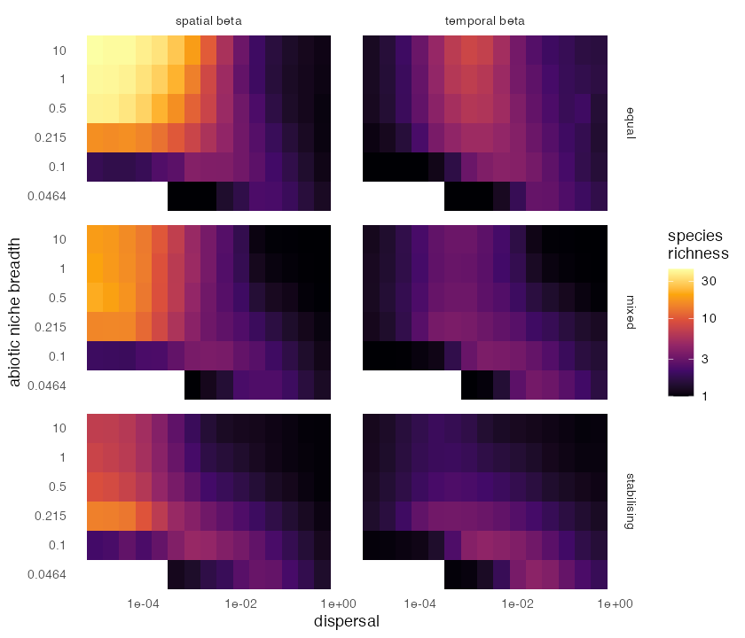

comdynamite was implemented from the published equations of Thompson et al.
(2020), so we checked it in three ways: against analytical results, against
mcomsimr, the R implementation by the same authors, and against the patterns in
the article. The last check showed that the article and the code archived with it
differ in several points. They are listed here because they change results, and
anyone reimplementing the model from the text alone will not reproduce the figures.

All scripts are in
[`data-raw/`](https://github.com/diogoprov/comdynamite/tree/main/data-raw).

## Analytical results

`tests/testthat/test-analytic.R` compares simulations with results derived by hand:
single-species and multispecies equilibria, competitive exclusion, source-sink
dynamics, flow through the dispersal kernel and the survival of isolated populations
under extirpation.

## Comparison with mcomsimr

`validation_mcomsimr.R` gives both implementations the same environment, traits,
competition and dispersal, with 25 sites, 12 species and 200 replicates in each of
32 scenarios, and compares the distributions of five statistics. None of the 160
comparisons was significant (Kolmogorov-Smirnov tests, false discovery rate of 5%).

Without extirpation, mean differences in alpha, gamma and total abundance stayed
below 1%. With extirpation, the largest difference was 8%, in alpha on a grid with
dispersal of 0.001. The cause is the immigration step. comdynamite draws immigrants
from a Poisson distribution, as does the authors' Julia code, so that a few
emigrants may produce no immigrant. mcomsimr conserves dispersers. In that scenario,
alpha was 1.75 with Poisson immigrants, 1.85 with multinomial immigrants and 1.85
in mcomsimr (600 runs each, standard error 0.015).

## Article and archived code

We compared the article with the code archived for it,
[Meta_com_framework v1.0](https://doi.org/10.5281/zenodo.3708350). We cannot tell
whether this is exactly the code that produced every figure, but the values in
Figure 3 agree with the code in the first row of the table: for example, in panel
c, gamma is about 40, alpha about 4 and spatial beta about 10, which is gamma / alpha
and not gamma - alpha.

| Item | Article | Archived code |
|---|---|---|
| Spatial and temporal beta | gamma - alpha, Table 1 | gamma / alpha |
| Empty patches and time points | Not mentioned | Left out of alpha and gamma |
| Environment | Between 0 and 1, mean and variance of 0.5 | Field rescaled, then converted to ranks over all patches and steps, so it is uniform on [0, 1] |
| Lowest dispersal | 0.0001 in the text, 0.00001 on the axes of Figures 3 and 4 | 0.00001 |
| Seeding | Every 10 steps up to step 100 | Every 20 steps up to step 100 |
| Emigrants | Binomial | Poisson |
| Sampling | Every 20 steps after step 1000 | Every 22 steps, from about step 1040 |
| Replicate landscapes | 30 | The scripts loop over 15 |
| Competition-colonisation: immigrants | Not mentioned | Halved in this scenario only |
| Competition-colonisation: dominants | Dominant effects from U(1, 1.5) | The same, but only on species later in the order, so dominants form a hierarchy |

The conversion to ranks matters most. Our first version rescaled a Gaussian field to
[0, 1] without it. The standard deviation among sites was then 0.11, against 0.29
with ranks, which made niches effectively broader. Without ranks, the peak of spatial beta at intermediate niche
breadths under stabilising competition does not appear.

As of November 2026 we found no report of these differences in the issue trackers of
either repository, no correction registered for the article in Crossref, and nothing
in a web search. This does not show that nobody has noticed them.

## Patterns in the article

`validation_thompson.R` follows the archived code, with 100 patches, 50 species, 15
dispersal rates, 30 landscapes, three types of competition and 6 of the 13 niche
breadths. Two differences remain. RandomFields is no longer on CRAN, so the field
before conversion to ranks is an AR(1) process with spatial covariance, not a single
covariance over space and time, and emigrants are binomial, as in the article.

Values at dispersal of 0.00001 are close to Figure 3, read from the plot because the
article has no table of values:

| Competition | Niche breadth | alpha | gamma | Spatial beta |
|---|---|---|---|---|
| Equal | 0.5 | 1.0 | 39 | 38.8 |
| Equal | 10 | 1.0 | 44 | 43.1 |
| Mixed | 0.5 | 1.9 | 40 | 21.5 |
| Mixed | 10 | 2.3 | 43 | 18.6 |
| Stabilising | 0.5 | 4.6 | 42 | 9.1 |
| Stabilising | 10 | 6.6 | 46 | 7.0 |

Their hypotheses H1, H2, H3, H5 and H6 appear. H4 states that spatial and temporal
beta are promoted by narrow niches or strong competition. The part on competition
holds: at the lowest dispersal and a niche breadth of 0.5, spatial beta is 38.8 with
equal competition, 21.5 with mixed competition and 9.1 with stabilising competition.

The part on niches depends on the scenario. Under stabilising competition, spatial
beta peaks at a niche breadth of 0.215 (14.4, against 7.0 at 10). Under mixed
competition the peak is weak. Under equal competition and low dispersal, beta
increases with niche breadth (16.5, 38.8 and 43.1 at 0.215, 0.5 and 10), because drift
fixes a different species in each patch. Narrow niches raise beta under equal
competition only from a dispersal of about 0.02. Figure 4 of the article shows the
same pattern, so the difference lies between that figure and the wording of H4.

The competition-colonisation scenario, in `validation_thompson_cc.R`, uses
`extirpation = 0.002` and reproduces the code in the two last rows of the table. At
a niche breadth of 0.5, gamma rises from 3.6 to about 6 near a dispersal of 0.0005 and
then falls. At 10, the metacommunity collapses to one species from a dispersal of
about 0.02. Both agree with Figure 3g and h by eye.

## References

Thompson, P. L., Guzman, L. M., De Meester, L., Horváth, Z., Ptacnik, R.,
Vanschoenwinkel, B., Viana, D. S., & Chase, J. M. (2020). A process-based
metacommunity framework linking local and regional scale community ecology.
*Ecology Letters*, 23, 1314–1329. https://doi.org/10.1111/ele.13568
